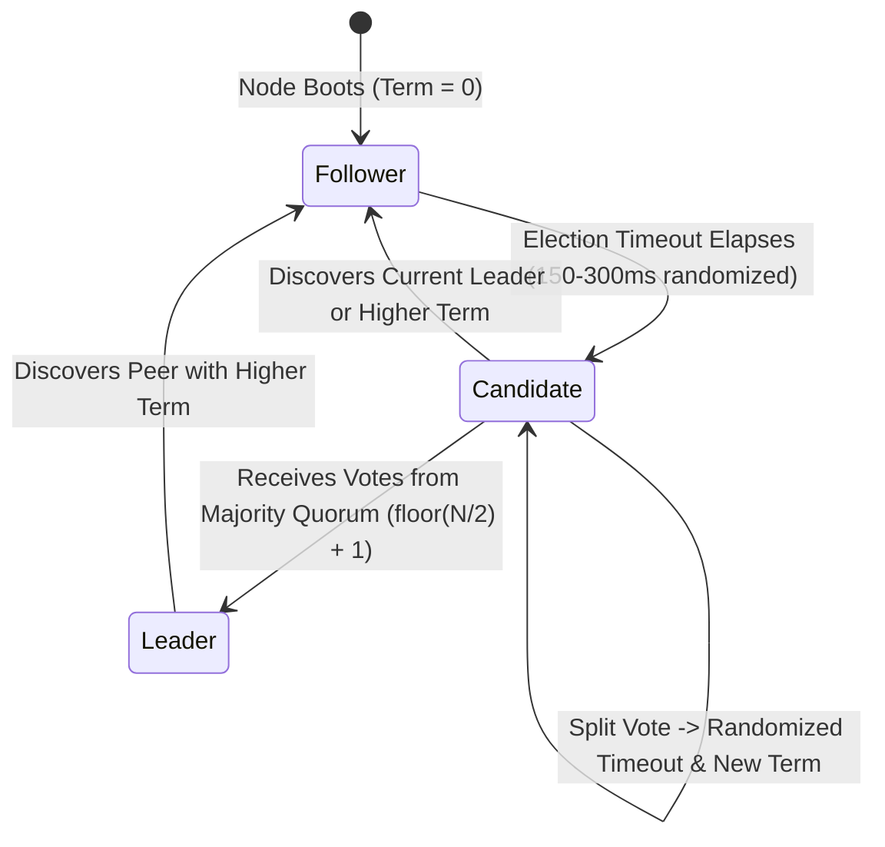
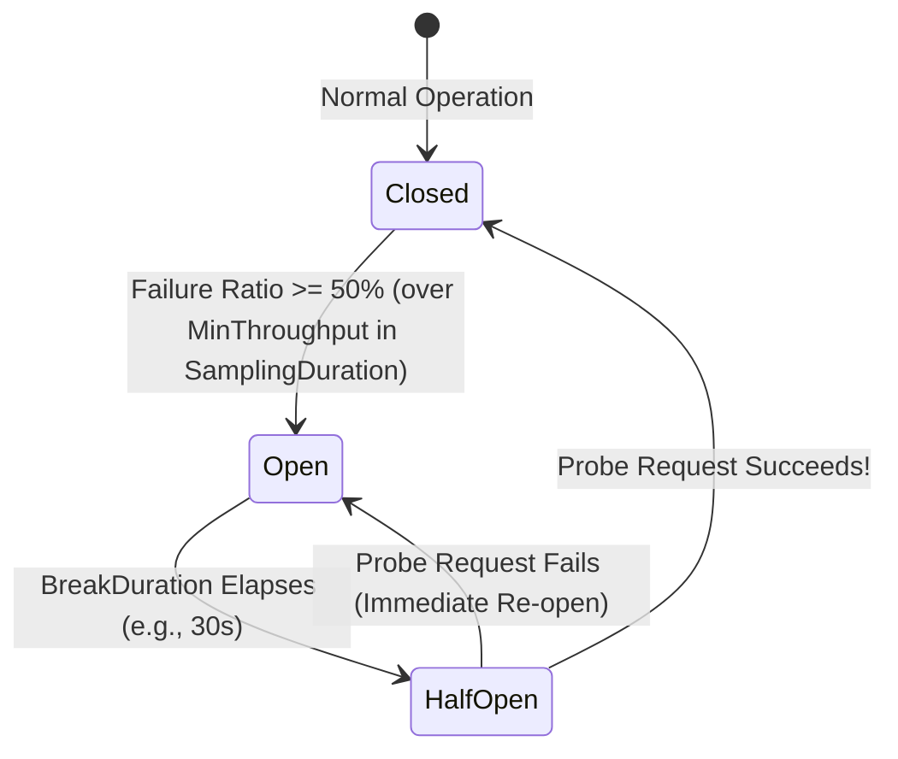

# Module 07 — Distributed Systems

**Senior Software Engineer Academy · Module 07 of 12**

> **Learning objective:** Master the theoretical foundations, failure modes, consistency trade-offs, and messaging architectures of modern distributed cloud systems. Develop senior-level competence in the CAP and PACELC theorems, logical time (Lamport, Vector, HLC), consensus protocols (Raft, Paxos), message broker semantics (Azure Service Bus, Apache Kafka), resilient integration patterns (Polly v8, Circuit Breakers, Bulkheads), distributed data consistency (Transactional Outbox, Sagas, Idempotent Consumers), and event sourcing.
>
> **Audience:** Experienced C#/.NET engineers preparing for Senior, Lead, and Staff technical interviews and distributed system design rounds. Practical Azure, messaging, and microservices experience is assumed; distributed system failure modes and consistency proofs are taught with rigorous precision.
>
> **Version note:** Code and architectural examples target modern .NET (.NET 8 LTS and .NET 9) with C# 12/13, Azure Service Bus SDK (`Azure.Messaging.ServiceBus`), MassTransit v8, Polly v8, and OpenTelemetry.

## How to use this module

Every section in Part II provides comprehensive senior-level instruction:
1. **Theoretical Foundations & Failure Models:** The 8 fallacies, partial failure, clock skew, network partitions, and quorum math.
2. **C#/.NET Production Architecture:** Production-ready Transactional Outbox, Idempotent Consumer, Polly resilience pipelines, and Service Bus session processors.
3. **Enterprise Production Scenarios:** Dual-write data loss, message duplication during failover, distributed lock expiration, and split-brain recovery.
4. **Trade-offs, Alternatives & Failure Modes:** When 2PC fails, when eventual consistency hurts user experience, and when Kafka is chosen over Service Bus.
5. **What a Senior Engineer Is Expected to Know:** Mid-level vs Senior/Staff distributed systems judgment.
6. **Interview Questions with Model Answers:** Real interview questions with structured, senior-level responses.
7. **Practical Exercises:** Distributed consensus proofs, failure simulations, and Outbox implementations.

## Module boundaries

- **This module owns:** Distributed computing fallacies, time and ordering, CAP/PACELC, replication, consensus (Raft/Paxos), distributed locking, message brokers (Service Bus/Kafka), Sagas, Transactional Outbox/Inbox, and distributed resilience.
- **Related topics owned by other modules:**
  - In-process design patterns, CQRS, and Clean Architecture → Module 04
  - Relational database transactions, locking, isolation levels, and MVCC → Module 05
  - HTTP semantics, REST APIs, and OAuth2/OIDC → Module 06
  - High-level system design, global load balancing, and multi-region architecture → Module 08
  - Production incident management, postmortems, and CI/CD pipelines → Module 11

---

# Part I — Complete Curriculum

## Section 1 — Distributed Systems Fundamentals & The 8 Fallacies
- 1.1 The Definition of a Distributed System: Autonomous computing nodes communicating over a shared network without shared memory or a global clock.
- 1.2 The 8 Fallacies of Distributed Computing: 1. The network is reliable; 2. Latency is zero; 3. Bandwidth is infinite; 4. The network is secure; 5. Topology doesn't change; 6. There is one administrator; 7. Transport cost is zero; 8. The network is homogeneous.
- 1.3 Failure Models: Crash-Stop, Crash-Recovery, Omission Failures, Arbitrary (Byzantine) Failures; the reality of Partial Failure.

## Section 2 — Time, Physical Clocks, Skew & Logical Ordering
- 2.1 Physical Clocks & NTP: Clock drift, leap seconds, clock skew; why wall-clock timestamps (`DateTime.UtcNow`) cannot reliably determine event causality in distributed systems.
- 2.2 Monotonic Clocks: `Stopwatch.GetTimestamp()` vs wall-clock time; measuring elapsed durations safely.
- 2.3 Logical Clocks: Lamport Timestamps (partial ordering via the *happens-before* relation $\to$), Vector Clocks (causality tracking and concurrent conflict detection).
- 2.4 Hybrid Logical Clocks (HLC): Combining physical time bounds with logical increment counters (used in modern distributed databases).

## Section 3 — CAP Theorem, PACELC & Consistency Models Spectrum
- 3.1 CAP Theorem Formulated: In the presence of a Network Partition (P), a distributed system must choose between Consistency (C - Linearizability) and Availability (A - every non-failing node returns a non-error response).
- 3.2 The PACELC Theorem: If Partition (P), trade off Availability (A) vs Consistency (C); Else (E), trade off Latency (L) vs Consistency (C).
- 3.3 The Consistency Spectrum: Linearizability (Strict Consistency), Sequential Consistency, Causal Consistency, Read-Your-Writes Consistency, Monotonic Reads, Eventual Consistency.
- 3.4 Azure Cosmos DB Consistency Levels: Strong, Bounded Staleness, Session (default), Consistent Prefix, Eventual; trade-offs in RU costs and latency.

## Section 4 — Replication Mechanics, Quorums & Consensus Protocols
- 4.1 Replication Topologies: Single-Leader (Active-Passive), Multi-Leader (Active-Active), Leaderless (Dynamo-style).
- 4.2 Quorum Math: Given $N$ replicas, read quorum $R$, and write quorum $W$: $R + W > N$ guarantees set overlap under a fixed replica set, not linearizability by itself.
- 4.3 Conflict Resolution: Last-Write-Wins (LWW) and silent data loss; Conflict-Free Replicated Data Types (CRDTs: G-Counter, PN-Counter, OR-Set).
- 4.4 Consensus Fundamentals: Paxos and Raft overview; Leader Election, Log Replication, Split-Brain prevention via majority quorums ($\lfloor N/2 \rfloor + 1$).
- 4.5 Distributed Locking & Fencing Tokens: Why Redis Redlock is controversial; Martin Kleppmann's critique; using Fencing Tokens to prevent split-brain zombies.

## Section 5 — Partitioning, Sharding & Consistent Hashing
- 5.1 Consistent Hashing: Hash ring architecture, virtual nodes to prevent uneven distribution and hot spots; minimizing data migration during node scaling.
- 5.2 Hot Key Mitigation: Salting keys, read-aside caching, write buffering.

## Section 6 — Messaging Architectures: Queues, Topics & Event Streams
- 6.1 Brokers vs Event Streams: Message Queues (RabbitMQ, Azure Service Bus) vs Partitioned Log Streams (Apache Kafka, Azure Event Hubs).
- 6.2 Azure Service Bus Deep Dive: Queues vs Topics/Subscriptions; Message Sessions (ordering within a session, not across sessions); Peek-Lock vs Receive-and-Delete; Duplicate Detection window; Scheduled messages.
- 6.3 Apache Kafka / Event Hubs Deep Dive: Partitions as the unit of parallelism; Consumer Groups; Offset management (commit after processing); Log Compaction.
- 6.4 Message Semantics: Commands (intent to act, one receiver) vs Events (facts that occurred, zero-to-many subscribers).

## Section 7 — Delivery Semantics, Idempotency & Poison Handling
- 7.1 Delivery Guarantees: At-Most-Once (loss tolerated), At-Least-Once (duplicates possible), "Exactly-Once" Processing Myth (achieved only via at-least-once transport + idempotent consumer).
- 7.2 The Idempotent Consumer Pattern: Deduplication store (Redis / SQL table) tracking processed Message IDs within a transaction.
- 7.3 Poison Messages & Dead-Letter Queues (DLQ): Max delivery attempts, dead-letter reasons, automated and manual DLQ reprocessing pipelines.

## Section 8 — Distributed Reliability Patterns (Polly v8, Circuit Breakers)
- 8.1 Transient vs Non-Transient Failures: HTTP 503/429 vs 400/404; identifying retryable errors.
- 8.2 Exponential Backoff with Jitter: Full jitter formula ($T = \text{random}(0, \min(\text{cap}, \text{base} \cdot 2^{\text{attempt}}))$) preventing synchronized retry storms.
- 8.3 Circuit Breaker Pattern: Closed $\to$ Open $\to$ Half-Open state transitions; failing fast during downstream outages.
- 8.4 Bulkhead Isolation & Hedging: Segmenting thread pools and connection resources; request hedging (speculative duplicate requests).

## Section 9 — Cross-Service Consistency: Sagas & Transactional Outbox
- 9.1 Why 2PC (Two-Phase Commit) Fails: Blocking coordinator, network partition vulnerability, latency explosion across cloud boundaries.
- 9.2 The Dual-Write Problem: Why updating a database and publishing a message to a broker in the same method always leads to data loss or inconsistency.
- 9.3 The Transactional Outbox Pattern: Storing domain events in an `Outbox` table within the same ACID database transaction; asynchronous background dispatcher (or CDC Debezium).
- 9.4 The Saga Pattern: Choreography (event-driven notification) vs Orchestration (centralized state machine); Compensating transactions for semantic rollback.
- 9.5 State Machine Sagas in MassTransit / Azure Durable Functions: Persisting correlation state, handling timeouts, and coordinating multi-step transactions.

## Section 10 — Event-Driven Architecture, Event Sourcing & Projections
- 10.1 Event Sourcing Mechanics: Storing events as the single source of truth; replaying streams to rebuild state; snapshots for performance.
- 10.2 CQRS Projections & Eventual Consistency UX: Materializing read models; handling eventual consistency delays in user interfaces.
- 10.3 Event Schema Evolution: Upcasting, versioning event contracts without breaking existing serialized streams.

## Section 11 — Distributed Observability, Tracing & W3C Correlation
- 11.1 Correlation & Causality: W3C `traceparent` propagation across message metadata; OpenTelemetry integration in Azure Service Bus and MassTransit.

## Section 12 — Chaos Engineering & Fault Injection Verification
- 12.1 Principles of Chaos Engineering: Hypothesize steady state, inject real-world faults (network latency, partition, node crash), verify resilience, automate experiments.

## Section 13 — Senior Scenarios, Distributed Incidents & Capstone
- 13.1 Capstone Scenario: End-to-end design of a mission-critical e-commerce order fulfillment Saga across Inventory, Billing, and Shipping using Transactional Outbox on Azure Service Bus.

---

# Part II — Lessons

## Section 1 — Distributed Systems Fundamentals & The 8 Fallacies

### 1.1 The Reality of Partial Failure

In a single-process application, if a method crashes, the entire process terminates predictably.
In a distributed system, **Partial Failure** is the baseline condition:
- Node A may successfully execute its work, but the network request to Node B drops.
- Node B may execute its mutation, but the network acknowledgement back to Node A times out.
- Node A cannot distinguish between:
  1. Node B crashed before doing work.
  2. Node B executed work, but the network response dropped.
  3. Node B is still running slowly and will finish 10 seconds later.

*Senior Engineering Rule:* **In a distributed system, an unanswered request is neither success nor failure—it is unknown.** Systems must be designed assuming timeouts will happen constantly.

#### Safety and Liveness Are Different Promises

**Safety** means something invalid never happens: one seat is not confirmed for two buyers, or a committed ledger entry is not silently overwritten. **Liveness** means progress eventually happens under stated assumptions: an accepted job eventually completes when dependencies recover.

A system that refuses every booking preserves the no-double-booking invariant but has no useful liveness. A system that accepts bookings during every partition may be available while violating that invariant. In an interview, name both the invariant and the conditions needed for progress; "highly available and consistent" is not precise enough.

A timeout is a failure-detector suspicion, not proof that a process is dead. Treat a paused worker as capable of returning later. Leases, fencing, idempotency, and reconciliation exist because different nodes cannot reliably distinguish a failed peer from a delayed one.

---

### 1.2 The 8 Fallacies of Distributed Computing & Failure Models (Crash-Stop, Crash-Recovery, Omission, Byzantine)

Originally formulated by Peter Deutsch and James Gosling at Sun Microsystems, the **8 Fallacies of Distributed Computing** represent false assumptions engineers make when transitioning from single-process monoliths to distributed systems:

| # | Fallacy | Reality in Cloud Production | Architectural Mitigation |
|---|---|---|---|
| **1** | **The network is reliable** | Switches fail, BGP routes flap, TCP connections reset, and cloud VMs undergo live migration drops. | Timeouts, exponential backoff with jitter, idempotent endpoints, and durable message queues. |
| **2** | **Latency is zero** | An L1 cache read takes $0.5\text{ ns}$; an intra-datacenter RPC takes $500,000\text{ ns}$ ($0.5\text{ ms}$); cross-continent takes $150\text{ ms}$. | Coarse-grained APIs, batching, avoid chatty N+1 RPC loops, edge caching, and async messaging. |
| **3** | **Bandwidth is infinite** | Cross-AZ/Cross-Region links saturate during bulk data replication or cache hydration storms. | Payload compression (Brotli/Gzip), Protobuf/gRPC binary serialization, pagination, and claim-check pattern. |
| **4** | **The network is secure** | Zero-trust reality: packet sniffing, compromised sidecars, SSRF, and lateral movement inside VNets. | mTLS everywhere (Service Mesh), OAuth2/OIDC token validation per hop, Azure Private Endpoints. |
| **5** | **Topology doesn't change** | Kubernetes pods scale up/down continuously; IPs are ephemeral; load balancers drain nodes dynamically. | Service discovery, DNS with short TTLs, client-side load balancing, and `IHttpClientFactory` DNS refresh. |
| **6** | **There is one administrator** | SaaS dependencies (Stripe, Auth0, Azure SQL) have independent maintenance windows and upgrade policies. | Circuit breakers, SLA decoupling, fallback degradation, and contract testing. |
| **7** | **Transport cost is zero** | Serialization (JSON reflection) consumes CPU/GC; cross-AZ and egress bandwidth costs thousands of dollars. | UTF-8 source-generated `JsonSerializerContext`, co-locating chatty services in the same Availability Zone. |
| **8** | **The network is homogeneous** | Mobile 4G clients, legacy SOAP appliances, Linux containers, and Windows hosts differ in MTU, TLS, and endianness. | Standardize on open protocols (HTTP/2, gRPC, CloudEvents, W3C TraceContext). |

#### Formal Distributed Failure Models

When designing consensus algorithms or replication protocols, we classify node and network failures into a strict hierarchy of difficulty:

```text
+-------------------------------------------------------------------+
| Arbitrary / Byzantine Failures (Malicious / Corrupted Bit Flips)  |
|  +-------------------------------------------------------------+  |
|  | Crash-Recovery & Omission Failures (Dropped Packets, GC)    |  |
|  |  +-------------------------------------------------------+  |  |
|  |  | Crash-Stop (Fail-Stop: Node halts permanently)        |  |  |
|  |  +-------------------------------------------------------+  |  |
|  +-------------------------------------------------------------+  |
+-------------------------------------------------------------------+
```

1. **Crash-Stop (Fail-Stop):** A node operates correctly until it halts permanently and never executes another step. Once dead, other nodes can eventually detect it (assuming a synchronous network). This is the simplest theoretical model.
2. **Crash-Recovery (Fail-Recovery):** A node may halt at any moment (power loss, OOM kill, pod eviction) and later reboot. Upon recovery, volatile in-memory state is lost; only state flushed to non-volatile storage (`fsync` / Write-Ahead Log) survives. **This is the standard node model for cloud microservices and Raft/Paxos.**
3. **Omission Failures:** A node executes correctly, but fails to send (*Send-Omission*) or receive (*Receive-Omission*) messages—typically caused by full NIC ring buffers, OS kernel packet drops, or prolonged Garbage Collection (GC) pauses.
4. **Arbitrary (Byzantine) Failures:** Nodes may fail in arbitrary ways: sending contradictory messages to different peers, corrupting data silently due to cosmic ray bit flips without checksums, or acting maliciously. Tolerating $f$ Byzantine faults requires $3f + 1$ nodes (e.g., PBFT), whereas tolerating $f$ Crash-Recovery faults requires only $2f + 1$ nodes.

---

### Section 1 Review: Interview Questions & Practice Exercises

#### Interview Questions
1. **Q: Why is treating a remote microservice call like a local C# interface method call (`_paymentService.Charge()`) a dangerous anti-pattern?**
   - **Model Answer:** Hiding a network call behind a synchronous-looking interface obscures Fallacies #1, #2, and #7. A local method call executes in nanoseconds, cannot fail due to packet loss, and fails atomically with the caller. A remote call introduces orders-of-magnitude higher latency, serialization overhead, and the certainty of **partial failure**—where the request times out and the caller does not know whether the side effect occurred. Remote calls must explicitly model timeouts (`CancellationToken`), idempotency keys (`Idempotency-Key`), and transient retry policies.
2. **Q: In cloud infrastructure (e.g., Kubernetes + Azure SQL), why do we design for the Crash-Recovery + Asynchronous Network model rather than the Byzantine model?**
   - **Model Answer:** Inside a trusted corporate cloud VNet protected by TLS/TCP checksums and cryptographic authentication, nodes do not intentionally lie or forge contradicting protocol messages. However, pods restart (`Crash-Recovery`), disks stall, and networks drop packets or pause during GC (`Omission`). Designing for Crash-Recovery requires $2f + 1$ replicas (e.g., 3 nodes tolerate 1 failure) using protocols like Raft, whereas Byzantine Fault Tolerance ($3f + 1$ nodes, multiple quadratic message rounds) imposes prohibitive latency and throughput penalties unnecessary for trusted datacenters.

#### Practice Exercises
1. **Audit for the 8 Fallacies:** Take an existing `HttpClient` integration in a .NET service. Verify how it handles: (a) DNS IP rotation when topology changes (`PooledConnectionLifetime`), (b) an unanswered TCP socket hang (`Timeout`), and (c) duplicate execution if a retry triggers after the server already committed the request.
2. **Failure Mode Classification:** Classify each incident into Crash-Stop, Crash-Recovery, Omission, or Byzantine:
   - A Kubernetes pod hits its `memory.limit` and is `OOMKilled`, then rescheduled 15 seconds later.
   - A buggy network card corrupts a JSON payload byte *before* the TLS MAC is calculated, causing a wrong price (`\$10` instead of `\$100`) to be saved.
   - An overwhelmed UDP logging agent silently drops 20% of incoming telemetry packets when its socket buffer fills up.

---

## Section 2 — Time, Physical Clocks, Skew & Logical Ordering

### 2.1 The Clock Skew Trap

Servers synchronize their physical quartz clocks using the Network Time Protocol (NTP).
However, NTP synchronization across cloud VMs has variance (skew) typically ranging from **5ms to 50ms**, and can drift by seconds during network hiccups or leap second smearing!

#### The Disaster: Ordering Events via `DateTime.UtcNow`
Suppose Server 1 creates an order at physical time $T=100$, but its clock is skewed backward to $T=90$.
Server 2 receives the payment at physical time $T=105$, but its clock is accurate at $T=105$.
If your system orders events by wall-clock timestamp, a query for "Events before Payment" will report that the order was created *after* the payment occurred!

#### Logical Clocks: Lamport Timestamps
Leslie Lamport (1978) proved that to order events in a distributed system, we must track the **Happens-Before relation ($\to$)** using logical counters rather than physical clocks:
1. Each node maintains an integer counter $L$, initialized to 0.
2. Before a node executes a local event, it increments: $L \mathrel{+}= 1$.
3. When sending a message, the node attaches its current $L$.
4. When receiving a message with timestamp $L_{\text{msg}}$, the receiver sets its local clock:
   $$L_{\text{local}} = \max(L_{\text{local}}, L_{\text{msg}}) + 1$$
*Guarantee:* If Event A caused Event B ($A \to B$), then $L(A) < L(B)$.

---

### 2.2 Monotonic Clocks, Vector Clocks & Hybrid Logical Clocks (HLC)

#### 1. Physical Time-of-Day vs Monotonic Clocks in .NET
Every server operating system exposes two fundamentally different physical clocks:
- **Time-of-Day (Wall-Clock) (`DateTime.UtcNow` / `DateTimeOffset.UtcNow`):** Synchronized via NTP. If the local quartz crystal runs fast and NTP steps the clock *backward* by 200ms, `DateTime.UtcNow` jumps backward in time! Never use `DateTime.UtcNow` to measure elapsed durations or timeouts.
- **Monotonic Clock (`Stopwatch.GetTimestamp()` / `TimeProvider.System.GetTimestamp()`):** Driven by the hardware High-Precision Event Timer (HPET) or CPU Time Stamp Counter (TSC). Guaranteed to move strictly forward at a constant rate regardless of NTP adjustments.

```csharp
// WRONG: Vulnerable to NTP backward clock jumps (elapsed could be negative or zero!)
var startWall = DateTime.UtcNow;
await ExecuteRpcAsync();
var badElapsed = DateTime.UtcNow - startWall;

// RIGHT (.NET 8+): Zero-allocation monotonic duration measurement
long startTimestamp = Stopwatch.GetTimestamp();
await ExecuteRpcAsync();
TimeSpan safeElapsed = Stopwatch.GetElapsedTime(startTimestamp);
```

#### 2. The Limitation of Lamport Clocks & The Rise of Vector Clocks
Lamport timestamps guarantee $A \to B \implies L(A) < L(B)$, **but the converse is false!** Observing $L(A) < L(B)$ does *not* tell you whether $A$ caused $B$ or whether $A$ and $B$ happened concurrently on independent nodes ($A \parallel B$).

**Vector Clocks** solve this by maintaining an array of logical counters $V[1 \dots N]$—one slot per node in the cluster:
1. Node $i$ increments its own entry $V[i] \mathrel{+}= 1$ before each local event.
2. When Node $i$ sends a message, it attaches its full vector $V_{\text{msg}}$.
3. Upon receiving $V_{\text{msg}}$, Node $j$ merges the vectors element-wise and increments its own position:
   $$\forall k \in [1..N]: V_j[k] = \max(V_j[k], V_{\text{msg}}[k]), \quad \text{then } V_j[j] \mathrel{+}= 1$$

**Causality & Conflict Detection Rules:**
- **$V(A) < V(B)$ ($A$ causally precedes $B$):** Every element $V(A)[k] \le V(B)[k]$, and at least one element is strictly smaller ($V(A)[k] < V(B)[k]$). Safe to overwrite $A$ with $B$.
- **$V(A) \parallel V(B)$ (Concurrent Conflict!):** Neither vector is $\le$ the other (e.g., $V(A) = [2, 1, 0]$ and $V(B) = [1, 2, 0]$). Both updates occurred without knowledge of each other—sibling conflict resolution is required!

#### 3. Hybrid Logical Clocks (HLC)
Used in CockroachDB, YugabyteDB, and MongoDB, **Hybrid Logical Clocks (HLC)** combine physical wall-clock time (`pt`) with a logical counter (`c`) into a single 64-bit monotonically increasing timestamp $(l, c)$:
- $l$ tracks the highest physical time seen so far (either local `pt` or from any incoming message).
- $c$ increments whenever $l$ cannot advance (because physical time hasn't caught up to $l$ yet, or multiple events occur within the same physical tick).
- **Why HLC wins in production:** Unlike Vector Clocks (which grow $O(N)$ with node count), HLC fits in a compact 64-bit integer, stays within milliseconds of physical UTC wall-clock time for human querying, and provides strict causal ordering ($A \to B \implies \text{HLC}(A) < \text{HLC}(B)$).

```csharp
public readonly record struct HybridTimestamp(long LogicalWallMs, int Counter, string NodeId)
    : IComparable<HybridTimestamp>
{
    public int CompareTo(HybridTimestamp other)
    {
        int cmp = LogicalWallMs.CompareTo(other.LogicalWallMs);
        if (cmp != 0) return cmp;
        cmp = Counter.CompareTo(other.Counter);
        return cmp != 0 ? cmp : string.CompareOrdinal(NodeId, other.NodeId);
    }
}

public sealed class HybridLogicalClock(string nodeId, TimeProvider timeProvider)
{
    private readonly object _gate = new();
    private long _lastWallMs;
    private int _counter;

    // 1. Local event or send message
    public HybridTimestamp Now()
    {
        lock (_gate)
        {
            long physicalMs = timeProvider.GetUtcNow().ToUnixTimeMilliseconds();
            if (physicalMs > _lastWallMs)
            {
                _lastWallMs = physicalMs;
                _counter = 0;
            }
            else
            {
                _counter++; // Physical clock hasn't caught up; advance logical counter!
            }
            return new HybridTimestamp(_lastWallMs, _counter, nodeId);
        }
    }

    // 2. Receive message with remote HLC timestamp
    public HybridTimestamp Receive(HybridTimestamp remote)
    {
        lock (_gate)
        {
            long physicalMs = timeProvider.GetUtcNow().ToUnixTimeMilliseconds();
            if (physicalMs > _lastWallMs && physicalMs > remote.LogicalWallMs)
            {
                _lastWallMs = physicalMs;
                _counter = 0;
            }
            else if (remote.LogicalWallMs > _lastWallMs)
            {
                _lastWallMs = remote.LogicalWallMs;
                _counter = remote.Counter + 1;
            }
            else if (_lastWallMs > remote.LogicalWallMs)
            {
                _counter++;
            }
            else // _lastWallMs == remote.LogicalWallMs
            {
                _counter = Math.Max(_counter, remote.Counter) + 1;
            }
            return new HybridTimestamp(_lastWallMs, _counter, nodeId);
        }
    }
}
```

---

### Section 2 Review: Interview Questions & Practice Exercises

#### Interview Questions
1. **Q: What is the difference between a Lamport Timestamp and a Vector Clock, and when must you use a Vector Clock?**
   - **Model Answer:** A Lamport Timestamp is a single scalar integer that guarantees $A \to B \implies L(A) < L(B)$, providing a total order when combined with a node ID tie-breaker. However, you cannot look at two Lamport timestamps $L(A) < L(B)$ and determine if $A$ causally preceded $B$ or if they were concurrent. A Vector Clock maintains an array of counters (one per node) so that $V(A) < V(B) \iff A \to B$. You must use Vector Clocks (or Version Vectors) in leaderless/multi-leader systems to detect concurrent conflicting writes that require sibling resolution rather than blindly overwriting one update.
2. **Q: How does Google Spanner's TrueTime API achieve external consistency (linearizability) across global datacenters without cross-planet read locks, and how does it differ from NTP?**
   - **Model Answer:** Standard NTP has unbounded clock uncertainty during network partitions. Spanner equips datacenters with GPS receivers and atomic rubidium clocks, exposing `TrueTime.now()` as a bounded time interval $[t_{\text{earliest}}, t_{\text{latest}}]$ where uncertainty $\epsilon$ is typically $1\text{–}7\text{ ms}$. By enforcing the **Commit Wait** rule—where a leader assigns timestamp $s = t_{\text{latest}}$ and waits $2\epsilon$ milliseconds until $s < t_{\text{earliest}}$ globally before releasing locks or making data visible—Spanner guarantees that if Transaction $T_2$ starts in real time after $T_1$ commits, $T_2$'s timestamp is strictly greater than $T_1$'s timestamp.

#### Practice Exercises
1. **Vector Clock Conflict Trace:** Given three nodes $(N_1, N_2, N_3)$ starting at $[0,0,0]$:
   - $N_1$ writes `X = 10` at $V_1 = [1,0,0]$ and replicates to $N_2$ ($V_2 = [1,1,0]$).
   - Now $N_1$ writes `X = 20` locally, while concurrently $N_2$ writes `X = 30` locally.
   - Compute the resulting Vector Clocks on $N_1$ and $N_2$, and prove mathematically why a coordinator reading both replicas detects a conflict.
2. **HLC Unit Test:** Write an xUnit test using `Microsoft.Extensions.Time.Testing.FakeTimeProvider` that simulates a sender node whose clock is skewed $+500\text{ ms}$ ahead of the receiver node, verifying that `HybridLogicalClock.Receive()` preserves strict monotonicity on the receiver.

---

## Section 3 — CAP Theorem, PACELC & Consistency Models Spectrum

### 3.1 The PACELC Theorem

Eric Brewer's CAP Theorem states that across a network partition, you must trade off Consistency vs Availability.
Daniel Abadi extended this with the **PACELC Theorem**:

$$\textbf{If } \text{Partition (P)} \implies \text{trade off } \textbf{Availability (A)} \textbf{ vs } \textbf{Consistency (C)}$$
$$\textbf{Else (E)} \implies \text{trade off } \textbf{Latency (L)} \textbf{ vs } \textbf{Consistency (C)}$$

Even in normal, healthy network conditions (Else), you cannot escape trade-offs:
- If you demand immediate strong consistency across replicas, writes must wait for multi-datacenter network round-trips, imposing high **Latency (L)**.
- If you optimize for low **Latency (L)**, writes return immediately and replicate asynchronously, meaning readers may read stale data (trading **Consistency (C)**).

---

### 3.2 The Consistency Models Spectrum (Linearizability, Sequential, Causal, Read-Your-Writes, Eventual)

Many candidates treat consistency as binary ("Strong vs Eventual"). In reality, distributed data stores offer a spectrum of consistency guarantees trading off latency, throughput, and availability:

```text
STRONGEST (Highest Latency / Lowest Availability during Partition)
  |
  +-- 1. Linearizability (Strict / Atomic Consistency)
  |      Real-time recency guarantee: Once a write completes, ALL subsequent reads
  |      (in wall-clock real time) across the globe MUST see that write or a newer one.
  |
  +-- 2. Sequential Consistency
  |      No real-time bound, but all nodes observe operations in the SAME single global order
  |      that respects each individual process's program order.
  |
  +-- 3. Causal Consistency
  |      Causally related operations (A -> B) are seen in the same order by every node;
  |      concurrent operations (A || B) may be observed in different orders on different nodes.
  |
  +-- 4. Session Guarantees (Read-Your-Writes, Monotonic Reads, Monotonic Writes)
  |      Scoped to a single client session token: a user always sees their own updates
  |      and never sees time move backward when switching read replicas.
  |
  +-- 5. Eventual Consistency
         Weakest guarantee: If writes stop, replicas eventually converge to the same state.
         Allows temporary stale reads, out-of-order reads, and read-your-writes violations.
WEAKEST (Lowest Latency / Highest Availability)
```

#### Deep Dive: Linearizability vs Sequential Consistency
- **Linearizability** is a *single-object, real-time* property: every operation appears to take effect atomically at a single point in time between its invocation and its completion response. If User A updates their password and then calls User B on the phone, User B's immediate read **must** see the new password.
- **Sequential Consistency** drops the real-time clock requirement: operations can lag behind real time, provided every replica sees the exact same interleaved sequence of events (e.g., an asynchronous single-leader replication log where all followers apply the leader's WAL in the exact same sequence).

#### Production Application: Azure Cosmos DB's 5 Consistency Levels
Azure Cosmos DB natively operationalizes this spectrum, allowing architects to choose the exact PACELC trade-off per account or overridden per read request:

| Cosmos DB Level | Formal Guarantee | Write Quorum & Replication | Read RU Cost (per 1 KB) | Production Use Case |
|---|---|---|---|---|
| **Strong** | Linearizability | Synchronous majority quorum across regions (if configured) before write ack. | **2 RUs** (reads from quorum / leader) | Financial ledger balances, inventory seat allocation where double-booking is unacceptable. |
| **Bounded Staleness** | Sequential within $(K \text{ versions}, T \text{ seconds})$ | Asynchronous outside window; throttles writes if replication lag exceeds $K$ operations or $T$ seconds. | **2 RUs** (single region) / **1 RU** (local relaxed) | Global apps requiring HA multi-region failover with guaranteed RPO $\le T$ seconds. |
| **Session** *(Default)* | Read-Your-Writes, Monotonic Reads, Causal within Session | Local majority write; returns a `SessionToken` (`LSN`) that clients pass on subsequent requests. | **1 RU** | **90% of enterprise apps:** User profiles, e-commerce shopping carts, SaaS dashboards. |
| **Consistent Prefix** | Monotonic Order (No out-of-order writes seen) | Reads never see write #3 without seeing writes #1 and #2. | **1 RU** | Social media activity feeds, comment threads, live sports scoreboards. |
| **Eventual** | Eventual Convergence | Reads served from any single replica without LSN check. | **1 RU** | Product reviews count, IoT telemetry ingestion, non-critical view counters. |

```csharp
// Passing Cosmos DB Session Token across stateless ASP.NET Core Web API instances
// to preserve Read-Your-Writes consistency for the end user at 50% the RU cost of Strong!
public async Task<OrderDocument> GetOrderWithSessionConsistencyAsync(
    Container container, string orderId, string customerId, string? clientSessionToken)
{
    var requestOptions = new ItemRequestOptions
    {
        SessionToken = clientSessionToken // Forces replica to catch up to LSN before returning
    };

    ItemResponse<OrderDocument> response = await container.ReadItemAsync<OrderDocument>(
        id: orderId,
        partitionKey: new PartitionKey(customerId),
        requestOptions: requestOptions);

    // Return updated response.Headers.Session back to the browser via HTTP header!
    return response.Resource;
}
```

---

### Section 3 Review: Interview Questions & Practice Exercises

#### Interview Questions
1. **Q: A candidate says, "Our system uses a CP database, so it is never available, or an AP database, so it is never consistent." Correct this misconception using the CAP and PACELC theorems.**
   - **Model Answer:** In the CAP theorem, $C$ and $A$ are only mutually exclusive *during an active network partition ($P$)*. When the network is healthy, a distributed system provides both Consistency and Availability. However, as the PACELC theorem explains, even when there is no partition ($E$), you still face a fundamental trade-off between **Latency ($L$)** and **Consistency ($C$)**—because guaranteeing linearizability requires synchronous network coordination across replicas before acknowledging a write or serving a read.
2. **Q: Why is Azure Cosmos DB's default `Session` consistency level preferred over `Strong` consistency for most web applications, and how does it work under the hood?**
   - **Model Answer:** `Strong` consistency doubles the Request Unit (RU) cost of reads (2 RUs vs 1 RU per 1 KB) and prevents multi-region active-active writes or adds cross-region synchronous write latency. Most web applications do not require global linearizability across unrelated users—they require that *a user sees their own writes immediately* (`Read-Your-Writes`) and never sees stale data after seeing newer data (`Monotonic Reads`). Cosmos DB achieves this at 1 RU by embedding the Partition ID and Logical Sequence Number (`LSN`) inside a lightweight `SessionToken`. Any replica holding `localLSN >= tokenLSN` can serve the read immediately in $O(1)$ without contacting a quorum.

#### Practice Exercises
1. **PACELC Classification:** Classify the following systems under PACELC (`PC/EC`, `PA/EL`, `PC/EL`, `PA/EC`):
   - Apache Cassandra configured with `LOCAL_ONE` read/write consistency.
   - Etcd / ZooKeeper cluster backing Kubernetes control plane state.
   - Azure Cosmos DB configured with `Session` consistency across 3 regions.
2. **Read-Your-Writes Bug Hunt:** A stateless ASP.NET Core API writes to a primary SQL database and reads from 3 asynchronous read replicas. A user updates their shipping address and immediately refreshes the page, seeing their old address. Propose two concrete mechanisms (without routing 100% of all reads to the primary) to guarantee Read-Your-Writes consistency.

---

## Section 4 — Replication Mechanics, Quorums & Consensus Protocols

### 4.1 Quorum Math in Leaderless Systems (Dynamo-Style)

Given $N$ replicas:
- Write Quorum $W$: The number of nodes that must acknowledge a write for it to succeed.
- Read Quorum $R$: The number of nodes that must respond to a read request.

#### The Strict Quorum Rule:
$$R + W > N$$
If read and write responses come from the same fixed set of $N$ replicas, this inequality guarantees their sets intersect. Intersecting a completed write's quorum is useful, but the read protocol must still identify and return an appropriate version. Concurrent writes, incomplete writes, replica replacement, and conflict resolution prevent the inequality alone from proving linearizability.

*Example:* $N = 3, W = 2, R = 2 \implies 2 + 2 = 4 > 3$: every two-node read set overlaps every two-node write set. This is an overlap guarantee, not a complete strong-consistency protocol.
If you configure $W = 1, R = 1 \implies 1 + 1 = 2 < 3$ (Eventual Consistency, low latency, high availability).

**Worked failure question:** A write reaches replica A but times out before reaching its required second replica. A later read may observe that value even though the writer received no success acknowledgement. Does your contract allow this, and how are conflicting versions resolved? Counting responses does not answer either question. Sloppy quorums using substitute replicas can also remove the intended overlap; eventual convergence still requires repair and a defined conflict policy.

---

### 4.2 Distributed Locking and Fencing Tokens

Using a distributed lock (e.g., in Redis or Azure Blob Lease) to protect shared resources is vulnerable to **GC Pause / Process Freeze bugs**:
1. Client 1 acquires the lock for 10 seconds.
2. Client 1 enters a Stop-The-World Full GC pause or network stall for 15 seconds.
3. The lock lease expires in Redis.
4. Client 2 acquires the lock and updates storage.
5. Client 1 wakes up from its GC pause, incorrectly assumes it still owns the lock, and executes its write—**corrupting Client 2's data!**

#### The Fix: Fencing Tokens
Every lock acquisition must return a monotonically increasing integer **Fencing Token** ($1, 2, 3 \dots$). The storage layer must reject any write accompanied by a token lower than the highest token it has already processed!

```text
Client 1                 Distributed Lock Manager            Shared Storage
   |                                |                               |
   |--- Acquire Lock -------------->|                               |
   |<-- Lock Granted (Token = 41) --|                               |
   |                                |                               |
   |=== [STALL / GC PAUSE 15s] =====|                               |
   |    (Lease Expires!)            |                               |
   |                                |                               |
   |                   Client 2     |                               |
   |                      |-- Acquire Lock ------>|                 |
   |                      |<- Granted (Token = 42)|                 |
   |                      |---------------- Write (Token = 42) ---->|
   |                      |                         |               |<-- OK (Processed 42)
   |                                                                |
   |=== [Client 1 Wakes Up] ========================================|
   |--------------------------------------- Write (Token = 41) ---->|
   |<-------------------------------------- REJECTED (Stale Token!) |
```

---

### 4.3 Conflict Resolution (LWW vs CRDTs) & Raft Consensus Protocol (Leader Election & Log Replication)

#### 1. Conflict Resolution in Multi-Leader & Leaderless Replication
When two clients concurrently write to the same key on different replicas ($W_1 \parallel W_2$), the system must converge to an identical state across all nodes:

- **Last-Write-Wins (LWW):** Attaches a physical or logical timestamp to each write and discards the write with the smaller timestamp.
  - *Fatal Flaw:* **Silent Data Loss.** If two users concurrently add different items to a shopping cart within the same millisecond (or with slightly skewed NTP clocks), LWW overwrites the entire cart, silently destroying one item that was already acknowledged as saved! LWW is only safe when keys are immutable (e.g., UUID-keyed log events).
- **Conflict-Free Replicated Data Types (CRDTs):** Data structures mathematically designed so that concurrent updates automatically merge without coordination or conflicts:
  - **Operation-Based (CmRDT) & State-Based (CvRDT):** Rely on a merge function $\sqcup$ that forms a **Bounded Join-Semilattice**:
    1. **Commutative:** $A \sqcup B = B \sqcup A$ (order of arrival doesn't matter).
    2. **Associative:** $(A \sqcup B) \sqcup C = A \sqcup (B \sqcup C)$ (grouping doesn't matter).
    3. **Idempotent:** $A \sqcup A = A$ (duplicate delivery of state is harmless).

```csharp
// Production State-Based PN-Counter (Positive-Negative Counter) CRDT in C#
// Supports concurrent increments and decrements across N replicas with zero locks or data loss!
public sealed class PnCounterCrdt
{
    private readonly Dictionary<string, long> _increments = new();
    private readonly Dictionary<string, long> _decrements = new();

    public void Increment(string nodeId, long delta = 1)
    {
        ArgumentOutOfRangeException.ThrowIfNegative(delta);
        _increments[nodeId] = _increments.GetValueOrDefault(nodeId) + delta;
    }

    public void Decrement(string nodeId, long delta = 1)
    {
        ArgumentOutOfRangeException.ThrowIfNegative(delta);
        _decrements[nodeId] = _decrements.GetValueOrDefault(nodeId) + delta;
    }

    public long Value => _increments.Values.Sum() - _decrements.Values.Sum();

    // Semilattice Merge: Commutative, Associative, and Idempotent!
    public void Merge(PnCounterCrdt remote)
    {
        foreach (var (node, count) in remote._increments)
            _increments[node] = Math.Max(_increments.GetValueOrDefault(node), count);

        foreach (var (node, count) in remote._decrements)
            _decrements[node] = Math.Max(_decrements.GetValueOrDefault(node), count);
    }
}
```

#### 2. The Raft Consensus Protocol (etcd, CockroachDB, Consul, Kafka KRaft)
While Dynamo-style quorums ($R + W > N$) do not guarantee strict linearizability during concurrent writes or sloppy quorums, **Consensus Protocols (Raft, Paxos)** guarantee that all nodes agree on a single, linearizable sequence of state machine commands.

Raft decomposes consensus into two core phases governed by **Terms** (monotonically increasing logical epochs that act as fencing tokens):



1. **Leader Election & Split-Brain Prevention:**
   - Every node starts as a **Follower** expecting periodic heartbeats (`AppendEntries` RPC) from the **Leader**.
   - If a Follower hears no heartbeat within its **randomized election timeout** ($150\text{–}300\text{ ms}$), it increments its `CurrentTerm`, transitions to **Candidate**, votes for itself, and sends `RequestVote` RPCs to all peers.
   - **Safety Invariant 1 (One Vote Per Term):** Each node votes for at most one candidate per Term on a first-come, first-served basis. Because any two majorities ($\lfloor N/2 \rfloor + 1$) must overlap by at least one node, **two leaders can NEVER be elected in the same Term.**
   - **Safety Invariant 2 (Log Completeness Check):** A voter denies its vote if the Candidate's log is *less up-to-date* than the voter's own log (compared first by `LastLogTerm`, then by `LastLogIndex`). This guarantees the elected Leader already holds every committed log entry!
2. **Log Replication (Two-Step Commit):**
   - Client sends a command to the **Leader**.
   - Leader appends the command to its local Write-Ahead Log (WAL) as *uncommitted* and sends `AppendEntries` RPCs in parallel to all Followers.
   - Once a strict majority ($\lfloor N/2 \rfloor + 1$) of nodes have written the entry to their WAL and acknowledged it, the Leader advances its `CommitIndex`, applies the command to its state machine, and returns success to the client.
   - On subsequent heartbeats, the Leader notifies Followers of the updated `CommitIndex` so they apply the entry to their local state machines.

---

### Section 4 Review: Interview Questions & Practice Exercises

#### Interview Questions
1. **Q: Why does a 4-node Raft cluster have worse fault tolerance availability than a 3-node Raft cluster, even though it has more servers?**
   - **Model Answer:** Raft requires a strict majority quorum of $Q = \lfloor N/2 \rfloor + 1$ nodes to elect a leader and commit writes.
     - For $N = 3$: $Q = \lfloor 3/2 \rfloor + 1 = 2$. The cluster can tolerate $3 - 2 = \mathbf{1}$ failed node.
     - For $N = 4$: $Q = \lfloor 4/2 \rfloor + 1 = 3$. The cluster can still only tolerate $4 - 3 = \mathbf{1}$ failed node!
     Adding a 4th node provides **zero** additional fault tolerance while increasing the probability that any two nodes fail simultaneously and adding an extra node that must acknowledge every quorum write. Consensus clusters always use odd numbers ($3, 5, 7$).
2. **Q: Even when $R + W > N$ in a Dynamo-style leaderless database, why is it still NOT strictly linearizable without read-repair or consensus?**
   - **Model Answer:** Consider $N=3, W=2, R=2$ where $X=0$. A writer sends $X=1$ to $\{N_1, N_2\}$. $N_1$ applies $X=1$ immediately; $N_2$'s network packet is still in flight. Reader A reads from $\{N_1, N_3\}$, sees $X=1$ on $N_1$, and returns $X=1$ to the user. Immediately afterward, Reader B reads from $\{N_2, N_3\}$ (before $N_2$'s write arrives), sees $X=0$ on both, and returns $X=0$! Reader B started in real time *after* Reader A finished, yet observed an older value—violating linearizability.

#### Practice Exercises
1. **Raft Split-Brain Trace:** Suppose a 5-node Raft cluster $\{A, B, C, D, E\}$ with Leader $A$ (in Term 1) suffers a network partition isolating $\{A, B\}$ on one side and $\{C, D, E\}$ on the other. Trace step-by-step what happens when:
   - Client 1 sends a write to stale Leader $A$.
   - Nodes $\{C, D, E\}$ time out and elect $C$ in Term 2, and Client 2 writes to $C$.
   - The network partition heals. How does $A$ reconcile its uncommitted Term 1 log entries?
2. **OR-Set (Observed-Remove Set) Design:** Explain why a naive Set CRDT cannot simply union additions and union removals when an element is added, removed, and re-added concurrently. Show how tagging each added element with a unique `(Element, GuidTag)` solves the problem.

---

## Section 5 — Partitioning, Sharding & Consistent Hashing

### 5.1 Consistent Hashing Ring & Virtual Nodes (with C# Reference Implementation)

When sharding data across $N$ cache or database nodes, naive modulo hashing (`nodeIndex = Hash(key) % N`) is catastrophic during autoscaling:
- If $N$ changes from $10$ to $11$ (a pod scales out or crashes), **$\frac{N-1}{N} \approx 91\%$ of all keys map to a different node simultaneously**, triggering a massive cache stampede that melts the underlying database!

#### The Consistent Hash Ring ($0 \to 2^{32}-1$)
Consistent Hashing maps **both storage nodes and data keys** onto a circular integer ring $[0, 2^{32} - 1]$:
1. To locate the node responsible for `key`, compute `h = Hash(key)` (using a fast uniform non-cryptographic hash like `XxHash32` or `MurmurHash3`).
2. Walk clockwise around the ring to find the first node whose position is $\ge h$ (wrapping around to the first node on the ring if $h$ exceeds the highest node position).
3. **Minimal Key Migration Guarantee:** Adding or removing a node only affects the keys between the new node and its immediate counter-clockwise neighbor—migrating only **$\frac{K}{N}$ keys** on average!

```text
                     0 / 2^32 - 1
                       [vNode A1]
                      /          \
        [vNode C2]   /            \   [vNode B1]
            |       |   Hash Ring  |       |
        [vNode B2]   \            /   [vNode C1]
                      \          /
                       [vNode A2]
```

#### Why Virtual Nodes (vNodes) Are Mandatory
If each physical server is placed at only a single point on the ring:
- **Non-Uniform Arc Lengths:** With small $N$, random hash placement creates huge gaps and tiny arcs, leaving one node with $5\times$ the data of another.
- **Hot Cascade on Node Failure:** When Node B dies, 100% of Node B's traffic shifts onto its single clockwise neighbor (Node C), overloading Node C in a cascading failure!
- **The Solution (Virtual Nodes):** Assign each physical server $V$ virtual tokens (e.g., $V = 150\text{–}256$ labels such as `"NodeA#0" ... "NodeA#199"`) scattered uniformly around the ring. Variance drops to $< 5\%$, and when Node B fails, its load distributes evenly across all remaining physical servers!

```csharp
using System.IO.Hashing;
using System.Text;

public sealed class ConsistentHashRing<TNode> where TNode : notnull
{
    private readonly SortedDictionary<uint, TNode> _ring = new();
    private readonly uint[] _sortedKeys = [];
    private readonly int _virtualNodeCount;
    private readonly Func<TNode, string> _nodeIdSelector;

    public ConsistentHashRing(
        IEnumerable<TNode> nodes,
        Func<TNode, string> nodeIdSelector,
        int virtualNodeCount = 150)
    {
        _virtualNodeCount = virtualNodeCount;
        _nodeIdSelector = nodeIdSelector;

        foreach (var node in nodes)
        {
            string nodeId = _nodeIdSelector(node);
            for (int i = 0; i < _virtualNodeCount; i++)
            {
                uint hash = ComputeXxHash32($"{nodeId}#vn{i}");
                _ring[hash] = node;
            }
        }

        _sortedKeys = [.. _ring.Keys];
    }

    public TNode GetNode(ReadOnlySpan<char> key)
    {
        if (_sortedKeys.Length == 0)
            throw new InvalidOperationException("Consistent hash ring is empty.");

        uint hash = ComputeXxHash32(key);

        // O(log(N * V)) binary search for the first virtual node clockwise >= hash
        int index = Array.BinarySearch(_sortedKeys, hash);
        if (index < 0)
        {
            index = ~index; // Bitwise complement gives index of first element > hash
            if (index >= _sortedKeys.Length)
                index = 0; // Wrap around the 2^32 ring to 0!
        }

        return _ring[_sortedKeys[index]];
    }

    private static uint ComputeXxHash32(ReadOnlySpan<char> input)
    {
        Span<byte> utf8Bytes = stackalloc byte[Encoding.UTF8.GetMaxByteCount(input.Length)];
        int bytesWritten = Encoding.UTF8.GetBytes(input, utf8Bytes);
        return XxHash32.HashToUInt32(utf8Bytes[..bytesWritten]);
    }
}
```

---

### 5.2 Hot Key Mitigation & Fencing Token Verification in Storage

#### 1. Mitigating Hot Keys & Celebrity Partitions
Even with a balanced Consistent Hash Ring, a single logical partition key (e.g., `ProductId = "PS5-Launch"` or a celebrity social media account with 50M followers) can receive $500,000\text{ QPS}$, saturating the single physical partition hosting that key (**429 Too Many Requests / Hot Partition**):

1. **Key Salting (Write-Spread / Scatter-Gather Read):**
   - Append a deterministic or random suffix $[0 \dots S-1]$ (e.g., `PS5-Launch#0` through `PS5-Launch#9`) to distribute writes across 10 distinct physical partitions ($10\times$ write throughput).
   - *Trade-off:* Reads must now execute a **scatter-gather fan-out** across all 10 salted keys (`PS5-Launch#0 .. #9`) and sum/merge the results.
2. **Read-Aside Local L1 + Distributed L2 Caching (.NET 9 `HybridCache`):**
   - For read-hot keys, cache the item in local process memory (`IMemoryCache` / L1) for $1\text{–}5\text{ seconds}$ with single-flight stampede protection in front of Redis (L2). Even a $2\text{-second}$ local TTL collapses $100,000\text{ QPS}$ per pod down to **0.5 QPS** hitting the shared shard!
3. **Write Buffering / Batch Aggregation:**
   - Instead of executing $10,000$ individual SQL/Cosmos point increments per second on a hot counter, buffer increments in memory or a partitioned stream (Kafka/Event Hubs) and flush aggregated deltas (`COUNT += 450`) every $500\text{ ms}$.

#### 2. Enforcing Fencing Tokens in the Storage Layer (Martin Kleppmann's Critique of Redlock)
In Section 4.2, we saw why time-based distributed locks (like Redis Redlock) fail under GC pauses or network delays. Below is the C# storage-layer pattern that enforces **Fencing Token monotonicity** via optimistic concurrency in SQL/Cosmos DB so that a zombie leader's delayed write is deterministically rejected:

```csharp
// SQL / EF Core Enforcement: Reject any write whose FencingToken < HighestSeenFencingToken
public async Task<bool> TryCommitFencedInventoryUpdateAsync(
    Guid skuId, int newQuantity, long clientFencingToken, CancellationToken ct)
{
    // Atomic conditional UPDATE: Only succeeds if clientFencingToken >= current row token!
    int rowsAffected = await _dbContext.InventoryItems
        .Where(item => item.SkuId == skuId && item.LastFencingToken <= clientFencingToken)
        .ExecuteUpdateAsync(setters => setters
            .SetProperty(i => i.Quantity, newQuantity)
            .SetProperty(i => i.LastFencingToken, clientFencingToken), ct);

    if (rowsAffected == 0)
    {
        // A newer lock holder with a higher fencing token already wrote to this resource!
        throw new StaleFencingTokenException(
            $"Write rejected for SKU {skuId}: Fencing token {clientFencingToken} is stale.");
    }

    return true;
}
```

---

### Section 5 Review: Interview Questions & Practice Exercises

#### Interview Questions
1. **Q: How does Consistent Hashing minimize data movement when a cluster scales from $N$ to $N+1$ nodes, and why are Virtual Nodes necessary?**
   - **Model Answer:** Modulo hashing (`Hash(k) % N`) remaps $\approx \frac{N-1}{N}$ of all keys whenever $N$ changes because every divisor changes. Consistent hashing maps keys and nodes onto a fixed integer ring $[0, 2^{32}-1]$ and routes each key to the first node clockwise. When an $(N+1)\text{-th}$ node joins, it only steals keys that fall on the arc between its predecessor and its own position, moving only $\frac{1}{N+1}$ of keys. Virtual nodes place each physical host at $150+$ distinct points on the ring, eliminating statistical size skew across arcs and ensuring that if one host dies, its traffic is spread evenly across all $N-1$ remaining hosts instead of overwhelming a single clockwise neighbor.
2. **Q: You have an Azure Cosmos DB container partitioned by `/tenantId`. One enterprise tenant generates 70% of all Request Units (RUs) and constantly triggers HTTP 429 throttling on a single physical partition while 9 other physical partitions sit idle. How do you fix this?**
   - **Model Answer:** A single physical partition in Cosmos DB is capped at $10,000\text{ RUs/sec}$ and $50\text{ GB}$. Even if you provision $100,000\text{ RUs}$ on the container, each of the 10 physical partitions only gets $100,000 / 10 = 10,000\text{ RUs}$. To eliminate the hot partition: (1) Use **Hierarchical Partition Keys** (Subpartitioning, up to 3 levels: `["/tenantId", "/yearMonth", "/orderId"]`) so Cosmos DB can split a single large tenant across multiple physical partitions while still allowing efficient prefix queries by `/tenantId`, or (2) Apply **Synthetic Partition Key Salting** (`tenantId_0` .. `tenantId_9`) for write-heavy workloads.

#### Practice Exercises
1. **Consistent Hash Distribution Benchmark:** Instantiate `ConsistentHashRing<string>` with 5 nodes and test the key distribution of $100,000$ random GUID keys with `virtualNodeCount = 1` vs `virtualNodeCount = 200`. Compute the standard deviation of keys per node in both cases.
2. **Hot Key Salting Calculator:** A flash-sale SKU receives $45,000\text{ writes/sec}$. Each Redis/Cosmos shard handles at most $5,000\text{ writes/sec}$. Determine the minimum salt factor $S$ and write a C# helper that writes to a random salted shard `sku:{id}:{Random(0, S)}` and reads the total remaining inventory via parallel scatter-gather `Task.WhenAll`.

---

## Section 6 — Messaging Architectures: Queues, Topics & Event Streams

### 6.1 Azure Service Bus Sessions (FIFO Ordering)

Standard message queues process messages concurrently using the Competing Consumers pattern, which breaks message ordering.
**Azure Service Bus Sessions** enable guaranteed, in-order FIFO processing for grouped messages:
- A publisher attaches a `SessionId` (e.g. `SessionId = OrderId.ToString()`).
- The broker groups all messages with the same `SessionId` into a dedicated sequential sub-queue.
- Only **one consumer instance** can lock and process a specific `SessionId` at any given time.
- Different `SessionId` values are processed concurrently in parallel across multiple worker nodes!

```csharp
// Consumer: Processing guaranteed in-order session messages
ServiceBusSessionProcessor processor = client.CreateSessionProcessor("orders-topic", "fulfillment-sub", new ServiceBusSessionProcessorOptions
{
    MaxConcurrentSessions = 8 // Concurrently processes 8 distinct orders in parallel
});

processor.ProcessMessageAsync += async args =>
{
    var message = args.Message;
    // Guaranteed to receive OrderCreated BEFORE OrderPaid for this specific SessionId!
    await ProcessOrderStepAsync(args.SessionId, message.Body.ToString());
};
```

---

### 6.2 Message Brokers (Service Bus) vs Partitioned Event Streams (Kafka / Event Hubs)

A classic Senior System Design interview question is: *"Should we use Azure Service Bus (or RabbitMQ) or Apache Kafka (or Azure Event Hubs)?"* They represent two fundamentally different architectural paradigms:

| Dimension | Enterprise Message Broker (Azure Service Bus / RabbitMQ) | Partitioned Event Stream (Apache Kafka / Azure Event Hubs) |
|---|---|---|
| **Core Abstraction** | **Smart Broker, Dumb Consumer:** Queue/Topic managing per-message locks, retries, dead-lettering, and deletion upon acknowledgment. | **Dumb Broker, Smart Consumer:** Distributed, immutable, append-only partitioned commit log where consumers track their own offset pointer. |
| **Message Lifecycle** | Destructive read: Message is **deleted** from the queue once `CompleteMessageAsync` is called. | Non-destructive read: Events are **retained** on disk for $N$ days (or forever via **Log Compaction**), allowing historical replay by new consumers! |
| **Ordering Unit** | Per **Session** (`SessionId`), allowing millions of lightweight dynamic FIFO streams. | Per **Partition** (`Murmur2(Key) % NumPartitions`). Global order across partitions does not exist. |
| **Max Concurrency** | Unbounded competing consumers per queue (or 1 active worker per `SessionId`). | Strictly bounded by **Partition Count**: in a single Consumer Group, if a topic has 12 partitions, a 13th consumer pod sits completely idle! |
| **Delivery Modes** | `PeekLock` (at-least-once with lock renewal) vs `ReceiveAndDelete` (at-most-once). Native DLQ & Scheduled Delivery. | Client-managed offset commit (`EnableAutoCommit = false` + manual `Commit(offset)` after processing for at-least-once). |
| **Ideal Workload** | Transactional command workflows, Sagas, individual message routing, dead-lettering, and delayed scheduling ($1\text{k–}50\text{k msg/sec}$). | High-throughput telemetry, event sourcing streams, CDC pipelines, and multi-consumer replay ($100\text{k–}5\text{M+ events/sec}$). |

#### Deep Dive: Kafka / Event Hubs Partitioning, Consumer Groups & Log Compaction

```text
Topic: "order-events" (3 Partitions)           Consumer Group A (Fulfillment: 3 Pods)
+-----------------------------------+          +------------------------------------+
| Partition 0: [0][1][2][3][4] ---- | -------> | Pod A1 (Assigned P0, Offset = 4)   |
| Partition 1: [0][1][2][3] ------- | -------> | Pod A2 (Assigned P1, Offset = 3)   |
| Partition 2: [0][1][2][3][4][5] - | -------> | Pod A3 (Assigned P2, Offset = 5)   |
+-----------------------------------+          +------------------------------------+
                  |
                  | (Independent Offset Replay!)
                  v
       Consumer Group B (Analytics Warehouse: 1 Pod reads P0, P1, P2 from Offset 0)
```

1. **Partition Keys & Ordering:** When publishing to Kafka, hashing the message key (`OrderId`) ensures all events for that specific order (`OrderCreated`, `OrderPaid`, `OrderShipped`) land in the exact same partition in strict chronological order.
2. **The Offset Commit Trap:** If a Kafka consumer uses `enable.auto.commit = true`, the background timer might commit offset `105` *before* your C# code finishes saving offset `105` to SQL. If the pod crashes 10ms later, offset `105` is permanently lost (**At-Most-Once**)! Always disable auto-commit and commit the offset *after* durable downstream persistence.
3. **Log Compaction:** Instead of deleting segments by age (e.g., 7 days), a compacted Kafka topic retains the **most recent event payload for every unique key** forever (and deletes keys when a `null` payload **Tombstone** event is published), enabling new microservices to bootstrap their entire local cache from offset `0`.
4. **Commands vs Events Semantics:**
   - **Command (`ChargeCreditCard`):** Imperative intent directed at **one specific owner**; expects validation and can be rejected; typically sent over point-to-point queues.
   - **Domain Event (`CreditCardCharged`):** Past-tense immutable fact broadcast to **zero-to-many subscribers** via pub/sub topics or streams; the publisher has zero coupling to who listens.

---

### Section 6 Review: Interview Questions & Practice Exercises

#### Interview Questions
1. **Q: Your team has a Kafka topic with 8 partitions and a Consumer Group of 8 pods that is falling behind (high consumer lag). A developer scales the Kubernetes deployment from 8 pods to 20 pods, but throughput does not improve at all. Why, and how do you fix it?**
   - **Model Answer:** In Kafka and Azure Event Hubs, **a single partition can be assigned to at most one consumer instance within the same Consumer Group** to preserve per-partition FIFO ordering. With 8 partitions and 20 pods in the same group, 8 pods each read 1 partition while **12 pods sit 100% idle**. To increase parallelism, you must either: (1) increase the partition count on the topic (noting that changing partition count changes `Hash(key) % N` key-to-partition mapping for stateful streams), or (2) decouple I/O polling from processing inside each pod using bounded in-memory channels (`System.Threading.Channels`) keyed by entity ID while tracking contiguous completed offsets before committing.
2. **Q: How does Azure Service Bus `PeekLock` work, and what happens if a message handler takes 3 minutes to process a message when the queue's `LockDuration` is set to 60 seconds?**
   - **Model Answer:** In `PeekLock` mode, the broker hides the message from other consumers for `LockDuration` (e.g., 60s) and assigns a `LockToken`. If the handler takes 3 minutes without renewing the lock, the lock expires at $T=60\text{s}$, the broker increments `DeliveryCount`, and makes the message visible again. A second consumer picks up and processes the exact same message concurrently, and when the first consumer finishes at $T=180\text{s}$ and calls `CompleteMessageAsync`, Service Bus throws `ServiceBusException (MessageLockLost)`. To prevent this, configure `ServiceBusProcessorOptions.MaxAutoLockRenewalDuration = TimeSpan.FromMinutes(10)` so the SDK background timer automatically renews the lock before expiration.

#### Practice Exercises
1. **Kafka vs Service Bus Architecture Selection:** For each requirement below, justify choosing either **Azure Service Bus** or **Apache Kafka / Event Hubs**:
   - Processing $250,000\text{ IoT sensor readings/sec}$ where 4 different teams (Anomaly Detection, Billing, Time-Series DB, Data Lake) need to read the stream independently at their own pace.
   - Coordinating a bank wire transfer workflow where failed transfers must retry 5 times with backoff, move to a Dead-Letter Queue for compliance review on failure, and schedule a reminder message 24 hours in the future.
2. **Session FIFO Processor:** Write a C# `ServiceBusSessionProcessor` handler that stores per-session progress in **Session State** (`args.SetSessionStateAsync`) so that if a worker crashes mid-sequence, the next worker resuming that `SessionId` knows the exact step completed.

---

## Section 7 — Delivery Semantics, Idempotency & Poison Handling

### 7.1 At-Most-Once, At-Least-Once & The "Exactly-Once" Myth

In any distributed system communicating over an unreliable network (the **Two Generals' Problem**), it is mathematically impossible to guarantee that two nodes agree on message delivery without the possibility of either message loss or duplicate delivery:

```text
Publisher / Broker                                        Consumer Service
        |                                                        |
        |--- 1. Deliver Message (MsgId = 99) ------------------->|
        |                                                        |-- 2. Commit to SQL DB
        |       [ X <--- Network Drops ACK Packet! --- ] --------|
        |                                                        |
        | (Broker Times Out waiting for ACK!)                    |
        |--- 3. Redeliver Message (MsgId = 99, DeliveryCount=2)->| (DUPLICATE ARRIVAL!)
```

1. **At-Most-Once (`0 or 1`):** The consumer (or broker in `ReceiveAndDelete` mode) marks the message as consumed *before* processing it. If the consumer process crashes mid-execution, the message is **permanently lost**. Acceptable only for non-critical telemetry.
2. **At-Least-Once (`1 or more`):** The broker retains the message (`PeekLock` or uncommitted Kafka offset) until the consumer finishes processing and explicitly acknowledges it. If the consumer crashes *after* committing to its database but *before* the ACK reaches the broker, the broker redelivers the message. **Duplicates are guaranteed to occur in production.**
3. **Why "Exactly-Once Delivery" Is a Myth (and How "Effectively-Once Processing" Works):**
   - No network protocol can prevent the ACK-drop scenario above. When frameworks (like Kafka Streams or Flink) advertise "Exactly-Once Semantics (EOS)", they mean **transactional read-process-write within the closed boundaries of the broker/stream engine itself**.
   - Across heterogeneous boundaries (Service Bus $\to$ C# Microservice $\to$ SQL Server / Stripe API), we achieve **Effectively-Once Processing** via the fundamental equation of distributed messaging:

$$\textbf{Effectively-Once Side Effects} = \textbf{At-Least-Once Delivery} + \textbf{Idempotent Consumer}$$

---

### 7.2 The Idempotent Consumer (Inbox) Pattern in C# & EF Core

An operation $f(x)$ is **idempotent** if executing it multiple times produces the exact same system state as executing it once: $f(f(x)) = f(x)$.
- **Naturally Idempotent Operations:** `SET AccountStatus = 'Active'`, `DELETE FROM Cart WHERE Id = @Id`.
- **Non-Idempotent Operations:** `UPDATE Wallet SET Balance = Balance - 100`, sending an email, charging a credit card.

To make *any* message handler idempotent, we implement the **Idempotent Consumer (Transactional Inbox) Pattern**:
1. Every published message carries a globally unique, deterministic `MessageId` (e.g., from the publisher's `OutboxMessages.Id`).
2. Inside the consumer's database, we create an `InboxMessages` table with a **Primary Key / Unique Constraint** on `MessageId`.
3. When a message arrives, the consumer opens a local ACID database transaction, inserts `MessageId` into `InboxMessages`, executes the business state mutation, and commits **both in the same transaction** before acknowledging the message to Service Bus!

```csharp
using Azure.Messaging.ServiceBus;
using Microsoft.Data.SqlClient;
using Microsoft.EntityFrameworkCore;

public sealed class InboxMessage
{
    public required Guid MessageId { get; init; }
    public required string ConsumerName { get; init; }
    public required DateTimeOffset ProcessedAtUtc { get; init; }
}

public sealed class IdempotentPaymentConsumer(
    PaymentDbContext dbContext,
    ILogger<IdempotentPaymentConsumer> logger)
{
    private const string ConsumerName = nameof(IdempotentPaymentConsumer);

    public async Task ProcessMessageAsync(ProcessMessageEventArgs args)
    {
        Guid messageId = Guid.Parse(args.Message.MessageId);
        CancellationToken ct = args.CancellationToken;

        // 1. Fast pre-check (optimization to avoid unnecessary work on obvious duplicates)
        bool alreadyProcessed = await dbContext.InboxMessages
            .AnyAsync(m => m.MessageId == messageId && m.ConsumerName == ConsumerName, ct);

        if (alreadyProcessed)
        {
            logger.LogInformation("Duplicate message {MessageId} detected via pre-check. Completing.", messageId);
            await args.CompleteMessageAsync(args.Message, ct);
            return;
        }

        // 2. Atomic Transaction: Record Inbox entry + Execute Business Mutation together!
        await using var transaction = await dbContext.Database.BeginTransactionAsync(ct);
        try
        {
            dbContext.InboxMessages.Add(new InboxMessage
            {
                MessageId = messageId,
                ConsumerName = ConsumerName,
                ProcessedAtUtc = DateTimeOffset.UtcNow
            });

            var payload = args.Message.Body.ToObjectFromJson<OrderPlacedEvent>()!;
            await DebitCustomerWalletAsync(payload.CustomerId, payload.TotalAmount, ct);

            // Commits BOTH the wallet debit and the InboxMessage row atomically!
            await dbContext.SaveChangesAsync(ct);
            await transaction.CommitAsync(ct);
        }
        catch (DbUpdateException ex) when (IsUniqueConstraintViolation(ex))
        {
            // Race condition: Two competing workers processed the same MessageId concurrently!
            // The unique constraint on (MessageId, ConsumerName) blocked the second commit!
            await transaction.RollbackAsync(ct);
            logger.LogWarning("Concurrent duplicate message {MessageId} blocked by unique constraint.", messageId);
        }

        // 3. Only acknowledge the broker AFTER the database transaction is durably committed!
        await args.CompleteMessageAsync(args.Message, ct);
    }

    private static bool IsUniqueConstraintViolation(DbUpdateException ex) =>
        ex.InnerException is SqlException { Number: 2601 or 2627 }; // SQL Server Unique Index / PK violation

    private Task DebitCustomerWalletAsync(Guid customerId, decimal amount, CancellationToken ct) =>
        dbContext.Wallets
            .Where(w => w.CustomerId == customerId)
            .ExecuteUpdateAsync(s => s.SetProperty(w => w.Balance, w => w.Balance - amount), ct);
}
```

---

### 7.3 Poison Messages, Dead-Letter Queues (DLQ) & Automated Replay Pipelines

**Inbox boundary check:** The preceding consumer must distinguish a violation of its specific inbox uniqueness rule from other unique-constraint failures. SQL error codes alone cannot prove that an invoice or business-key conflict is a harmless duplicate. Roll back, verify the committed inbox marker using fresh state, and only then acknowledge a duplicate; otherwise surface the failure. Scope the key by consumer so independent subscribers can each process the same event.

Deduplication retention must cover the actual redelivery and replay horizon, including disaster recovery and manual DLQ replay, not just the broker's duplicate-detection window. If old messages can be replayed indefinitely, durable business-operation keys may need to outlive short-lived inbox rows.

A **Poison Message** is a message that can never be processed successfully regardless of how many times it is retried (e.g., malformed JSON schema, `NullReferenceException` due to missing lookup reference, or a violated business invariant).

If a consumer blindly abandons poison messages forever, they loop infinitely at the head of the queue, consuming CPU/DB resources and blocking valid messages behind them!

#### Senior Poison Handling Strategy:
1. **Differentiate Transient vs Permanent Failures inside the Consumer:**
   - **Transient Failure (`SqlException` timeout, `HttpRequestException` 503):** Throw or call `AbandonMessageAsync` so Service Bus increments `DeliveryCount` and retries up to `MaxDeliveryCount` (default 10).
   - **Permanent Failure (`JsonException`, Schema Validation Error):** Do **not** retry 10 times! Immediately call `args.DeadLetterMessageAsync(args.Message, deadLetterReason: "InvalidPayloadSchema", deadLetterErrorDescription: ex.Message)` to move it directly to the `$DeadLetterQueue` sub-queue.
2. **DLQ Monitoring, Alerting & Automated Replay:**
   - A Dead-Letter Queue is **not** a trash can; it is a hospital triage ward.
   - Configure Azure Monitor alerts whenever `DeadLetterMessageCount > 0`.
   - Build a controlled **DLQ Replay Tool / Admin Endpoint** that reads messages from `queueName/$DeadLetterQueue`, inspects the `DeadLetterReason`, allows engineers to deploy a bug fix, and re-publishes the messages back to the main queue while preserving the original `MessageId` and `CorrelationId`.

#### Ordering Is Scoped, and Replay Is a New Workload

Kafka ordering is per partition; Service Bus session ordering is within a session, not across sessions. Parallel processing or retries can still change the order in which side effects finish. Choose an aggregate/session key, define sequence or version checks, and decide whether a gap causes buffering, retry, or reconciliation. Independent entities rarely need one global order.

Replay slowly after fixing the root cause. Preserve business identity, record the replay attempt separately, and monitor failure rate, backlog age, and downstream load. A broker's duplicate-detection window can suppress a republished transport message with the same ID; plan transport replay identity without defeating business-level deduplication. Replaying a million messages at once can recreate the original outage.

---

### Section 7 Review: Interview Questions & Practice Exercises

#### Interview Questions
1. **Q: Why is checking `if (!await db.Inbox.AnyAsync(id))` at the start of a message handler NOT sufficient by itself to guarantee idempotency?**
   - **Model Answer:** That check-then-act pattern suffers from a classic **Time-of-Check to Time-of-Use (TOCTOU) race condition**. If a message lock expires or a publisher accidentally sends two identical messages simultaneously, two worker threads can execute `AnyAsync(id)` at the exact same millisecond, both see `false`, and both execute the non-idempotent side effect. You must enforce a database-level `UNIQUE` constraint on `(MessageId, ConsumerName)` inside the same ACID transaction as the business state change, and catch SQL error `2601/2627` as a benign idempotent success.
2. **Q: How do you guarantee idempotency when your message handler calls an external third-party HTTP API (like Stripe to charge a credit card) that does not share your local SQL database transaction?**
   - **Model Answer:** Because you cannot wrap an external HTTP call in a local SQL transaction, you must pass a deterministic **Idempotency Key** (derived from the message's `OrderId` or `MessageId`) in the HTTP request header (e.g., `Idempotency-Key: order-8492-charge`). Before calling the external API, record the intent in local state. If the worker crashes *after* Stripe charges the card but *before* saving the result locally, the redelivered message will call Stripe again with the **exact same `Idempotency-Key`**. Stripe recognizes the key, does not charge the customer a second time, and returns the cached HTTP 200 response from the first call, allowing your consumer to finish saving its local state and complete the message.

#### Practice Exercises
1. **DLQ Triage Filter:** Write a C# `ServiceBusProcessor` exception handler middleware that catches `JsonException` and `ValidationException` and immediately dead-letters the message with structured metadata, while allowing `TimeoutException` and transient `SqlException` to bubble up for standard retry delivery.
2. **Inbox Cleanup Job:** Because the `InboxMessages` table grows with every processed message, design a partitioned SQL cleanup strategy (or TTL policy) paired with the broker's maximum duplicate time window so old deduplication keys are purged without locking live inserts.

---

## Section 8 — Distributed Reliability Patterns (Polly v8, Circuit Breakers)

### 8.1 Transient vs Non-Transient Failures & Exponential Backoff with Full Jitter

#### One Retry Budget Across the Call Chain

If three nested layers each make up to three attempts, one logical request can produce up to $3^3=27$ deepest-dependency attempts. Jitter spreads those attempts over time but does not reduce the total work. Choose which layer owns retries, cap attempts and elapsed time, and avoid retrying after the caller's useful deadline has passed.

Reserve time for queueing, connection acquisition, response handling, and cleanup. Retry only when the operation is safe to repeat and the failure is plausibly transient; respect server retry guidance within the remaining budget. Hedging creates additional concurrent attempts and therefore needs an even stricter safety and load budget.

**Checkpoint:** A two-second request budget calls a dependency with a one-second attempt timeout. Explain why three attempts plus backoff cannot fit, and which work should be rejected or stopped instead of queued.

When a downstream microservice returns `HTTP 503 Service Unavailable` or `HTTP 429 Too Many Requests` during a brief CPU spike or leader election, retrying is essential. However, **naive retries are one of the leading causes of total cloud outages (Retry Storms / Self-Inflicted DDoS)**.

#### The Anatomy of a Synchronized Retry Storm
Suppose a downstream service stumbles for 2 seconds while handling $1,000\text{ req/sec}$.
- If all callers retry immediately (or with a fixed $1\text{-second}$ or pure exponential $2^k\text{-second}$ delay), all $2,000$ failed requests fire in synchronized waves at $T = 1\text{s}, 2\text{s}, 4\text{s}$—on top of $1,000$ new incoming requests!
- If the call graph is 3 services deep ($A \to B \to C$) and each layer retries 3 times, a single failure at $C$ amplifies into **$3^3 = 27$ requests** hitting $C$, guaranteeing $C$ can never recover!

#### The Mathematical Fix: Exponential Backoff with Full Jitter
As proven by AWS Architecture research, adding **Full Jitter** (randomizing the sleep duration across the entire exponential range) desynchronizes client retry waves into a flat, manageable trickle:

$$T_{\text{sleep}} = \text{Random}\!\left(0, \min\!\left(T_{\text{cap}}, T_{\text{base}} \cdot 2^{\text{attempt}}\right)\right)$$

```text
Pure Exponential Backoff (Synchronized Spikes):
Load |       ||              ||                              ||
     +-------||--------------||------------------------------||-----> Time
            2s              4s                              8s

Exponential Backoff + Full Jitter (Desynchronized Smooth Load):
Load |  ............................................................
     +--------------------------------------------------------------> Time
```

*Senior Rule on Multi-Layer Retries:* **Retry at only ONE layer of the call stack** (typically the immediate caller of the leaf dependency), or use a retry budget (e.g., max 10% extra retry traffic) so retries never multiply exponentially across hops.

---

### 8.2 Circuit Breakers, Bulkhead Isolation & Request Hedging in Polly v8

Modern .NET 8/9 applications standardize on **Polly v8** (`Polly.Core` and `Microsoft.Extensions.Resilience` / `AddStandardResilienceHandler`), which uses a zero-allocation pipeline architecture:



1. **Circuit Breaker (`AddCircuitBreaker`):** Protects a failing downstream system from being hammered and fails fast (`BrokenCircuitException` in $<1\text{ ms}$) so callers don't waste threads waiting on $30\text{-second}$ timeouts.
   - **Closed:** Traffic flows normally; rolling window tracks failure ratio.
   - **Open:** Trips when failure rate exceeds `FailureRatio` (e.g., $50\%$) over `SamplingDuration` (e.g., $10\text{s}$) with at least `MinimumThroughput` requests. All calls fail immediately for `BreakDuration`.
   - **Half-Open:** Allows a single probe request through. If it succeeds, transitions to **Closed**; if it fails, trips back to **Open**.
2. **Bulkhead Isolation (`AddConcurrencyLimiter`):** Prevents a single slow dependency from exhausting the entire process's ThreadPool or `HttpClient` socket pool (just like watertight compartments in a ship's hull). Caps concurrent calls to Dependency X at $M$ (with $Q$ queued), leaving resources healthy for Dependencies Y and Z.
3. **Request Hedging (`AddHedging`):** Eliminates **P99 Tail Latency** for idempotent read requests. If Replica 1 does not respond within the P95 latency threshold (e.g., $40\text{ ms}$), Polly speculatively sends a parallel duplicate request to Replica 2 and returns whichever response arrives first, cancelling the slower one!

```csharp
using System.Net;
using Microsoft.Extensions.DependencyInjection;
using Microsoft.Extensions.Http.Resilience;
using Polly;
using Polly.CircuitBreaker;
using Polly.Hedging;
using Polly.Retry;

public static class ResiliencePipelineRegistration
{
    public static IServiceCollection AddProductionPaymentResilience(this IServiceCollection services)
    {
        // Pipeline Order Matters! Outer -> Inner:
        // TotalTimeout -> Bulkhead -> Retry -> CircuitBreaker -> AttemptTimeout -> HTTP Call
        services.AddResiliencePipeline<string, HttpResponseMessage>("payment-gateway-pipeline", builder =>
        {
            // 1. OUTER TOTAL TIMEOUT: Caps the entire operation including all retries and backoffs
            builder.AddTimeout(TimeSpan.FromSeconds(15));

            // 2. BULKHEAD ISOLATION: Max 50 concurrent calls, max 25 queued; isolates thread pool
            builder.AddConcurrencyLimiter(permitLimit: 50, queueLimit: 25);

            // 3. RETRY WITH EXPONENTIAL BACKOFF + FULL JITTER
            builder.AddRetry(new RetryStrategyOptions<HttpResponseMessage>
            {
                MaxRetryAttempts = 3,
                BackoffType = DelayBackoffType.Exponential,
                UseJitter = true, // Full Jitter preventing retry storms!
                Delay = TimeSpan.FromMilliseconds(200),
                ShouldHandle = new PredicateBuilder<HttpResponseMessage>()
                    .Handle<HttpRequestException>()
                    .Handle<TimeoutRejectedException>()
                    .HandleResult(r => r.StatusCode is HttpStatusCode.RequestTimeout
                        or HttpStatusCode.TooManyRequests
                        or >= HttpStatusCode.InternalServerError)
                    // Notice: We do NOT retry BrokenCircuitException when Circuit Breaker is inside Retry,
                    // or we let Circuit Breaker fail fast!
            });

            // 4. CIRCUIT BREAKER: Trips if >= 50% of calls fail within 10s (min 20 calls)
            builder.AddCircuitBreaker(new CircuitBreakerStrategyOptions<HttpResponseMessage>
            {
                FailureRatio = 0.5,
                SamplingDuration = TimeSpan.FromSeconds(10),
                MinimumThroughput = 20,
                BreakDuration = TimeSpan.FromSeconds(30),
                ShouldHandle = new PredicateBuilder<HttpResponseMessage>()
                    .Handle<HttpRequestException>()
                    .Handle<TimeoutRejectedException>()
                    .HandleResult(r => r.StatusCode >= HttpStatusCode.InternalServerError)
            });

            // 5. INNER PER-ATTEMPT TIMEOUT: Kills any single hung socket call after 2 seconds
            builder.AddTimeout(TimeSpan.FromSeconds(2));
        });

        return services;
    }
}
```

---

### Section 8 Review: Interview Questions & Practice Exercises

#### Interview Questions
1. **Q: In a Polly v8 resilience pipeline, why does the ordering of `TotalTimeout`, `Retry`, `CircuitBreaker`, and `AttemptTimeout` matter critically?**
   - **Model Answer:** Resilience strategies wrap each other like Russian nesting dolls (middleware pipeline):
     - **`TotalTimeout` must be outside `Retry`** so that the cumulative time of all retry attempts + jitter sleeps never exceeds the caller's SLA.
     - **`AttemptTimeout` must be inside `Retry` and `CircuitBreaker`** so that a single hung socket times out after e.g. $2\text{s}$, gets recorded as a failure by the `CircuitBreaker`, and triggers the next `Retry` attempt. If you accidentally place `AttemptTimeout` outside `Retry`, a single timeout kills the entire retry loop!
     - **`CircuitBreaker` belongs inside `Retry`** so that each failed retry attempt feeds the circuit breaker's failure counter, and when the circuit trips Open, the outer retry can either abort immediately on `BrokenCircuitException` or wait for recovery.
2. **Q: When is Request Hedging safe to use, and when is it dangerous?**
   - **Model Answer:** Request Hedging fires a speculative parallel request before the first request has failed or completed. Therefore, it is **only safe for strictly idempotent operations** (primarily read queries or idempotent state mutations keyed by an `Idempotency-Key`). Using hedging on a non-idempotent POST endpoint would execute duplicate mutations in parallel. Additionally, hedging should only trigger at the P95/P99 latency threshold so it adds at most $1\text{–}5\%$ extra load under normal conditions, and must be disabled or throttled when the downstream cluster is already near CPU saturation.

#### Practice Exercises
1. **Pipeline Order Bug Identification:** Inspect a resilience pipeline configured in the reverse order: `AttemptTimeout(2s) -> CircuitBreaker -> Retry(3 attempts, 2s base delay)`. Trace the exact timeline when the downstream server hangs for 5 seconds on every call.
2. **HTTP 429 `Retry-After` Respect:** Extend the Polly v8 `RetryStrategyOptions<HttpResponseMessage>` above using the `DelayGenerator` property so that if the downstream API returns `HTTP 429 Too Many Requests` with a `Retry-After: 5` response header, Polly waits the exact server-requested duration instead of computing random backoff.

---

## Section 9 — Cross-Service Consistency: Sagas & Transactional Outbox

### 9.1 The Dual-Write Problem

```csharp
// DISASTER: The Dual-Write Anti-Pattern
public async Task PlaceOrderAsync(Order order)
{
    await _dbContext.Orders.AddAsync(order);
    await _dbContext.SaveChangesAsync(); // Step 1: Database Commit

    // What happens if the server crashes, power cuts, or network fails HERE?
    // The Order exists in SQL, but the Event is NEVER sent to Service Bus!
    // Result: The customer was charged, but the warehouse NEVER fulfills the order!

    await _serviceBusSender.SendMessageAsync(new OrderPlacedEvent(order.Id)); // Step 2: Message Broker
}
```

---

### 9.2 The Transactional Outbox Pattern

The Transactional Outbox pattern guarantees **atomicity between database mutations and the durable intent to publish**, not atomic completion of the later broker send:
1. When saving the `Order`, write the outgoing event as a row into an `OutboxMessages` table in the **exact same ACID SQL transaction**.
2. A background worker (or CDC stream) polls the `OutboxMessages` table, publishes the message to Azure Service Bus, and marks the row as processed.

```csharp
public sealed class OrderService(AppDbContext dbContext)
{
    public async Task CreateOrderAsync(CreateOrderDto dto, CancellationToken ct)
    {
        var order = new Order(dto.CustomerId, dto.Items);
        dbContext.Orders.Add(order);

        // Store event in the OUTBOX table in the SAME transaction!
        var outboxMessage = new OutboxMessage
        {
            Id = Guid.CreateVersion7(),
            Type = nameof(OrderCreatedEvent),
            Payload = JsonSerializer.Serialize(new OrderCreatedEvent(order.Id)),
            CreatedAt = DateTimeOffset.UtcNow
        };
        dbContext.OutboxMessages.Add(outboxMessage);

        // ATOMIC COMMIT: Either BOTH save, or NEITHER saves! Zero dual-write data loss!
        await dbContext.SaveChangesAsync(ct);
    }
}
```

---

#### Outbox Crash Windows to Explain Before Designing a Saga

| Crash point | Durable state | Required recovery |
|---|---|---|
| Before the database transaction commits | Neither business mutation nor outbox intent committed | Retry the command according to its idempotency contract |
| After commit, before publish | Mutation and pending outbox row exist | Dispatcher resumes publishing |
| After broker accepts, before row is marked sent | Message may already be delivered; row still pending | Publish again with stable identity; consumer deduplicates |
| After marking sent | Dispatcher considers publication complete | Rely on the broker's documented durability and recovery guarantees |

Never mark a row sent before broker acknowledgement. Multiple dispatchers need a safe claim/lease strategy, but leases cannot eliminate duplicate publication after a crash. Monitor the oldest unpublished row as well as count: a stable count can hide one permanently stuck business operation.

### 9.3 The Saga Pattern: Orchestration with MassTransit State Machines

When a business transaction spans multiple microservices (e.g. Order $\to$ Payment $\to$ Inventory $\to$ Shipping), we cannot use distributed database locks. We implement a **Saga**:
- **Choreography:** Services listen to events and publish new events independently. Suitable for simple 2-3 step workflows.
- **Orchestration:** A central State Machine oversees the workflow, sends explicit commands to participants, tracks responses, and triggers **Compensating Transactions** (e.g., refunding payment if inventory reservation fails) upon error.

#### Compensation Is Not Database Rollback

Other services can observe intermediate saga states. A refund is a new business action that may incur fees or fail; it does not erase the original charge. Persist each step, timeout, and compensation decision so recovery does not depend on a worker's memory.

Define how late success interacts with a timeout: payment may succeed after the orchestrator has started cancellation. Correlate the response to the specific operation/attempt, recheck persisted saga state, and converge through an explicit refund or reconciliation path. Make compensation idempotent and provide a visible manual-resolution state for outcomes that cannot be automated safely.

**Practice:** Trace reserve, charge, timeout, late charge-success, and failed refund. Identify which durable state and message cause the next action at each step. "The saga rolls everything back" is not an adequate answer.

---

### 9.4 Why 2PC Fails at Scale, Outbox Background Publisher & MassTransit State Machine Saga in C#

#### 1. Why Two-Phase Commit (2PC / XA Transactions) Is an Anti-Pattern in Microservices
Two-Phase Commit attempts to provide atomic ACID transactions across multiple databases via a central **Transaction Coordinator**:
1. **Phase 1 (Prepare / Vote):** Coordinator asks all participants (`OrderDB`, `PaymentDB`, `InventoryDB`) to prepare the transaction, acquire exclusive row/table locks, flush undo/redo logs to disk, and vote `YES` or `NO`.
2. **Phase 2 (Commit / Abort):** If all vote `YES`, the Coordinator broadcasts `COMMIT`; if any votes `NO` or times out, it broadcasts `ABORT`.

**Why 2PC Fails in Cloud Microservices:**
- **Synchronous Blocking Protocol:** Once a participant votes `YES` in Phase 1, it **cannot release its database locks** or unilaterally abort until it hears the Coordinator's Phase 2 decision. If the Coordinator crashes or a network partition occurs after Phase 1, participant databases hold exclusive row locks indefinitely, freezing the entire system!
- **Multiplicative Availability Degradation ($A_{\text{total}} = A^N$):** If 5 participating services each have $99.9\%$ availability, a synchronous 2PC transaction across all 5 has composite availability $0.999^5 \approx 99.5\%$ (over $43\text{ hours}$ of downtime per year).

#### 2. Production Outbox Background Publisher (`UPDLOCK, READPAST, ROWLOCK`)
To scale the Transactional Outbox pattern across multiple concurrent worker pods without publishing duplicate batches or blocking competing workers, we query SQL Server using **`WITH (UPDLOCK, READPAST, ROWLOCK)`** (or `FOR UPDATE SKIP LOCKED` in PostgreSQL):

```csharp
using Azure.Messaging.ServiceBus;
using Microsoft.EntityFrameworkCore;

public sealed class OutboxPublisherWorker(
    IServiceScopeFactory scopeFactory,
    ServiceBusSender serviceBusSender,
    ILogger<OutboxPublisherWorker> logger) : BackgroundService
{
    protected override async Task ExecuteAsync(CancellationToken stoppingToken)
    {
        while (!stoppingToken.IsCancellationRequested)
        {
            int publishedCount = await PublishBatchAsync(stoppingToken);
            if (publishedCount == 0)
            {
                await Task.Delay(TimeSpan.FromMilliseconds(500), stoppingToken);
            }
        }
    }

    private async Task<int> PublishBatchAsync(CancellationToken ct)
    {
        using var scope = scopeFactory.CreateScope();
        var dbContext = scope.ServiceProvider.GetRequiredService<AppDbContext>();

        await using var transaction = await dbContext.Database.BeginTransactionAsync(ct);

        // UPDLOCK + ROWLOCK locks selected rows; READPAST skips rows locked by other worker pods!
        var messages = await dbContext.OutboxMessages
            .FromSqlRaw("""
                SELECT TOP (50) *
                FROM OutboxMessages WITH (UPDLOCK, READPAST, ROWLOCK)
                WHERE ProcessedAtUtc IS NULL
                ORDER BY CreatedAt ASC
                """)
            .ToListAsync(ct);

        if (messages.Count == 0)
            return 0;

        foreach (var msg in messages)
        {
            var sbMessage = new ServiceBusMessage(BinaryData.FromString(msg.Payload))
            {
                MessageId = msg.Id.ToString(), // Deterministic ID for Idempotent Consumer / Duplicate Detection!
                Subject = msg.Type,
                ContentType = "application/json"
            };

            await serviceBusSender.SendMessageAsync(sbMessage, ct);
            msg.ProcessedAtUtc = DateTimeOffset.UtcNow;
        }

        await dbContext.SaveChangesAsync(ct);
        await transaction.CommitAsync(ct);
        logger.LogInformation("Published {Count} outbox messages.", messages.Count);
        return messages.Count;
    }
}
```

#### 3. Complete MassTransit State Machine Saga with Compensating Transactions
Below is a production C# **MassTransit State Machine Saga (`MassTransitStateMachine<OrderSagaState>`)** orchestrating `OrderSubmitted` $\to$ `ChargePayment` $\to$ `ReserveInventory`, and executing a **Compensating Transaction (`RefundPayment`)** when inventory reservation fails:

```csharp
using MassTransit;

// 1. Persisted Saga State Instance (stored in SQL / Postgres / Cosmos DB with Optimistic Concurrency)
public sealed class OrderSagaState : SagaStateMachineInstance
{
    public Guid CorrelationId { get; set; } // Matches OrderId
    public string CurrentState { get; set; } = default!;
    public Guid CustomerId { get; set; }
    public decimal TotalAmount { get; set; }
    public Guid? PaymentTransactionId { get; set; }
    public byte[] RowVersion { get; set; } = default!; // Optimistic concurrency token
}

// 2. Saga Events & Commands
public record OrderSubmitted(Guid OrderId, Guid CustomerId, decimal TotalAmount);
public record ChargePaymentCommand(Guid OrderId, Guid CustomerId, decimal Amount);
public record PaymentSucceeded(Guid OrderId, Guid PaymentTransactionId);
public record PaymentFailed(Guid OrderId, string Reason);
public record ReserveInventoryCommand(Guid OrderId);
public record InventoryReserved(Guid OrderId);
public record InventoryReservationFailed(Guid OrderId, string Reason);
public record RefundPaymentCommand(Guid OrderId, Guid PaymentTransactionId, decimal Amount);
public record PaymentRefunded(Guid OrderId);

// 3. State Machine Orchestrator Definition
public sealed class OrderFulfillmentStateMachine : MassTransitStateMachine<OrderSagaState>
{
    public State AwaitingPayment { get; private set; } = default!;
    public State AwaitingInventory { get; private set; } = default!;
    public State CompensatingPayment { get; private set; } = default!;
    public State Completed { get; private set; } = default!;
    public State Faulted { get; private set; } = default!;

    public Event<OrderSubmitted> OrderSubmittedEvent { get; private set; } = default!;
    public Event<PaymentSucceeded> PaymentSucceededEvent { get; private set; } = default!;
    public Event<PaymentFailed> PaymentFailedEvent { get; private set; } = default!;
    public Event<InventoryReserved> InventoryReservedEvent { get; private set; } = default!;
    public Event<InventoryReservationFailed> InventoryFailedEvent { get; private set; } = default!;
    public Event<PaymentRefunded> PaymentRefundedEvent { get; private set; } = default!;

    public OrderFulfillmentStateMachine()
    {
        InstanceState(x => x.CurrentState);

        Event(() => OrderSubmittedEvent, x => x.CorrelateById(ctx => ctx.Message.OrderId));
        Event(() => PaymentSucceededEvent, x => x.CorrelateById(ctx => ctx.Message.OrderId));
        Event(() => PaymentFailedEvent, x => x.CorrelateById(ctx => ctx.Message.OrderId));
        Event(() => InventoryReservedEvent, x => x.CorrelateById(ctx => ctx.Message.OrderId));
        Event(() => InventoryFailedEvent, x => x.CorrelateById(ctx => ctx.Message.OrderId));
        Event(() => PaymentRefundedEvent, x => x.CorrelateById(ctx => ctx.Message.OrderId));

        Initially(
            When(OrderSubmittedEvent)
                .Then(ctx =>
                {
                    ctx.Saga.CustomerId = ctx.Message.CustomerId;
                    ctx.Saga.TotalAmount = ctx.Message.TotalAmount;
                })
                .Publish(ctx => new ChargePaymentCommand(
                    ctx.Saga.CorrelationId, ctx.Saga.CustomerId, ctx.Saga.TotalAmount))
                .TransitionTo(AwaitingPayment));

        During(AwaitingPayment,
            When(PaymentSucceededEvent)
                .Then(ctx => ctx.Saga.PaymentTransactionId = ctx.Message.PaymentTransactionId)
                .Publish(ctx => new ReserveInventoryCommand(ctx.Saga.CorrelationId))
                .TransitionTo(AwaitingInventory),
            When(PaymentFailedEvent)
                .TransitionTo(Faulted)
                .Finalize());

        During(AwaitingInventory,
            When(InventoryReservedEvent)
                .TransitionTo(Completed)
                .Finalize(),
            When(InventoryFailedEvent)
                // COMPENSATING TRANSACTION: Undo the committed payment via semantic refund!
                .Publish(ctx => new RefundPaymentCommand(
                    ctx.Saga.CorrelationId,
                    ctx.Saga.PaymentTransactionId!.Value,
                    ctx.Saga.TotalAmount))
                .TransitionTo(CompensatingPayment));

        During(CompensatingPayment,
            When(PaymentRefundedEvent)
                .TransitionTo(Faulted)
                .Finalize());

        SetCompletedWhenFinalized();
    }
}
```

---

### Section 9 Review: Interview Questions & Practice Exercises

#### Interview Questions
1. **Q: Does the Transactional Outbox pattern guarantee "Exactly-Once" message publishing to Azure Service Bus?**
   - **Model Answer:** No—it guarantees **At-Least-Once** publishing. If the `OutboxPublisherWorker` successfully sends the message to Azure Service Bus on line 43, and the pod crashes or loses SQL connectivity *before* committing `msg.ProcessedAtUtc = DateTimeOffset.UtcNow` on line 47, the next polling cycle will select that same outbox row and publish it a second time. That is why the Outbox pattern must always be paired with either **Service Bus Duplicate Detection** (matching on the deterministic `OutboxMessage.Id` assigned to `ServiceBusMessage.MessageId`) or an **Idempotent Consumer (Inbox table)** on the receiving side.
2. **Q: Since Sagas lack the `Isolation` property of ACID (making them `ACD`), what is a "Dirty Read / Lack of Isolation" anomaly in a Saga, and how do you mitigate it?**
   - **Model Answer:** In a Saga, each local step commits immediately to its local database before the overall Saga finishes. If Saga A adds `\$500` credit to a user's account in Step 1 and later compensates (`-\$500`) in Step 3, another concurrent workflow (Saga B) might read that temporary `\$500` balance between Step 1 and Step 3 and allow a withdrawal! We mitigate lack of isolation using **Semantic Locks** (marking the record as `Status = PendingApproval` or moving funds into a `ReservedBalance` escrow column during the forward phase, and only moving to `AvailableBalance` upon the Saga's final pivot/completion step).

#### Practice Exercises
1. **Choreography vs Orchestration Refactoring:** Draw the communication topology of a 6-step international loan approval workflow using Choreography vs Orchestration. Identify how cyclic event dependencies ("Event Pinball") can arise in Choreography and how the State Machine prevents them.
2. **Outbox vs CDC (Debezium):** Compare polling the `OutboxMessages` table via `READPAST` vs tailing the database transaction log (SQL Server CDC / PostgreSQL WAL) via Debezium + Kafka Connect. List two operational pros and cons of each.

---

## Section 10 — Event-Driven Architecture, Event Sourcing & Projections

### 10.1 Event Sourcing Mechanics: Event Streams, Aggregate Reconstruction & Snapshots in C#

In traditional CRUD systems, we overwrite the current state in place (`UPDATE Accounts SET Balance = 450`), destroying the history of *how* and *why* the state was reached unless a separate audit log is maintained.
**Event Sourcing** persists the state of a domain aggregate as an **append-only, immutable sequence of Domain Events**:

$$\text{CurrentState}(T) = \text{Fold}\!\left(\text{InitialState}, \left[e_1, e_2, \dots, e_n\right]\right)$$

```csharp
public abstract record BankAccountEvent(Guid AccountId, int Version, DateTimeOffset OccurredAtUtc);
public sealed record AccountOpened(Guid AccountId, string Currency, DateTimeOffset OccurredAtUtc)
    : BankAccountEvent(AccountId, 1, OccurredAtUtc);
public sealed record FundsDeposited(Guid AccountId, int Version, decimal Amount, DateTimeOffset OccurredAtUtc)
    : BankAccountEvent(AccountId, Version, OccurredAtUtc);
public sealed record FundsWithdrawn(Guid AccountId, int Version, decimal Amount, DateTimeOffset OccurredAtUtc)
    : BankAccountEvent(AccountId, Version, OccurredAtUtc);

public sealed class BankAccountAggregate
{
    private readonly List<BankAccountEvent> _uncommittedEvents = [];

    public Guid Id { get; private set; }
    public decimal Balance { get; private set; }
    public int Version { get; private set; }

    public IReadOnlyList<BankAccountEvent> UncommittedEvents => _uncommittedEvents;

    // Reconstruct aggregate state by replaying historical event stream
    public static BankAccountAggregate Replay(IEnumerable<BankAccountEvent> history)
    {
        var account = new BankAccountAggregate();
        foreach (var @event in history)
        {
            account.Apply(@event);
        }
        return account;
    }

    public void Withdraw(decimal amount, DateTimeOffset now)
    {
        if (amount <= 0) throw new ArgumentOutOfRangeException(nameof(amount));
        if (Balance < amount) throw new InvalidOperationException("Insufficient funds.");

        RaiseEvent(new FundsWithdrawn(Id, Version + 1, amount, now));
    }

    private void RaiseEvent(BankAccountEvent @event)
    {
        Apply(@event);
        _uncommittedEvents.Add(@event);
    }

    // Pure deterministic state mutation (NEVER throws or calls external I/O!)
    private void Apply(BankAccountEvent @event)
    {
        switch (@event)
        {
            case AccountOpened opened:
                Id = opened.AccountId;
                Balance = 0m;
                break;
            case FundsDeposited deposited:
                Balance += deposited.Amount;
                break;
            case FundsWithdrawn withdrawn:
                Balance -= withdrawn.Amount;
                break;
        }
        Version = @event.Version;
    }
}
```

#### Optimistic Concurrency & Snapshots
1. **Optimistic Concurrency on Append:** The `Events` table has a unique constraint on `(StreamId, Version)`. When appending `Version = 14`, if another thread concurrently appended `Version = 14`, the database rejects the insert, preventing lost updates without distributed locks!
2. **Snapshots:** If a high-frequency aggregate accumulates $50,000$ events, replaying from `Version = 1` on every command is too slow. We periodically store a **Snapshot** at version $V_s$ (e.g., every $500$ events). Reconstruction loads the latest snapshot at $V_s$ and only replays events where $\text{Version} > V_s$.

---

### 10.2 CQRS Projections & Handling Eventual Consistency in User Interfaces

Because you cannot efficiently run SQL `JOIN` or `WHERE Balance > 1000` queries across raw JSON event streams, Event Sourcing is almost always paired with **CQRS (Command Query Responsibility Segregation)**:
- **Write Side:** Appends events to the Event Store (`Marten` / `EventStoreDB` / Cosmos DB Change Feed).
- **Read Side (Projections):** Asynchronous background workers subscribe to the event stream and materialize denormalized Read Models optimized for specific UI screens (e.g., SQL tables, Redis hashes, Elasticsearch indices).

#### Solving the "Eventual Consistency UX Gap"
If a user submits a command (`POST /orders`) and the UI immediately redirects to `GET /orders` (which queries an asynchronous CQRS projection that lags by $250\text{ ms}$), the user won't see the order they just created!
**Three Production Solutions:**
1. **Command Returns Projection Version (`ExpectedVersion`):** The write command returns `StreamVersion = 42` to the browser. When the browser queries the Read API (`GET /orders?minVersion=42`), if the read projection is still at `Version = 41`, the API either waits briefly ($50\text{–}200\text{ ms}$) for the projection to catch up or reads from the write store.
2. **Optimistic UI / Client-Side Cache Update:** The command returns the newly created resource DTO (or ID), and the SPA (React/Blazor) immediately injects it into local client state while the projection catches up in the background.
3. **Inline (Synchronous) Projections:** Using libraries like **Marten (PostgreSQL)**, critical user-facing projections can be updated inside the *exact same database transaction* as the appended event, providing immediate Read-Your-Writes consistency!

---

### 10.3 Event Schema Evolution & Upcasting

#### Rebuild Projections Without Repeating Business Effects

A projection replay must not resend emails, recreate payments, or apply today's business rules to yesterday's accepted facts. Keep deterministic event application separate from live side-effect handlers. Persist projection state and its checkpoint atomically where possible; otherwise make replay after a checkpoint failure idempotent.

For a blue-green rebuild, record a source position, replay historical events into the new projection, then catch up with live events before switching readers. Compare business totals and sampled entities, not just row counts. A per-stream version is meaningful only with its stream identity; version 42 of one order says nothing about another order's progress.

Retain old payload fixtures and test upcasters against them. An upcaster can reshape known information but cannot reliably infer data that was never recorded, such as splitting every historical full name into given and family names. Preserve the old value or use an explicit unknown/manual-enrichment policy rather than inventing historical facts.

Events in an Event Store are **immutable**, yet business requirements evolve constantly (e.g., `OrderCreated_V1` had a single `string Address`, while `OrderCreated_V2` splits it into `Street`, `City`, `PostalCode`).
- **Rule 1 (Additive Weak Schema):** Prefer nullable/defaulted properties so a single C# record can deserialize both old and new JSON payloads.
- **Rule 2 (Event Upcasters):** When a structural breaking change occurs, register an **Upcaster** pipeline during deserialization that transforms raw `OrderCreated_V1` JSON (`JsonNode`) into `OrderCreated_V2` in memory on the fly, so domain aggregate code only ever deals with the latest event version!

---

### Section 10 Review: Interview Questions & Practice Exercises

#### Interview Questions
1. **Q: Why must an Event Sourced Aggregate's `Apply(Event)` method never throw business validation exceptions or call external services?**
   - **Model Answer:** The `Apply(Event)` method is executed not only when raising new events, but also when **replaying historical events** from the Event Store to reconstruct the aggregate's current state. Because an event in the Event Store represents an immutable historical fact that *already happened*, throwing a validation exception inside `Apply` (for instance, if a business rule changed two years later) would crash aggregate loading and brick the entire stream! All validation and external checks must happen in the **Command Handler / Public Command Method** *before* `RaiseEvent` is called.
2. **Q: How do you comply with GDPR "Right to be Forgotten" (erasing a user's PII) in an immutable Event Sourced system where events can never be modified or deleted?**
   - **Model Answer:** We use **Crypto-Shredding**:
     1. Never store raw PII (names, emails, SSNs) in plain text inside immutable events.
     2. Encrypt PII fields inside the event payload using a **per-user symmetric encryption key** (`UserKeyId`) stored in a separate mutable key-management table / Vault.
     3. When a user exercises their GDPR Right to be Forgotten, simply **delete their encryption key** from the key store. All historical events remain intact for financial auditing and stream replay, while the PII inside them becomes permanently undecipherable ciphertext.

#### Practice Exercises
1. **Event Upcaster Implementation:** Write a C# `IEventUpcaster` using `System.Text.Json.Nodes.JsonObject` that upgrades an old `"CustomerRegistered_v1"` JSON payload containing `"fullName": "Ada Lovelace"` into a `"CustomerRegistered_v2"` payload containing `"firstName": "Ada"` and `"lastName": "Lovelace"`.
2. **Idempotent Projection Rebuild:** Design a blue-green projection rebuild pipeline that replays $10\text{ million}$ events into a new shadow table `OrderSummary_v2` without causing downtime on the live `OrderSummary_v1` table, then swaps them atomically.

---

## Section 11 — Resilience Engineering: Retries, Jitter, Circuit Breakers & Bulkheads

### 11.1 Retry Storms & Exponential Backoff with Full Jitter

When a downstream microservice or database experiences a transient CPU spike or brief network blip and returns `HTTP 503 Service Unavailable`, naive clients that retry immediately (or retry at fixed $1\text{-second}$ intervals) synchronize into a **Thundering Herd / Retry Storm**:
- If 1,000 clients fail at $t = 0\text{s}$ and retry at $t = 1\text{s}, 2\text{s}, 4\text{s}$ without randomization, all 1,000 retries hit the recovering server in lockstep waves on top of new incoming traffic, guaranteeing the downstream service never recovers!
- **Exponential Backoff with Full Jitter (AWS Architecture Formula):** Randomizes the wait duration uniformly across the exponential window to spread retry load flat across time:

$$T_{\text{sleep}} = \text{Random}\!\left(0,\; \min\!\left(T_{\max},\; T_{\text{base}} \times 2^{\text{attempt}}\right)\right)$$

### 11.2 Circuit Breakers, Bulkhead Isolation, Hedging & Polly v8 (`Microsoft.Extensions.Resilience`)

1. **Circuit Breaker State Machine (`Closed` $\to$ `Open` $\to$ `Half-Open`):**
   - **Closed:** Requests flow normally while a sliding window tracks failure rate (e.g., $\ge 50\%$ failures over $30\text{s}$ with minimum throughput $\ge 20$ requests).
   - **Open:** Trips when the threshold is breached; **fails fast** locally (`BrokenCircuitException` in $< 1\text{ }\mu\text{s}$) for the break duration ($15\text{s}$) without touching the network, shedding load from the dying downstream dependency.
   - **Half-Open:** Allows a single probe request through after the break duration; if it succeeds, transitions back to `Closed`; if it fails, re-opens immediately.
2. **Bulkhead Isolation:** Caps the maximum concurrent calls (`ConcurrencyLimiter`) to a specific dependency so a slow third-party API cannot exhaust all Kestrel worker threads or socket connections needed by healthy endpoints.
3. **Request Hedging:** Combats $P_{99}$ tail-latency spikes on idempotent reads by firing a secondary parallel request to another replica if the primary doesn't respond within the $P_{95}$ threshold (e.g., $40\text{ ms}$), returning whichever finishes first.

```csharp
// Production .NET 8/9 Resilience Pipeline using Microsoft.Extensions.Http.Resilience (Polly v8)
builder.Services.AddHttpClient<IPaymentGatewayClient, StripeGatewayClient>()
    .AddResilienceHandler("payment-pipeline", static pipeline =>
    {
        // 1. Bulkhead Isolation: Cap max concurrent outbound calls to protect local pool
        pipeline.AddConcurrencyLimiter(permitLimit: 100, queueLimit: 50);

        // 2. Total Request Timeout (outer bound across all retries)
        pipeline.AddTimeout(TimeSpan.FromSeconds(10));

        // 3. Retry with Exponential Backoff + Full Jitter
        pipeline.AddRetry(new HttpRetryStrategyOptions
        {
            MaxRetryAttempts = 3,
            BackoffType = DelayBackoffType.Exponential,
            UseJitter = true,
            Delay = TimeSpan.FromMilliseconds(200)
        });

        // 4. Circuit Breaker: Fail fast when downstream error rate >= 50%
        pipeline.AddCircuitBreaker(new HttpCircuitBreakerStrategyOptions
        {
            FailureRatio = 0.5,
            SamplingDuration = TimeSpan.FromSeconds(30),
            MinimumThroughput = 20,
            BreakDuration = TimeSpan.FromSeconds(15)
        });

        // 5. Per-Attempt Timeout (inner bound for a single HTTP try)
        pipeline.AddTimeout(TimeSpan.FromSeconds(2));
    });
```

### Section 11 Review: Interview Questions & Practice Exercises

#### Interview Questions
1. **Q: In a Polly v8 resilience pipeline combining Total Timeout, Retry, Circuit Breaker, and Attempt Timeout, what is the exact correct outer-to-inner ordering and why?**
   - **Model Answer:** From outermost to innermost: **`Total Timeout` $\to$ `Retry` $\to$ `Circuit Breaker` $\to$ `Attempt Timeout`**.
     - `Total Timeout` must wrap `Retry` so the caller never waits longer than the overall SLA budget across all attempts combined.
     - `Retry` must sit *outside* `Circuit Breaker` so that when the circuit is `Open`, `Retry` sees the fast-fail `BrokenCircuitException` (or skips retrying while broken), and each failed attempt reported by `Attempt Timeout` is counted by the `Circuit Breaker` right below it.
     - `Attempt Timeout` must be innermost so a hung socket on attempt #1 is aborted after $2\text{s}$ and triggers the outer `Retry`.
2. **Q: Why can retrying non-idempotent operations or retrying in multiple layers of a 4-tier microservice call chain (`Gateway -> Order -> Payment -> Bank`) cause a catastrophic outage?**
   - **Model Answer:** **Multiplicative Retry Amplification:** If each of the 4 tiers configures 3 retries (4 total attempts per tier), a single failure at the `Bank` layer causes $4^4 = \mathbf{256\text{ requests}}$ to hit the bank for every 1 user request! Senior rule: **retry at a single responsible boundary** (typically the immediate caller of the external dependency), enforce a retry budget (e.g., max 10% of total traffic can be retries), and require an `Idempotency-Key` on any retried mutation.

#### Practice Exercise
- **Chaos Resilience Test:** Write an xUnit test using Polly v8's `ChaosOutcomeStrategy` (`AddChaosOutcome`) that injects a 30% `HttpRequestException` fault rate and verifies that your pipeline recovers gracefully and trips the circuit breaker when the fault rate is raised to 70%.

---

## Section 12 — Distributed Observability, Context Propagation & Chaos Engineering

### 12.1 W3C `traceparent` Propagation Across Asynchronous Message Brokers

While `HttpClient` in .NET 8/9 automatically injects the W3C Trace Context header (`traceparent: 00-<16-byte-trace-id>-<8-byte-span-id>-01`), asynchronous message brokers (Azure Service Bus, Kafka, RabbitMQ) require propagating `ActivityContext` inside message metadata properties so distributed traces remain connected across producer, broker queue wait time, and consumer:

```csharp
public sealed class TracedServiceBusPublisher(ServiceBusSender sender)
{
    private static readonly ActivitySource MessagingSource = new("Enterprise.Messaging", "1.0.0");
    private static readonly DistributedContextPropagator Propagator = DistributedContextPropagator.Current;

    public async Task PublishWithTraceContextAsync<T>(T payload, CancellationToken ct)
    {
        using Activity? activity = MessagingSource.StartActivity(
            "servicebus.publish", ActivityKind.Producer);

        var message = new ServiceBusMessage(JsonSerializer.SerializeToUtf8Bytes(payload));

        // Inject W3C traceparent & tracestate into ServiceBusMessage.ApplicationProperties
        if (activity is not null)
        {
            Propagator.Inject(activity, message.ApplicationProperties, static (carrier, key, value) =>
            {
                if (carrier is IDictionary<string, object> props && value is not null)
                {
                    props[key] = value;
                }
            });
        }

        await sender.SendMessageAsync(message, ct);
    }
}
```

### 12.2 Chaos Engineering & Game Days (Azure Chaos Studio)

**Chaos Engineering** is the discipline of experimenting on a distributed system in production (or production-like environments) to build confidence in the system's capability to withstand turbulent conditions:
1. **Define the Steady-State Hypothesis:** Measurable business metrics (e.g., `Order Checkout Success Rate >= 99.95%`, `P99 Latency < 250ms`), not just infrastructure CPU metrics.
2. **Hypothesize that Steady State Continues:** Predict that killing 1 of 3 AKS availability zones, injecting $150\text{ ms}$ Redis latency, or blackholing a secondary payment provider will automatically trigger circuit breakers and failover without breaching the steady-state SLO.
3. **Minimize Blast Radius & Ensure an Instant Stop Button:** Run experiments in scoped canary rings with automated abort triggers if live error budgets are threatened.

### Section 12 Review: Interview Questions & Practice Exercises

#### Interview Questions
1. **Q: Why should a message consumer create a new `Activity` linked via `ActivityLink` (or parented via extracted `ActivityContext`) rather than sharing a long-lived span across a batch of 100 Kafka messages?**
   - **Model Answer:** In batch stream processing, the 100 messages in a single poll batch were produced by 100 *different* upstream user HTTP requests (100 distinct `TraceId`s). Creating a batch processing span with **`ActivityLink`s** pointing back to each message's producer `(TraceId, SpanId)` preserves exact causal correlation to all 100 originating user traces without corrupting parent-child hierarchy.
2. **Q: What is the difference between Testing and Chaos Engineering?**
   - **Model Answer:** Testing (unit/integration) verifies whether a known condition produces a known outcome in isolation (**validation of knowns**). Chaos Engineering injects real infrastructure faults (network partitions, clock skew, DNS failure, pod eviction) into a running distributed topology to uncover **unknown systemic interactions** (e.g., discovering that a circuit breaker timeout was longer than the API Gateway timeout).

#### Practice Exercise
- **Consumer Context Extraction:** Write the matching `ServiceBusProcessor` consumer code that uses `DistributedContextPropagator.Current.ExtractTraceIdAndState` on `args.Message.ApplicationProperties` and starts an `ActivityKind.Consumer` span parented to the upstream producer's `ActivityContext`.

---

## Section 13 — Senior Scenarios, Distributed Incidents & Capstone

### 13.1 Capstone Scenario: E-Commerce Fulfillment Saga Architecture

```text
[ Client ]
   |
   v
[ Order API ] ===(Atomic ACID)===> [ SQL Database: Orders + Outbox Table ]
                                                |
                                        (Outbox Publisher Worker)
                                                |
                                                v
                                   [ Azure Service Bus: Topics ]
                                                |
                   +----------------------------+----------------------------+
                   |                                                         |
                   v                                                         v
        [ Payment Service ]                                        [ Inventory Service ]
   (Charges Stripe via Idempotency)                           (Reserves Stock via Atomic Decr)
                   |                                                         |
                   +----------------------------+----------------------------+
                                                v
                                  [ Order Saga Orchestrator ]
                              (MassTransit Automatonymous State)
                                                |
                [ If Success ] -----------------+---------------- [ If Out of Stock ]
                       |                                                  |
                       v                                                  v
             [ Dispatch Shipping ]                               [ Send Refund Command ]
```

### 13.2 Distributed Incident Postmortem: Resolving a Cascading Retry Storm & Outbox Backlog

#### Incident Summary
During a flash-sale event ($8\times$ normal traffic), the `InventoryService` SQL database experienced a 12-second failover.
1. **Failure Mode 1 (Retry Storm):** `OrderSagaOrchestrator` had a naive retry policy (`Retry(5, immediate)`). When `InventoryService` blipped for 12 seconds, 40,000 in-flight saga instances fired 200,000 immediate retries, saturating Azure Service Bus and exhausting the SQL connection pool on `InventoryService` the moment the new primary came online.
2. **Failure Mode 2 (Single-Threaded Outbox Bottleneck):** Meanwhile, `OrderApi` accumulated 1.2 million rows in `OutboxMessages` because a single background worker was polling `TOP (50)` sequentially every $1,000\text{ ms}$ ($50\text{ msgs/sec}$ ceiling).

#### Architectural Remediation
1. Replaced immediate retries with **Exponential Backoff + Full Jitter** (`200ms -> 800ms -> 3.2s`) and a **Circuit Breaker** that pauses Service Bus message consumption for 15 seconds when downstream SQL connections fail.
2. Scaled the `OutboxPublisherWorker` horizontally across 16 pods using **`WITH (UPDLOCK, READPAST, ROWLOCK)`** batch size `500` and `SendMessagesAsync(batch)` batching, increasing Outbox throughput from $50\text{ msgs/sec}$ to $24,000\text{ msgs/sec}$.

### Section 13 Review: Interview Questions & Practice Exercises

#### Interview Questions
1. **Q: In the E-Commerce Fulfillment Saga above, what happens if the user clicks "Cancel Order" at the exact millisecond that `PaymentService` is charging their credit card in flight?**
   - **Model Answer:** Because distributed messages cross on the wire, `CancelOrderCommand` and `PaymentSucceededEvent` race at the Saga Orchestrator. The Saga State Machine handles this deterministically using **State-Driven Message Handling** and **Optimistic Concurrency (`RowVersion`)** on the `OrderSagaState` row:
     - If `CancelOrderCommand` arrives while in `AwaitingPayment`, the Saga transitions to `CancellingWaitPayment` (it does *not* finalize yet!).
     - When `PaymentSucceededEvent` arrives 100ms later against the `CancellingWaitPayment` state, the Saga immediately dispatches `RefundPaymentCommand` and transitions to `Cancelled`. Never drop or ignore in-flight payment events when a cancellation arrives early!
2. **Q: How do you prevent an Outbox table with 50 million historical processed rows from slowing down live `INSERT` and polling `SELECT` queries?**
   - **Model Answer:** Two complementary practices: (1) Create a **Filtered Index** `CREATE INDEX IX_Outbox_Unprocessed ON OutboxMessages (CreatedAtUtc) INCLUDE (Type, Payload) WHERE ProcessedAtUtc IS NULL` so polling queries only ever scan the tiny active subset of unprocessed rows; and (2) Either `DELETE` rows immediately upon successful broker acknowledgment or partition the `OutboxMessages` table by day and `TRUNCATE TABLE ... WITH (PARTITIONS (...))` once a partition is 100% processed.

#### Practice Exercise
- **Full Saga State Machine Edge Case:** Extend the `OrderFulfillmentStateMachine` from Section 9.3 to handle a **Saga Timeout (`Schedule`)**: if `PaymentService` neither succeeds nor fails within 5 minutes, send a `QueryPaymentStatusCommand` (using the deterministic `IdempotencyKey`) before deciding whether to compensate or advance.

---

# Part III — Interview Readiness

## 1. Mid-Level vs Senior-Level Distributed Systems Comparison

| Topic | Mid-Level Candidate Response | Senior / Staff-Level Candidate Response |
|---|---|---|
| **Eventual Consistency** | "Eventual consistency means data will eventually sync up in a second or two." | "Eventual consistency is a weak guarantee stating that if no new updates occur, all replicas will eventually converge to the same value. It offers no bounds on how long convergence takes, permits temporary dirty reads, and requires explicit conflict resolution and client-side tolerance." |
| **Two-Phase Commit (2PC)** | "Use 2PC or distributed transactions to keep multiple microservices consistent." | "2PC is an anti-pattern in cloud microservices. It is a synchronous blocking protocol vulnerable to coordinator failure, creates massive latency spikes across network boundaries, and reduces overall availability. In cloud systems, we replace 2PC with the Saga pattern and asynchronous compensating transactions." |
| **Dual-Write Problem** | "Update the database inside a `try` block, and in the next line send a message to Service Bus." | "The dual-write approach violates atomicity. If the process crashes or network fails between the database commit and the broker dispatch, the system enters an inconsistent state. We solve this using the Transactional Outbox pattern, committing the event row inside the same database transaction." |
| **Message Ordering** | "Kafka guarantees all messages are ordered across the entire system." | "Kafka guarantees order only within a single partition, and Azure Service Bus guarantees order only within a single Session. Global ordering across all partitions is an anti-pattern that destroys scalability. Ordering must be constrained to specific aggregate boundary keys." |
| **Retries & Resilience** | "Wrap failed HTTP or message calls in a `while` loop that retries 3 times." | "Naive retries without backoff or jitter trigger retry storms, overwhelming recovering downstream services. We configure Polly v8 resilience pipelines with exponential backoff, full jitter, circuit breakers to fail fast, and bulkhead isolation to protect local thread pools." |

---

## 2. Rapid-Fire Revision Sheet (50 Senior-Level Truths)

1. A distributed system consists of independent computing nodes that communicate solely via message passing over an unreliable network.
2. The 8 Fallacies of Distributed Computing remind us that networks are never reliable, latency is never zero, and bandwidth is finite.
3. Partial failure is the baseline condition of distributed systems; an unanswered network call is unknown, not necessarily failed.
4. Physical server clocks drift constantly; wall-clock time (`DateTime.UtcNow`) cannot reliably order events across distinct servers.
5. Leslie Lamport proved that causal event ordering requires logical clocks based on the happens-before relation ($\to$), not physical timestamps.
6. Vector Clocks track causality across nodes by maintaining a vector of logical counters, detecting concurrent conflicting updates.
7. The CAP Theorem states that in the event of a network partition, a system must choose between Linearizable Consistency (C) and Availability (A).
8. Partition tolerance (P) is non-negotiable in cloud systems; network hardware switches and fiber cables will inevitably experience partitions.
9. The PACELC Theorem extends CAP: If Partition (trade Availability vs Consistency), Else (trade Latency vs Consistency).
10. Linearizability (Strict Consistency) requires that any read must reflect the latest global write immediately, as if on a single shared register.
11. Azure Cosmos DB provides five tunable consistency levels: Strong, Bounded Staleness, Session (default), Consistent Prefix, and Eventual.
12. In leaderless replication (Dynamo-style), strong consistency is guaranteed when Read Quorum $R$ and Write Quorum $W$ satisfy $R + W > N$.
13. Last-Write-Wins (LWW) conflict resolution silently drops concurrent writes due to physical clock skew; CRDTs eliminate silent data loss.
14. Conflict-Free Replicated Data Types (CRDTs) mathematically guarantee convergence without distributed locks via commutative operations.
15. Consensus protocols (Raft and Paxos) require a strict majority quorum of non-failing nodes ($\lfloor N/2 \rfloor + 1$) to elect leaders and commit logs.
16. Distributed locks based on time leases (like Redis Redlock) are vulnerable to split-brain corruption during client GC pauses or network stalls.
17. Fencing Tokens are monotonically increasing integers issued with distributed locks that allow storage layers to reject stale client writes.
18. Consistent Hashing maps keys and nodes to a circular hash ring, minimizing key migration to $K/N$ keys during scaling events.
19. Virtual nodes in consistent hashing distribute data evenly across physical servers, preventing hot spots and partition skews.
20. Message Queues provide point-to-point command delivery; Event Streams (Kafka) provide partitioned append-only immutable commit logs.
21. Azure Service Bus Sessions enforce strict FIFO message ordering for messages sharing the same `SessionId` without sacrificing concurrency.
22. In Apache Kafka, the partition is the fundamental unit of parallelism, storage, and ordering; keys dictate partition placement.
23. The "Exactly-Once" delivery guarantee is an industry myth; distributed networks only provide At-Least-Once or At-Most-Once delivery.
24. "Effectively-Once" processing is achieved by combining At-Least-Once transport with an Idempotent Consumer.
25. An Idempotent Consumer maintains a deduplication table of processed Message IDs within a local database transaction.
26. Poison messages repeatedly fail deserialization or processing, triggering delivery limits and dead-lettering (DLQ).
27. Two-Phase Commit (2PC) is a synchronous blocking protocol that stalls if the coordinator crashes, reducing availability.
28. The Dual-Write problem occurs when updating a database and publishing to a message broker in the same method without atomicity.
29. The Transactional Outbox pattern writes domain events into an outbox table in the same ACID transaction as business data mutations.
30. The Saga pattern manages multi-service business workflows using a sequence of local transactions coordinated via events or commands.
31. In a Saga, failure at any step triggers Compensating Transactions to semantically undo previous successful steps.
32. Choreographed Sagas rely on decentralized event pub/sub; Orchestrated Sagas rely on centralized state machines (MassTransit/Durable Functions).
33. Event Sourcing stores the state of an aggregate as an immutable sequence of historical domain events, rather than current state snapshots.
34. In Event Sourcing, current state is reconstructed by replaying the event stream from the beginning or from a periodic snapshot.
35. CQRS Projections read event streams asynchronously to build optimized, denormalized read models in SQL, Redis, or Elasticsearch.
36. Event schemas must evolve using backward-compatible rules or explicit upcasting to prevent deserialization crashes on historical events.
37. Transient network failures (HTTP 503/429) should be retried using exponential backoff with full randomized jitter.
38. Retrying immediately without backoff creates a synchronized Retry Storm, exacerbating downstream service outages.
39. A Circuit Breaker trips to the Open state when error rates exceed a threshold, failing fast to allow downstream systems to recover.
40. Bulkhead isolation partitions thread pools and memory allocations to prevent a failing dependency from exhausting host resources.
41. Request Hedging sends duplicate requests to secondary replicas when P99 latency spikes, taking the fastest response to eliminate tail latency.
42. Distributed tracing relies on the W3C `traceparent` header to propagate correlation context across HTTP calls and message headers.
43. OpenTelemetry `ActivitySource` in .NET automatically injects and extracts distributed trace context across Azure Service Bus messages.
44. Chaos Engineering proactively injects real-world failures (packet loss, latency, killed pods) to verify distributed system self-healing.
45. In Kafka, consumer lag measures the distance between the latest produced offset and the consumer's committed offset.
46. A Split-Brain scenario occurs when network partitions cause two nodes to each believe they are the sole authoritative leader.
47. Heartbeats and lease timeouts prevent stale leaders from executing writes after network disconnection.
48. Event Hubs capture streams directly into Azure Blob Storage or Data Lake in Avro/Parquet format for analytical processing.
49. Compacting a Kafka topic retains only the latest value for each key, providing an immutable key-value table snapshot.
50. High availability in distributed systems is achieved through redundancy, decoupling, graceful degradation, and asynchronous boundaries.

---

## 3. Self-Assessment Rubric

| Dimension | Needs Work (Junior) | Developing (Mid-Level) | Senior-Ready | Strong Senior / Staff-Level |
|---|---|---|---|---|
| **Distributed Theory** | Believes clocks are synchronized; claims CAP means you can pick all three. | Understands CAP trade-offs; explains basic eventual consistency. | Explains PACELC, Lamport timestamps, Vector Clocks, quorum math ($R+W>N$), and linearizability. | Analyzes consensus invariants (Raft log matching); critiques distributed locks using fencing token proofs. |
| **Messaging Architecture** | Confuses queues with streams; expects global ordering across Kafka. | Uses Azure Service Bus queues and topics; configures retries. | Designs FIFO session pipelines in Service Bus; configures Kafka partition keys; implements Idempotent Consumer deduplication. | Formulates message envelope standards; tunes consumer lag and partition scaling; manages dead-letter triage pipelines. |
| **Data Consistency & Sagas** | Uses dual-writes; attempts 2PC across microservices. | Understands that dual-writes fail; implements basic event handlers. | Implements Transactional Outbox pattern; architectures Orchestrated Sagas with compensating transactions via MassTransit. | Formulates event sourcing architectures with upcasters; designs eventual-consistency UX patterns in distributed web apps. |
| **Resilience & Fault Tolerance** | Retries in a tight loop; no timeouts; unaware of circuit breakers. | Configures basic Polly retries and timeouts on HTTP clients. | Implements exponential backoff with full jitter; tunes circuit breaker thresholds; applies bulkhead isolation. | Architects self-healing systems; runs Chaos Engineering experiments with Azure Chaos Studio; mitigates retry storms. |
| **Observability & Operations** | Debugs distributed systems via local logs; loses correlation across boundaries. | Passes a correlation ID header across HTTP calls. | Injects and extracts W3C `traceparent` across messaging brokers; traces distributed spans using OpenTelemetry. | Defines distributed SLIs/SLOs; models error budgets; leads distributed postmortems with timeline-verified causality. |

---

# Part IV — References

1. **Foundational Distributed Systems Literature:**
   - Kleppmann, Martin. *Designing Data-Intensive Applications: The Big Ideas Behind Reliable, Scalable, and Maintainable Systems*. O'Reilly Media, 2017.
   - Lamport, Leslie. "Time, Clocks, and the Ordering of Events in a Distributed System". *Communications of the ACM*, 1978.
   - Gilbert, S., & Lynch, N. "Brewer's Conjecture and the Feasibility of Consistent, Available, Partition-Tolerant Web Services". *ACM SIGACT News*, 2002.
   - Abadi, Daniel J. "Consistency Tradeoffs in Modern Distributed Database System Design: CAP is Only Part of the Story". *Computer*, 2012.
   - Ongaro, D., & Ousterhout, J. "In Search of an Understandable Consensus Algorithm (Raft)". *USENIX ATC*, 2014.
   - Garcia-Molina, H., & Salem, K. "Sagas". *ACM SIGMOD Record*, 1987.
   - Hohpe, G., & Woolf, B. *Enterprise Integration Patterns: Designing, Building, and Deploying Messaging Solutions*. Addison-Wesley, 2003.
2. **Microsoft Azure & Cloud Documentation:**
   - [Azure Architecture Center: Cloud Design Patterns](https://learn.microsoft.com/azure/architecture/patterns/)
   - [Azure Service Bus Message Sessions (FIFO)](https://learn.microsoft.com/azure/service-bus-messaging/message-sessions)
   - [MassTransit Saga State Machine Documentation](https://masstransit.io/documentation/patterns/saga/state-machine)
