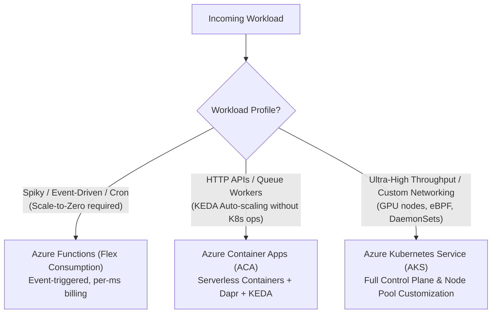
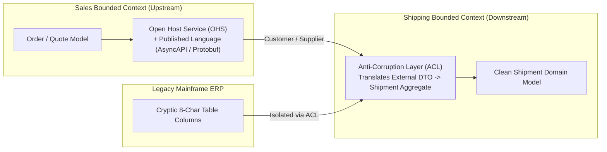
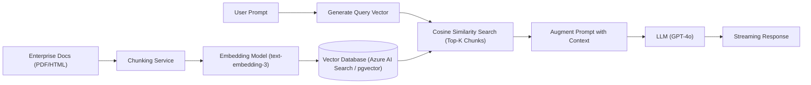

# Module 08 — System Design & Architecture

**Senior Software Engineer Academy · Module 08 of 12**

> **Learning objective:** Master large-scale system design, strategic and tactical Domain-Driven Design (DDD), high-availability multi-region architectures, quality attribute trade-offs, and modern AI-powered RAG systems. Develop the structured communication methodology required to lead 45–60 minute Senior and Staff Software Engineer system design interviews: gathering requirements, performing back-of-the-envelope capacity estimations, sketching high-level component diagrams, drilling into distributed bottlenecks, and defending architectural trade-offs with authority.
>
> **Audience:** Experienced C#/.NET engineers preparing for Senior, Lead, Staff, and Principal software engineering interviews and enterprise architecture reviews. Experience in cloud environments (Azure/AWS), microservices, and databases is assumed; capacity math, context mapping, and multi-tenant isolation patterns are taught with rigorous precision.
>
> **Version note:** Architectural reference designs target modern Microsoft Azure and cloud-native patterns (.NET 8/9, Azure Front Door, Azure Container Apps, AKS, Azure Cosmos DB, Azure Service Bus, Azure Key Vault, Azure AI Search).

## How to use this module

Every section in Part II provides comprehensive senior-level instruction:
1. **Methodology & Estimation Framework:** Step-by-step interview time-boxing, QPS calculations, and storage sizing.
2. **Architectural Schematics:** Concrete Mermaid component diagrams illustrating end-to-end cloud flows.
3. **Enterprise Production Scenarios:** Diagnosing noisy neighbors, multi-region failover splits, hot partition throttling, and cascading service outages.
4. **Trade-offs, Alternatives & Failure Modes:** When microservices fail, when to choose a modular monolith, and when active-active geo-replication is too costly.
5. **What a Senior Engineer Is Expected to Know:** Mid-level vs Senior/Staff architectural judgment.
6. **Interview Questions with Model Answers:** Real interview questions with structured, senior-level responses.
7. **Practical Exercises:** Full design challenges with requirements and capacity constraints.

## Progress tracker

| Section | Topic | Status |
|---|---|---|
| Section 1 | The Senior System Design Interview Framework & Estimation | Complete |
| Section 2 | Quality Attributes, SLAs & Availability Mathematics | Complete |
| Section 3 | Scaling Infrastructure: Compute, Load Balancing & Networking | Complete |
| Section 4 | System-Level Caching Architecture & CDN Topologies | Complete |
| Section 5 | Storage Tier Selection & Polyglot Persistence | Complete |
| Section 6 | Strategic Domain-Driven Design (DDD) & Context Mapping | Complete |
| Section 7 | Tactical Domain-Driven Design (DDD) in C# | Complete |
| Section 8 | Architectural Styles: Monolith, Microservices & Serverless | Complete |
| Section 9 | High Availability (HA), Multi-Region & Disaster Recovery (DR) | Complete |
| Section 10 | Multi-Tenant SaaS Architecture & Isolation Models | Complete |
| Section 11 | Enterprise Security Architecture & Threat Modeling (STRIDE) | Complete |
| Section 12 | Architecture Decisions, Documentation & C4 Modeling | Complete |
| Section 13 | AI-Powered System Design: RAG & Vector Search Architectures | Complete |
| Section 14 | Classic System Design Case Studies & Capstone | Complete |

**Current position:** Full curriculum complete. Ready for self-study, exercises, and interview drills.

## Module boundaries

- **This module owns:** System design interview framework, back-of-the-envelope estimation, high-level cloud architecture, strategic/tactical DDD, architectural styles, multi-tenancy models, high availability/disaster recovery, ADRs, C4 modeling, and RAG architectures.
- **Related topics owned by other modules:**
  - Object-oriented mechanics, SOLID principles, and coupling/cohesion → Module 01
  - Data structure selection and Big O analysis → Module 02
  - CoreCLR runtime memory layouts, thread pool, and async internals → Module 03
  - In-process design patterns, GoF patterns, and Clean Architecture → Module 04
  - Relational database indexing, SQL tuning, and transactions → Module 05
  - HTTP protocols, REST, gRPC, and OAuth2/OIDC → Module 06
  - Distributed systems theory (CAP/PACELC, Sagas, Outbox, Raft, messaging) → Module 07
  - DevOps, Kubernetes, CI/CD, and IaC → Module 11

---

# Part I — Complete Curriculum

## Section 1 — The Senior System Design Interview Framework & Estimation
- 1.1 The 5-Stage System Design Interview Protocol:
  - Stage 1: Clarify Requirements & Scope (Functional vs Non-Functional) (5 mins).
  - Stage 2: Back-of-the-Envelope Capacity Estimation (QPS, Bandwidth, Storage, Memory) (5 mins).
  - Stage 3: High-Level Architectural Blueprint (API, Core Components, Data Flow) (15 mins).
  - Stage 4: Deep Dive into Critical Bottlenecks & Failure Modes (20 mins).
  - Stage 5: Wrap-up, Trade-offs & Future Evolution (5 mins).
- 1.2 Back-of-the-Envelope Estimation Mastery: Converting Daily Active Users (DAU) to Queries Per Second (QPS); Peak QPS multiplier ($2\times \text{ to } 5\times$); Storage calculations across 5-year retention windows; Memory cache sizing using the Pareto 80/20 rule.

## Section 2 — Quality Attributes, SLAs & Availability Mathematics
- 2.1 The "-ilities": Scalability, Availability, Reliability, Latency, Throughput, Durability, Maintainability, Cost.
- 2.2 Service Level Terminology: SLA (commitment), SLO (target), SLI (actual measured metric), Error Budget.
- 2.3 The Availability Math of "Nines":
  - 99% (Two 9s) = 3.65 days downtime / year.
  - 99.9% (Three 9s) = 8.76 hours downtime / year.
  - 99.99% (Four 9s) = 52.6 minutes downtime / year.
  - 99.999% (Five 9s) = 5.26 minutes downtime / year.
- 2.4 Composite Availability: Series dependency ($A_{\text{total}} = A_1 \times A_2$) vs Parallel redundancy ($A_{\text{total}} = 1 - (1 - A_1) \times (1 - A_2)$).

## Section 3 — Scaling Infrastructure: Compute, Load Balancing & Networking
- 3.1 Scaling Dimensions: Vertical Scaling (Scale Up) vs Horizontal Scaling (Scale Out); The Stateless Service Imperative.
- 3.2 Load Balancing Topology: Layer 4 (Transport TCP/UDP - high throughput packet forwarding) vs Layer 7 (Application HTTP/HTTPS - URL routing, SSL termination, cookie affinity).
- 3.3 Azure Load Balancing Hierarchy: Azure Front Door (Global L7 + WAF + CDN), Azure Application Gateway (Regional L7), Azure Load Balancer (Regional L4).

## Section 4 — System-Level Caching Architecture & CDN Topologies
- 4.1 Multi-Tier Caching Strategy: Client Browser $\to$ CDN (Edge) $\to$ API Gateway $\to$ Application Cache (Redis) $\to$ Database Buffer Pool.
- 4.2 Cache Topologies: Distributed Shared Cache (Redis Cluster) vs Local In-Memory Cache (MemoryCache) vs Replicated Cache.
- 4.3 Cache Invalidation & Consistency: Write-Through vs Cache-Aside vs Write-Behind; Thundering Herd / Cache Stampede mitigation via distributed mutexes and .NET 9 `HybridCache`.

## Section 5 — Storage Tier Selection & Polyglot Persistence
- 5.1 Storage Archetypes: Relational (SQL Server, PostgreSQL), Document (Azure Cosmos DB, MongoDB), Key-Value (Redis), Blob/Object (Azure Blob Storage), Search Engine (Azure AI Search, Elasticsearch), Vector Database (pgvector, Qdrant).
- 5.2 Polyglot Persistence Architecture: Designing a system where each business capability utilizes the storage engine optimized for its specific read/write access patterns.

## Section 6 — Strategic Domain-Driven Design (DDD) & Context Mapping
- 6.1 Subdomain Categorization: Core Domain (competitive advantage), Supporting Subdomain (custom but non-differentiating), Generic Subdomain (off-the-shelf software).
- 6.2 Bounded Contexts: Defining explicit conceptual boundaries within which a domain model and Ubiquitous Language are strictly valid.
- 6.3 Context Mapping Relationships: Shared Kernel, Customer/Supplier, Conformist, Anti-Corruption Layer (ACL), Open Host Service (OHS) / Published Language.

## Section 7 — Tactical Domain-Driven Design (DDD) in C#
- 7.1 Tactical Building Blocks: Entities (identity), Value Objects (structural immutability), Aggregate Roots (consistency boundary), Domain Events, Domain Services.
- 7.2 Aggregate Sizing Rules: Keeping aggregates small; referencing other aggregates by Identity (`OrderId`), never by object reference; modifying only one aggregate per transaction.

## Section 8 — Architectural Styles: Monolith, Microservices & Serverless
- 8.1 Architectural Spectrum: Layered Monolith, Modular Monolith, Microservices, Event-Driven Architecture, Serverless (Azure Functions).
- 8.2 The Microservices Distributed Tax: Network latency, distributed transactions, data consistency, operational complexity, CI/CD overhead; why starting with a Modular Monolith is often the superior choice.
- 8.3 Migration Strategies: The Strangler Fig Pattern for migrating legacy monoliths to microservices incrementally without high-risk rewrites.

## Section 9 — High Availability (HA), Multi-Region & Disaster Recovery (DR)
- 9.1 Redundancy Topologies: Active-Passive (Hot/Cold Standby, Warm Standby) vs Active-Active (Multi-Region read/write).
- 9.2 Disaster Recovery Metrics: Recovery Point Objective (RPO) and Recovery Time Objective (RTO).
- 9.3 Azure Availability Zones & Traffic Routing: Zone-redundant services; global traffic routing via Azure Front Door / Traffic Manager.

## Section 10 — Multi-Tenant SaaS Architecture & Isolation Models
- 10.1 Tenancy Models:
  - Silo Model: Dedicated compute and dedicated database per tenant (maximum isolation, highest cost).
  - Pool Model: Shared compute and shared database with `TenantId` column (lowest cost, multi-tenant noisy neighbor risk).
  - Bridge / Hybrid Model: Shared compute with dedicated databases per tenant, or pooled basic tier with siloed enterprise tier.
- 10.2 Tenant Routing & Context Resolution: Resolving tenant identity via subdomain (`tenant1.app.com`), HTTP header, or JWT claims in ASP.NET Core middleware.

## Section 11 — Enterprise Security Architecture & Threat Modeling (STRIDE)
- 11.1 Zero Trust Principles: Verify explicitly, use least privileged access, assume breach.
- 11.2 Network Security in Azure: Virtual Networks (VNets), Subnets, Network Security Groups (NSGs), Private Endpoints, Azure Bastion.
- 11.3 STRIDE Threat Modeling: Spoofing, Tampering, Repudiation, Information Disclosure, Denial of Service, Elevation of Privilege.

## Section 12 — Architecture Decisions, Documentation & C4 Modeling
- 12.1 Architecture Decision Records (ADRs): Title, Status, Context, Decision, Consequences.
- 12.2 The C4 Model: Context (System-level actors), Containers (Deployable applications/databases), Components (Internal architectural modules), Code (Class diagrams).

## Section 13 — AI-Powered System Design: RAG & Vector Search Architectures
- 13.1 Retrieval-Augmented Generation (RAG) Architecture: Ingestion pipeline (Document parsing $\to$ Chunking $\to$ Embedding generation $\to$ Vector indexing); Retrieval pipeline (User query $\to$ Query embedding $\to$ Vector similarity search $\to$ Prompt augmentation $\to$ LLM generation).
- 13.2 Vector Search Mechanics: Cosine similarity vs Dot Product; Approximate Nearest Neighbors (HNSW algorithm).
- 13.3 Production Considerations: Semantic caching, token cost management, rate limiting, and guardrails.

## Section 14 — Classic System Design Case Studies & Capstone
- 14.1 Case Study 1: High-Scale URL Shortener (TinyURL) — 100M URLs/month, Base62 encoding, distributed collision-free key generation.
- 14.2 Case Study 2: Distributed Rate Limiter — 500,000 QPS, Redis sliding window counter, token bucket fallback.
- 14.3 Case Study 3: Global Notification Platform — Push, SMS, Email, prioritization, provider failover.
- 14.4 Case Study 4: Multi-Tenant Enterprise Document Processing Engine on Azure — End-to-end cloud architecture.

---

# Part II — Lessons

## Section 1 — The Senior System Design Interview Framework & Estimation

### 1.1 The 5-Stage System Design Interview Protocol

A 45-to-60-minute system design interview tests your ability to navigate ambiguity, drive technical consensus, make explicit trade-offs, and design scalable architectures under time pressure.

```text
[ 00:00 - 05:00 ]  STAGE 1: Clarify Requirements & Scope (Functional & Non-Functional)
[ 05:00 - 10:00 ]  STAGE 2: Back-of-the-Envelope Estimation (QPS, Storage, Bandwidth, Memory)
[ 10:00 - 25:00 ]  STAGE 3: High-Level Architecture (API Contracts, Components, Data Flow)
[ 25:00 - 45:00 ]  STAGE 4: Deep Dive into Bottlenecks, Data Models & Failure Modes
[ 45:00 - 50:00 ]  STAGE 5: Wrap-up, Trade-offs, Operational Monitoring & Future Evolution
```

---

### 1.2 Back-of-the-Envelope Estimation Mastery

#### The Golden Conversion Rule:
There are **86,400 seconds in a day** ($\approx 10^5 \text{ seconds}$).
$$\text{Average QPS} = \frac{\text{Daily Requests}}{86,400}\approx \frac{\text{Daily Requests}}{10^5}$$
$$\text{Peak QPS} = \text{Average QPS} \times 2 \text{ (or } 3\times \text{ to } 5\times \text{ for spiky traffic)}$$

#### Example Worked Estimation: High-Scale URL Shortener
- **Traffic Assumptions:**
  - 100 Million new URLs created per month.
  - Read-to-Write ratio: $10:1$ (1 Billion reads per month).
- **Write QPS:**
  $$\text{Write QPS} = \frac{100,000,000 \text{ writes}}{30 \times 86,400}\approx \frac{10^8}{2.6 \times 10^6}\approx \mathbf{40 \text{ writes/second}}$$
- **Read QPS:**
  $$\text{Read QPS} = 40 \times 10 = \mathbf{400 \text{ reads/second}}$$
  $$\text{Peak Read QPS} = 400 \times 3 = \mathbf{1,200 \text{ reads/second}}$$
- **Storage Calculations (5-Year Horizon):**
  - Total URLs stored in 5 years: $100\text{M} \times 12 \times 5 = \mathbf{6 \text{ Billion URLs}}$.
  - Bytes per record:
    - `ShortURL` (7 chars): 7 bytes
    - `OriginalURL` (string): 500 bytes
    - `CreatedAt` (timestamp): 8 bytes
    - `UserId` (UUID): 16 bytes
    - Total per row $\approx 550 \text{ bytes}$.
  - Total 5-Year Storage:
    $$\text{Storage} = 6 \times 10^9 \times 550 \text{ bytes}\approx 3.3 \text{ Terabytes (TB)}$$
    *(Senior Insight: 3.3 TB is small enough to fit on a single modern high-capacity SSD or small relational/NoSQL cluster! We do NOT need massive sharding for storage volume alone.)*
- **Memory Cache Sizing (Pareto 80/20 Rule):**
  - Cache the top 20% most popular URLs requested daily:
  - Daily read requests: $\frac{10^9}{30}\approx 33.3 \text{ Million reads/day}$.
  - Memory required to cache 20% of daily reads:
    $$\text{Cache Memory} = 33.3 \times 10^6 \times 0.20 \times 550 \text{ bytes}\approx 3.66 \text{ GB of RAM}$$
    *(Senior Insight: A single modest 16 GB Redis cluster can easily cache 20% of daily traffic with plenty of headroom!)*

### Section 1 Review: Interview Questions & Practice Exercises

#### Interview Questions & Model Answers

**Q1: In a 45-minute system design interview, candidates often run out of time before reaching the deep dive or operational failure modes. How do you structure your time and steer the conversation as a Staff-level candidate?**
> **Model Answer:** I treat the 45-minute interview as a structured architectural review with explicit time-boxes and checkpoints:
> 1. **Minutes 0–5 (Requirements & Scope):** I never draw a single box until I clarify functional boundaries (top 3–4 core user journeys) and non-functional quality attributes (read-to-write ratio, P99 latency target, consistency vs. availability preference under CAP/PACELC, and scale targets).
> 2. **Minutes 5–10 (Back-of-the-Envelope Math):** I translate DAU into average and peak QPS, bandwidth, memory cache size (80/20 Pareto rule), and 5-year storage footprint. Crucially, I always state the *architectural conclusion* of each number (e.g., *"At 40 writes/sec and 3.3 TB over 5 years, a single primary PostgreSQL instance with read replicas suffices for storage; our real bottleneck is peak read concurrency and hot keys"*).
> 3. **Minutes 10–25 (High-Level Blueprint):** I sketch the end-to-end data flow for both the write path and read path: API contracts (REST/gRPC headers, status codes, idempotency keys), edge routing, stateless services, caching tier, and primary data stores.
> 4. **Minutes 25–40 (Deep Dive into Bottlenecks):** I proactively identify the 2–3 hardest distributed engineering problems in my diagram (e.g., hot partition mitigation, distributed lock contention, dual-write avoidance via transactional outbox) and ask the interviewer which area they want to drill into first.
> 5. **Minutes 40–45 (Wrap-Up & Operational Readiness):** I summarize key trade-offs, observability (SLIs/SLOs, error budgets, distributed tracing), and how the architecture evolves at $10\times$ scale.

**Q2: Why is performing back-of-the-envelope capacity estimation before drawing the architecture considered a critical senior signal, and when can naive estimation mislead you?**
> **Model Answer:** Capacity estimation prevents both **premature over-engineering** (e.g., introducing complex multi-master sharded NoSQL clusters for a workload that generates 500 GB over 5 years and 80 writes/sec) and **fatal under-engineering** (e.g., trying to funnel 150,000 writes/sec through a single relational primary). However, naive *average* QPS math is a classic trap. Traffic is rarely uniform: a flash sale, breaking news event, or celebrity post can create a $10\times\text{–}50\times$ spike on a single partition key within seconds. Therefore, senior engineers always estimate **Peak QPS** ($2\times\text{–}5\times$ average) and evaluate **data skew / hot-key concentration** alongside raw averages.

**Q3: How do you apply the Pareto Principle (80/20 rule) when sizing a distributed memory cache like Azure Managed Redis?**
> **Model Answer:** The Pareto Principle states that roughly 80% of read traffic is generated by 20% of active items. Instead of sizing RAM to hold the entire 5-year historical dataset, we size the cache to hold **20% of the daily active unique records**, multiplied by the serialized object size plus ~30% Redis hash-table/pointer metadata overhead and a fragmentation safety buffer (keeping memory utilization below 75% to avoid eviction thrashing).

#### Practice Exercises

1. **Exercise 1.1 — Pastebin / GitHub Gist Capacity Estimation:**
   Design the capacity math for a global Pastebin service with **50 Million DAU**, where each user creates on average **0.1 pastes/day** (average paste size: **10 KB** of text) and reads **5 pastes/day**. Retention is **10 years**. Calculate:
   - Average and Peak ($3\times$) Write QPS and Read QPS.
   - Ingress and Egress network bandwidth in $\text{MB/s}$ at peak.
   - Total 10-year raw storage + $1.5\times$ index/replication overhead in $\text{TB}$.
   - Redis memory required to cache the top 20% of daily read pastes.
2. **Exercise 1.2 — Scoping an Ambiguous Prompt:**
   You are given the prompt: *"Design Uber Eats."* Write out the exact 6–8 clarifying questions (functional and non-functional) you would ask in the first 4 minutes, and define explicit numeric assumptions for DAU, concurrent active orders, driver GPS ping frequency, and P99 latency targets.

---

## Section 2 — Quality Attributes, SLAs & Availability Mathematics

### 2.1 Composite Availability Math

When services depend on one another, their individual availabilities compound:

#### 1. Series Dependency (Weakest Link):
If Service A ($99.9\%$) requires Service B ($99.9\%$) synchronously to complete a request:
$$A_{\text{total}} = A_1 \times A_2 = 0.999 \times 0.999 = 0.998001\approx \mathbf{99.8\%}$$
*Senior Takeaway:* Synchronously chaining five $99.9\%$ microservices drops your composite system availability to **$99.5\%$ (over 43 hours of downtime per year!)**.

#### 2. Parallel Redundancy (Resilient Fallback):
If Service A has a primary instance and an active-active secondary replica, both with $99.9\%$ availability:
$$A_{\text{total}} = 1 - (1 - A_1) \times (1 - A_2) = 1 - (0.001 \times 0.001) = 1 - 0.000001 = \mathbf{99.9999\%}$$

---

### 2.2 Latency Numbers Every Senior Engineer Must Know & Full Worked Estimation (100M DAU Notification Platform)

To defend architectural choices in an interview, you must have an intuitive grasp of order-of-magnitude hardware and network latencies.

#### Latency Reference Table (Modern Cloud Hardware)

| Operation | Typical Latency | Order of Magnitude | Architectural Implication |
|---|---|---|---|
| **L1 Cache Reference** | $0.5\text{ ns}\text{–}1\text{ ns}$ | Nanoseconds | CPU register / L1 hot loop |
| **L2 Cache Reference** | $4\text{ ns}\text{–}7\text{ ns}$ | Nanoseconds | Cache-line friendly structs (`Span<T>`) |
| **Branch Mispredict / Mutex Lock** | $5\text{ ns}\text{–}25\text{ ns}$ | Tens of ns | Uncontended `Interlocked` / lock |
| **Main Memory (RAM) Reference** | $80\text{ ns}\text{–}100\text{ ns}$ | $0.1\ \mu\text{s}$ | Local in-memory cache (`IMemoryCache`) |
| **Compress 1 KB with Snappy / LZ4** | $2\ \mu\text{s}\text{–}3\ \mu\text{s}$ | Microseconds | Always compress payloads before network/disk I/O |
| **NVMe SSD Random Read (4 KB)** | $20\ \mu\text{s}\text{–}100\ \mu\text{s}$ | $0.1\text{ ms}$ | Local NVMe is $100\times$ faster than spinning disk |
| **Intra-Datacenter Round Trip (Same AZ)** | $0.2\text{ ms}\text{–}0.5\text{ ms}$ | Sub-millisecond | Redis / DB call within the same Availability Zone |
| **Inter-Zone RTT (Cross-AZ in Same Region)** | $1\text{ ms}\text{–}2\text{ ms}$ | Low milliseconds | Synchronous replication tax across 3 AZs |
| **Read 1 MB Sequentially from SSD** | $0.5\text{ ms}\text{–}1\text{ ms}$ | $1\text{ ms}$ | Sequential log append (Kafka / WAL) is blazingly fast |
| **Cross-Continent RTT (US East $\leftrightarrow$ EU West)** | $75\text{ ms}\text{–}150\text{ ms}$ | $\sim 100\text{ ms}$ | Speed-of-light in fiber limit; requires CDN / geo-routing |

#### Full Worked Estimation: 100M DAU Global Notification Platform

Suppose we are designing an enterprise notification platform (Push, SMS, Email, In-App) serving **100 Million Daily Active Users (DAU)**:

1. **Traffic & Request Volume Assumptions:**
   - Each DAU receives an average of **20 notifications/day** (15 Push, 3 Email, 1.5 In-App, 0.5 SMS).
   - Total notifications dispatched per day:
     $$\text{Daily Volume} = 100 \times 10^6 \times 20 = 2 \times 10^9\text{ notifications/day (2 Billion/day)}$$
   - Average payload size (JSON metadata + rendered body + device tokens): **$2\text{ KB}$**.

2. **Average RPS & Peak RPS:**
   - Using $1\text{ day} = 86,400\text{ s} \approx 10^5\text{ s}$:
     $$\text{Average RPS} = \frac{2 \times 10^9}{86,400} \approx \mathbf{23,150\text{ notifications/sec}}$$
   - Marketing campaigns and breaking alerts cause sharp bursts ($4\times$ peak multiplier):
     $$\text{Peak RPS} = 23,150 \times 4 \approx \mathbf{92,600\text{ notifications/sec}} \ (\approx 100,000\text{ RPS})$$

3. **Network Bandwidth ($\text{MB/s}$):**
   - **Average Egress Bandwidth:**
     $$\text{Bandwidth}_{\text{avg}} = 23,150\text{ req/s} \times 2\text{ KB} \approx 46.3\text{ MB/s} \ (\approx 370\text{ Mbps})$$
   - **Peak Egress Bandwidth:**
     $$\text{Bandwidth}_{\text{peak}} = 92,600\text{ req/s} \times 2\text{ KB} \approx \mathbf{185.2\text{ MB/s}} \ (\approx 1.48\text{ Gbps})$$

4. **Redis RAM Sizing (User Preferences, Device Tokens & Deduplication):**
   - We cache active user device tokens & notification opt-in preferences ($500\text{ bytes}$ per user) for all $100\text{M}$ DAU:
     $$\text{User Cache} = 100 \times 10^6 \times 500\text{ bytes} = 50\text{ GB}$$
   - We store 24-hour idempotency keys (`NotificationId` + status = $64\text{ bytes}$) for all $2\text{B}$ daily events to guarantee at-most-once user-visible delivery:
     $$\text{Dedup Cache} = 2 \times 10^9 \times 64\text{ bytes} = 128\text{ GB}$$
   - Adding $30\%$ Redis overhead: $(50 + 128) \times 1.3 \approx \mathbf{231.4\text{ GB of Redis RAM}}$ (e.g., an Azure Managed Redis Enterprise cluster with 10 shards $\times$ 32 GB).

5. **5-Year Audit & Delivery Log Storage ($\text{TB}$):**
   - Only compact metadata ($500\text{ bytes}$ per notification) is archived for 5 years for compliance/analytics:
     $$\text{5-Year Storage} = 2 \times 10^9\text{ /day} \times 365\text{ days} \times 5\text{ years} \times 500\text{ bytes} \approx \mathbf{1,825\text{ TB}} \ (\approx 1.83\text{ PB})$$
   - *Architectural Conclusion:* $1.83\text{ PB}$ cannot live in hot relational storage (\$\$). We keep **30 days** ($\approx 30\text{ TB}$) in partitioned hot storage (Cosmos DB / Cassandra) and tier older logs into compressed Parquet files on **Azure Blob Cool/Archive Storage** at a fraction of the cost.

---

### Section 2 Review: Interview Questions & Practice Exercises

#### Interview Questions & Model Answers

**Q1: Explain the difference between SLI, SLO, SLA, and Error Budget. How do you use an Error Budget to resolve tension between product velocity and SRE stability?**
> **Model Answer:**
> - **SLI (Service Level Indicator):** The quantitative telemetry metric measuring service health from the user's perspective—for example, the proportion of HTTP requests returning non-`5xx` responses with P99 latency $< 200\text{ ms}$.
> - **SLO (Service Level Objective):** The internal engineering target for an SLI over a rolling window (e.g., $99.95\%$ of requests succeed under $200\text{ ms}$ over 30 days).
> - **SLA (Service Level Agreement):** The external legal/commercial contract with customers (usually looser than the internal SLO, e.g., $99.9\%$), carrying financial penalties or service credits if breached.
> - **Error Budget:** $\text{Error Budget} = 1 - \text{SLO}$. For a $99.9\%$ monthly SLO, the error budget is $0.1\%$, or $43.2\text{ minutes}$ of allowable unavailability per month. While the team has remaining error budget, they can ship risky features and experiments rapidly; if a faulty deployment burns through the monthly error budget, feature releases are frozen until reliability regressions and post-mortem action items are resolved.

**Q2: Your payment checkout API calls four downstream microservices synchronously (Cart, Fraud, Inventory, Ledger), and also depends on an Azure SQL Database. Every service has a $99.9\%$ SLO. What is your effective availability, and how do you redesign the flow to achieve $99.99\%$?**
> **Model Answer:** Five synchronous components in series each at $99.9\%$ yield a composite availability of $0.999^5 \approx 99.50\%$ ($\approx 43.8\text{ hours}$ of downtime/year)—far below $99.99\%$ ($52.6\text{ minutes}$/year). To reach $99.99\%$:
> 1. **Eliminate synchronous serial coupling:** Decouple non-blocking steps (e.g., Ledger posting, receipt emails, analytics) behind an asynchronous durable message bus (Azure Service Bus) using the Transactional Outbox pattern.
> 2. **Cache read dependencies locally:** Replicate product/inventory reference data locally or in a multi-AZ Redis cluster so Cart/Inventory checks don't require cross-service RPCs.
> 3. **Deploy multi-region active-active redundancy:** Deploying the streamlined checkout core across two independent Azure regions in parallel raises availability from $A = 0.999$ per region to $1 - (1 - 0.999)^2 = 99.9999\%$.

#### Practice Exercises

1. **Exercise 2.1 — Composite Availability Calculation:**
   An API Gateway ($99.99\%$) routes to a stateless compute tier deployed redundantly across 2 Availability Zones (each zone has $99.9\%$ availability), which then queries a single-primary database ($99.95\%$). Calculate the exact end-to-end availability percentage and total expected downtime in minutes per year.
2. **Exercise 2.2 — Latency Budget Allocation:**
   Your product requires a strict **P99 latency of $150\text{ ms}$** for a personalized feed endpoint accessed across the Atlantic (US user hitting an EU datacenter). Using the latency reference table, prove why a single-region EU deployment with 3 sequential database queries will violate the budget, and allocate a millisecond-by-millisecond latency budget using Anycast CDN edge termination and regional read replicas.

---

## Section 3 — Architectural Styles: Modular Monoliths, Microservices & Serverless

### 3.1 Modular Monolith vs Microservices Trade-Off Matrix & Module Boundary Enforcement

One of the highest-signal discussions in a Senior/Staff interview is explaining **why starting with a Modular Monolith is frequently superior to jumping straight into Microservices**, and how to enforce strict module boundaries inside a single deployment unit so it doesn't degrade into a "Big Ball of Mud."

#### Architectural Trade-Off Matrix

| Dimension | Layered Monolith (Big Ball of Mud) | Modular Monolith | Microservices Architecture |
|---|---|---|---|
| **Communication Latency** | In-process memory call ($\sim 1\text{ ns}$) | In-process interface / mediator call ($\sim 10\text{ ns}$) | Network RPC + serialization ($0.5\text{ ms}\text{–}5\text{ ms}$) |
| **Data Consistency** | Shared tables, uncontrolled joins | Logical schema isolation per module; ACID or local Outbox | Strict DB-per-service; eventual consistency via Sagas |
| **Deployment Unit** | Single binary | Single binary (independent module assemblies) | Independent container/process per service |
| **Operational / DevOps Tax** | Low | Low (single CI/CD pipeline, simple debugging) | High (Service Mesh, distributed tracing, k8s, contract testing) |
| **Team Scaling Sweet Spot** | 1–5 engineers | 5–40 engineers across domain squads | 40+ engineers with independent release cadences |
| **Failure Blast Radius** | Total process crash | Shared memory/CPU blast radius (mitigated via bulkheads) | Process-isolated (if circuit breakers & timeouts exist) |

#### Enforcing Modular Monolith Boundaries in C#

A Modular Monolith only succeeds if **compile-time and test-time guardrails** forbid Module A (`Ordering`) from referencing internal types or querying database tables owned by Module B (`Billing`):

1. **Project & Visibility Isolation:** Each module splits into `Modules.Ordering.Contracts` (public integration events and DTOs) and `Modules.Ordering.Internal` (`internal` domain entities, handlers, and EF Core `DbContext`).
2. **Separate Database Schemas per Module:** Even inside a single PostgreSQL/SQL Server database, `OrderingDbContext` maps exclusively to schema `ordering.*` and `BillingDbContext` maps to `billing.*`, with cross-schema foreign keys and joins strictly forbidden.
3. **Automated Architecture Tests (ArchUnitNET / NetArchTest):** Run in CI on every pull request to fail the build if a boundary violation is introduced.

```csharp
using System.Reflection;
using Microsoft.EntityFrameworkCore;

namespace EnterpriseArchitecture.ModularMonolith;

// 1. Public Contract Assembly: Only immutable DTOs and Integration Events are public
public sealed record OrderPlacedIntegrationEvent(
    Guid OrderId,
    Guid CustomerId,
    decimal TotalAmount,
    string Currency,
    DateTimeOffset OccurredAtUtc);

public interface IBillingModuleClient
{
    Task<InvoiceResultDto> IssueInvoiceAsync(Guid orderId, decimal amount, CancellationToken ct);
}

public sealed record InvoiceResultDto(Guid InvoiceId, bool IsSuccess);

// 2. Isolated DbContext per Module enforcing distinct database schemas
internal sealed class OrderingDbContext : DbContext
{
    public OrderingDbContext(DbContextOptions<OrderingDbContext> options) : base(options) { }

    protected override void OnModelCreating(ModelBuilder modelBuilder)
    {
        // Strict schema boundary: Ordering module only touches the 'ordering' schema
        modelBuilder.HasDefaultSchema("ordering");
        modelBuilder.ApplyConfigurationsFromAssembly(Assembly.GetExecutingAssembly());
    }
}
```

---

### 3.2 Event-Driven & Serverless Compute Topologies (AKS vs Azure Container Apps vs Azure Functions)

Choosing the right cloud compute substrate requires balancing **control, cold-start latency, scale-to-zero economics, and operational overhead**:



1. **Azure Functions (Serverless FaaS):**
   - **Strengths:** True pay-per-execution and sub-second KEDA event scaling; **Durable Functions** provide stateful workflow orchestration (Fan-Out/Fan-In, Async HTTP polling, Saga compensation) via event-sourced storage queues.
   - **Trade-offs:** Cold starts ($500\text{ ms}\text{–}3\text{ s}$ on standard consumption plans unless using Flex Consumption pre-warmed instances or Native AOT). Execution duration limits make it unsuitable for long-lived WebSockets or heavy steady-state compute.
2. **Azure Container Apps (ACA):**
   - **Strengths:** Abstracts away Kubernetes cluster upgrades and node management while providing native **KEDA (Kubernetes Event-Driven Autoscaling)** rules (scale from 0 to 100 replicas based on Azure Service Bus queue depth, Kafka lag, or concurrent HTTP requests) and built-in **Dapr** sidecars.
   - **Trade-offs:** Less low-level control over Linux kernel flags, custom CNI plugins, or DaemonSets than raw AKS.
3. **Azure Kubernetes Service (AKS):**
   - **Strengths:** Complete control over node pools (spot instances, confidential VMs, GPU nodes), service mesh (Istio/Linkerd), eBPF networking (Cilium), and custom scheduling.
   - **Trade-offs:** High operational burden—requires dedicated platform engineering for cluster upgrades, pod disruption budgets, and node bin-packing.

---

### Section 3 Review: Interview Questions & Practice Exercises

#### Interview Questions & Model Answers

**Q1: A startup CTO tells you: "We have 8 backend developers and we're building 15 microservices from day one so we never have to rewrite our monolith." How do you advise them?**
> **Model Answer:** I would strongly advise against starting with 15 microservices for an 8-person team. In an early-stage domain, bounded contexts are not yet well understood—getting service boundaries wrong across network boundaries results in a **Distributed Monolith**, which combines the worst of both worlds: tight logical coupling where every feature requires coordinated deployments across 5 services, plus the full **Microservices Distributed Tax** (network serialization latency, distributed transactions/Sagas, partial failure handling, and 15 CI/CD pipelines). Instead, start with a **Modular Monolith**: isolate domains into strict C# assemblies and separate database schemas (`ordering.*`, `billing.*`, `catalog.*`), communicate via in-process contracts or an internal event bus, and extract a specific module into an independent microservice later *only* when independent scaling, resource isolation (e.g., CPU-heavy media encoding), or organizational growth (Conway's Law) demands it.

**Q2: How do you mitigate Serverless cold starts in .NET 8/9 when using Azure Functions or Azure Container Apps scaled to zero?**
> **Model Answer:** Cold starts comprise container/environment provisioning, .NET runtime initialization, DI container build, and JIT compilation. We mitigate them at three layers:
> 1. **Compiler / Runtime Level:** Publish with **Native AOT (`<PublishAot>true</PublishAot>`)** or **ReadyToRun (`<PublishReadyToRun>true</PublishReadyToRun>`)**, trimming unused assemblies and eliminating JIT compilation overhead on the first request (reducing .NET startup from $>1\text{ s}$ to $<80\text{ ms}$).
> 2. **Dependency Injection Hygiene:** Defer heavy SDK client initialization (`Lazy<T>`) and avoid synchronous key-vault/config network fetches inside `Program.cs` startup.
> 3. **Infrastructure Level:** Use **Azure Functions Flex Consumption** with always-ready instances for latency-sensitive HTTP paths, or configure KEDA `minReplicas: 1` during business hours with predictive scaling before known traffic peaks.

#### Practice Exercises

1. **Exercise 3.1 — Modular Monolith Extraction Plan:**
   You have a Modular Monolith with three modules (`Users`, `Catalog`, `SearchIndexing`). `SearchIndexing` consumes $85\%$ of CPU during bulk merchant catalog uploads, starving `Users` login requests. Design the step-by-step extraction of `SearchIndexing` into an Azure Container App scaled via KEDA without changing the `Catalog` module's public domain logic.
2. **Exercise 3.2 — Compute Cost & Latency Trade-Off Analysis:**
   Compare running a steady-state $5,000\text{ RPS}$ payment API on Azure Functions vs. AKS reserved instances, and compare running a nightly 15-minute PDF statement generator (500,000 PDFs once a day) on the same two platforms. Justify which compute model wins for each workload.

---

## Section 4 — Domain-Driven Design (DDD): Strategic & Tactical Patterns

### 4.1 Strategic DDD: Ubiquitous Language, Subdomains, Bounded Contexts & Context Mapping

Strategic DDD solves the hardest problem in enterprise architecture: preventing a single bloated "canonical data model" (e.g., a 200-column `Customer` or `Product` class shared by every team) from paralyzing engineering velocity.

#### 1. Subdomain Classification
- **Core Subdomain:** Where the company generates its proprietary competitive edge (e.g., dynamic surge pricing & driver matching at Uber; algorithmic risk engine at a hedge fund). *Strategy:* Assign your strongest senior engineers, apply full tactical DDD, build in-house, never outsource.
- **Supporting Subdomain:** Necessary for the business and tailored to its workflows, but not a market differentiator (e.g., driver onboarding document verification, merchant promotions catalog). *Strategy:* Keep simple (CRUD / Active Record / Transaction Script) so it doesn't drain engineering bandwidth from the Core Domain.
- **Generic Subdomain:** Solved problems common to all businesses (e.g., Identity/OAuth2, payment card clearing, email/SMS delivery, general ledger accounting). *Strategy:* Buy SaaS (Auth0/Entra ID, Stripe, SendGrid) or adopt battle-tested open-source solutions.

#### 2. Bounded Contexts & Ubiquitous Language
A **Bounded Context** is an explicit semantic boundary within which a particular **Ubiquitous Language** (shared vocabulary between domain experts and code) has a single, unambiguous meaning.
- Inside the **Catalog Context**, a `Product` has a `Title`, `Description`, `MediaUrls`, and `DisplayPrice`.
- Inside the **Inventory/Fulfillment Context**, a `Product` (or `StockItem`) has a `SKU`, `WarehouseBinLocation`, `WeightGrams`, and `Dimensions`—it does not care about marketing descriptions!
- Inside the **Billing Context**, an item is simply an `InvoiceLineItem` with a `TaxCode` and `NetAmount`.

#### 3. Context Mapping Patterns (Integrating Bounded Contexts)



| Context Mapping Pattern | Relationship Dynamics | When to Use |
|---|---|---|
| **Customer / Supplier** | Upstream team prioritizes downstream team's requirements via agreed roadmaps and contract tests. | Two internal teams working in cooperative product alignment. |
| **Open Host Service (OHS) + Published Language** | Upstream exposes a versioned, standardized protocol (e.g., Protobuf/gRPC or CloudEvents JSON schema) consumed by many downstream contexts. | Platform services (Orders, Identity, Payments) consumed by 5+ downstream teams. |
| **Anti-Corruption Layer (ACL)** | Downstream builds a translation adapter that converts foreign/legacy models into its own pure domain model. | Integrating with legacy mainframes, external 3rd-party APIs, or messy upstream services. |
| **Conformist** | Downstream blindly adopts Upstream's model without translation to save translation effort. | When Upstream's model is already clean/industry-standard (e.g., ISO financial messages) and you have zero leverage over Upstream. |
| **Shared Kernel** | Two contexts share a small, co-owned subset of domain code/library. | Use sparingly! High coupling risk—only justified for tightly coupled sub-teams sharing core value objects. |

---

### 4.2 Tactical DDD in C#: Entities, Value Objects, Aggregates & Domain Events

Tactical DDD keeps complex business rules inside an expressive, persistence-ignorant domain model rather than scattering `if/else` validation across 50 controller actions and stored procedures.

#### The Four Golden Rules of Aggregate Roots (Vaughn Vernon)
1. **Protect True Business Invariants within Aggregate Boundaries:** An Aggregate is a transactional consistency boundary. Everything inside the Aggregate must be strongly consistent when `SaveChangesAsync()` commits.
2. **Design Small Aggregates:** Never load a `Customer` aggregate containing 10,000 historical `Orders`. Large aggregates cause severe memory overhead and database optimistic concurrency (`DbUpdateConcurrencyException`) conflicts.
3. **Reference Other Aggregates Strictly by Identity (`Guid` / `StrongId`), Never by Object Reference:** `Order` holds `CustomerId`, not a `public Customer Customer { get; set; }` navigation property. This prevents accidental cross-aggregate mutation in the same transaction.
4. **Update Other Aggregates via Eventual Consistency (Domain Events):** Mutate **only one Aggregate instance per database transaction**. Side effects on other aggregates (`Inventory`, `LoyaltyPoints`) happen via Domain Events.

#### Production C# Implementation: `Money` Value Object & `Order` Aggregate Root

```csharp
namespace EnterpriseCommerce.Domain.Orders;

public interface IDomainEvent
{
    Guid EventId { get; }
    DateTimeOffset OccurredOnUtc { get; }
}

// 1. Value Object: Structural equality, completely immutable, self-validating
// Using C# record struct or sealed record guarantees value-based equality out of the box.
public readonly record struct Money
{
    public decimal Amount { get; }
    public string Currency { get; }

    public Money(decimal amount, string currency)
    {
        if (string.IsNullOrWhiteSpace(currency) || currency.Length != 3)
            throw new ArgumentException("Currency must be a 3-letter ISO-4217 code.", nameof(currency));
        if (amount < 0)
            throw new ArgumentOutOfRangeException(nameof(amount), "Monetary amount cannot be negative.");

        Amount = decimal.Round(amount, 2, MidpointRounding.ToEven);
        Currency = currency.ToUpperInvariant();
    }

    public static Money Zero(string currency) => new(0m, currency);

    public Money Add(Money other)
    {
        EnsureSameCurrency(other);
        return new Money(Amount + other.Amount, Currency);
    }

    public Money Multiply(int quantity)
    {
        if (quantity < 0) throw new ArgumentOutOfRangeException(nameof(quantity));
        return new Money(Amount * quantity, Currency);
    }

    private void EnsureSameCurrency(Money other)
    {
        if (!string.Equals(Currency, other.Currency, StringComparison.Ordinal))
            throw new InvalidOperationException($"Cannot combine {Currency} and {other.Currency} without an explicit exchange rate.");
    }
}

// Strongly-typed IDs prevent accidentally passing a CustomerId where an OrderId is expected
public readonly record struct OrderId(Guid Value);
public readonly record struct CustomerId(Guid Value);
public readonly record struct ProductId(Guid Value);

public enum OrderStatus { Draft = 0, Submitted = 1, Paid = 2, Cancelled = 3 }

public sealed record OrderSubmittedDomainEvent(
    Guid EventId,
    OrderId OrderId,
    CustomerId CustomerId,
    Money TotalPrice,
    DateTimeOffset OccurredOnUtc) : IDomainEvent;

// 2. Internal Entity owned by the Order Aggregate Root (cannot be mutated outside Order)
public sealed class OrderLine
{
    public Guid Id { get; private set; }
    public ProductId ProductId { get; private set; }
    public int Quantity { get; private set; }
    public Money UnitPrice { get; private set; }
    public Money LineTotal => UnitPrice.Multiply(Quantity);

    private OrderLine() { } // For EF Core

    internal OrderLine(ProductId productId, int quantity, Money unitPrice)
    {
        if (quantity <= 0) throw new ArgumentOutOfRangeException(nameof(quantity), "Quantity must be positive.");
        Id = Guid.NewGuid();
        ProductId = productId;
        Quantity = quantity;
        UnitPrice = unitPrice;
    }

    internal void IncreaseQuantity(int additionalQuantity)
    {
        if (additionalQuantity <= 0) throw new ArgumentOutOfRangeException(nameof(additionalQuantity));
        Quantity += additionalQuantity;
    }
}

// 3. Aggregate Root: Enforces all invariants and raises Domain Events
public sealed class Order
{
    private const int MaxDistinctItems = 50;
    private readonly List<OrderLine> _lines = new();
    private readonly List<IDomainEvent> _domainEvents = new();

    public OrderId Id { get; private set; }
    public CustomerId CustomerId { get; private set; } // Rule 3: Reference other aggregate by ID only!
    public OrderStatus Status { get; private set; }
    public Money TotalPrice { get; private set; }
    public uint RowVersion { get; private set; } // Optimistic concurrency token (PostgreSQL xmin / SQL rowversion)

    public IReadOnlyCollection<OrderLine> Lines => _lines.AsReadOnly();
    public IReadOnlyCollection<IDomainEvent> DomainEvents => _domainEvents.AsReadOnly();

    private Order() { } // Required by EF Core materialization

    public static Order CreateDraft(CustomerId customerId, string currency)
    {
        return new Order
        {
            Id = new OrderId(Guid.NewGuid()),
            CustomerId = customerId,
            Status = OrderStatus.Draft,
            TotalPrice = Money.Zero(currency)
        };
    }

    public void AddItem(ProductId productId, int quantity, Money unitPrice)
    {
        if (Status != OrderStatus.Draft)
            throw new InvalidOperationException("Cannot modify items on an order that has already been submitted.");

        var existingLine = _lines.FirstOrDefault(l => l.ProductId == productId);
        if (existingLine is not null)
        {
            existingLine.IncreaseQuantity(quantity);
        }
        else
        {
            if (_lines.Count >= MaxDistinctItems)
                throw new InvalidOperationException($"An order cannot exceed {MaxDistinctItems} distinct line items.");

            _lines.Add(new OrderLine(productId, quantity, unitPrice));
        }

        RecalculateTotal();
    }

    public void Submit(DateTimeOffset nowUtc)
    {
        if (Status != OrderStatus.Draft)
            throw new InvalidOperationException($"Order in status {Status} cannot be submitted.");
        if (_lines.Count == 0)
            throw new InvalidOperationException("Cannot submit an empty order without line items.");

        Status = OrderStatus.Submitted;
        _domainEvents.Add(new OrderSubmittedDomainEvent(
            Guid.NewGuid(), Id, CustomerId, TotalPrice, nowUtc));
    }

    public void ClearDomainEvents() => _domainEvents.Clear();

    private void RecalculateTotal()
    {
        var total = Money.Zero(TotalPrice.Currency);
        foreach (var line in _lines)
        {
            total = total.Add(line.LineTotal);
        }
        TotalPrice = total;
    }
}
```

---

### Section 4 Review: Interview Questions & Practice Exercises

#### Interview Questions & Model Answers

**Q1: Why is it an anti-pattern in Tactical DDD to have a direct object reference from one Aggregate Root to another (e.g., `Order.Customer`), and why should you only mutate one Aggregate per transaction?**
> **Model Answer:** An Aggregate Root is a **transactional consistency and concurrency boundary**. If `Order` holds a direct navigation reference to `Customer` and a command handler mutates both `order.Submit()` and `customer.UpdateLoyaltyTier()` in the same database transaction, two severe problems occur:
> 1. **Lock Contention & Concurrency Collisions:** In a high-throughput system where multiple processes touch `Customer` (e.g., profile updates, concurrent orders, reward redemptions), tying `Order` creation to `Customer` row locks or optimistic concurrency tokens causes `Order` transactions to fail unnecessarily.
> 2. **Boundary Leakage:** If you later partition the database or extract `Customer` into a separate microservice, any code traversing `order.Customer.Address` breaks. Referencing `CustomerId` by value and propagating cross-aggregate changes asynchronously via `OrderSubmittedDomainEvent` keeps aggregates small, lock-free, and ready for horizontal partitioning.

**Q2: What is an Anemic Domain Model, why does Martin Fowler criticize it, and when is a simple Transaction Script / Anemic Model actually the *right* engineering choice?**
> **Model Answer:** An **Anemic Domain Model** consists of data bags (classes with only public getters and setters) while all business logic lives in procedural `OrderService` / `OrderManager` classes. This violates object-oriented encapsulation because any caller can mutate `order.Status = OrderStatus.Paid` or `order.TotalPrice = -50` directly, bypassing domain invariants.
> However, full Tactical DDD has a real cognitive and mapping cost. Using Strategic DDD's **Subdomain Classification**, we should reserve rich Aggregate Roots for the **Core Domain** (where complex invariants, state machines, and high business value exist). For **Supporting** or simple CRUD subdomains (e.g., managing admin lookup tables or basic user settings), a simple Transaction Script or Vertical Slice handler writing directly via EF Core is faster to build and maintain.

#### Practice Exercises

1. **Exercise 4.1 — Refactoring an Anemic Model to a Rich Aggregate Root:**
   Take a legacy `BankAccount` class with public setters (`Balance`, `OverdraftLimit`, `IsFrozen`) and an `AccountService.Withdraw()` method. Refactor it into a rich C# Aggregate Root that enforces overdraft invariants, prevents withdrawals when frozen, uses a `Money` value object, and raises an `AccountOverdrawnDomainEvent` when balance drops below zero.
2. **Exercise 4.2 — Context Mapping an Enterprise E-Commerce Acquisition:**
   Your company acquires a warehouse logistics firm running an older Oracle system where inventory items are identified by a compound `WarehouseCode + LegacyPartNumber`. Draw a Mermaid Context Map showing how your modern `OrderFulfillment` Bounded Context integrates with the acquired warehouse system using an **Anti-Corruption Layer (ACL)**.

---

## Section 5 — Clean, Hexagonal, Onion & Vertical Slice Architectures

### 5.1 Dependency Inversion in Clean & Hexagonal (Ports and Adapters) Architecture

Clean Architecture (Robert C. Martin), Onion Architecture (Jeffrey Palermo), and Hexagonal / Ports-and-Adapters Architecture (Alistair Cockburn) all share one foundational rule: **All source code dependencies must point strictly inward toward the Domain Core.**

```text
+-----------------------------------------------------------------------------------+
|                        HEXAGONAL (PORTS & ADAPTERS) / CLEAN                       |
|                                                                                   |
|   PRIMARY (DRIVING) ADAPTERS                     SECONDARY (DRIVEN) ADAPTERS      |
|  +--------------------------+                   +------------------------------+  |
|  | ASP.NET Minimal API      |                   | EF Core PostgreSQL Repo      |  |
|  | gRPC Service             |                   | Azure Service Bus Publisher  |  |
|  | MassTransit Consumer     |                   | Stripe Payment HTTP Adapter  |  |
|  +------------+-------------+                   +--------------+---------------+  |
|               | Calls                                          | Implements       |
|               v                                                v                  |
|  +-----------------------------------------------------------------------------+  |
|  |                        APPLICATION LAYER (USE CASES)                        |  |
|  |  - Inbound Ports:  PlaceOrderCommand / PlaceOrderHandler                    |  |
|  |  - Outbound Ports: IOrderRepository, IPaymentGateway, IOutboxPublisher      |  |
|  |                                     |                                       |  |
|  |                                     v Depends On                            |  |
|  |  +-----------------------------------------------------------------------+  |  |
|  |  |                      DOMAIN CORE (ZERO DEPENDENCIES)                  |  |  |
|  |  |  - Entities & Aggregate Roots (Order, OrderLine)                      |  |  |
|  |  |  - Value Objects (Money, Address)                                     |  |  |
|  |  |  - Domain Events & Pure Domain Services                               |  |  |
|  |  +-----------------------------------------------------------------------+  |  |
|  +-----------------------------------------------------------------------------+  |
+-----------------------------------------------------------------------------------+
```

#### Key Architectural Principles:
- **Zero Infrastructure Leakage in Domain:** The `Domain` project has **zero NuGet package references** to Entity Framework, Azure SDKs, Redis, or ASP.NET Core. It can be unit-tested in milliseconds without mocks or containers.
- **Inbound Ports (Driving) vs Outbound Ports (Driven):**
  - *Driving Adapters* (Controllers, CLI, Queue Consumers) **call** the Application Layer's Inbound Ports (Use Case handlers).
  - *Driven Adapters* (SQL Repositories, External HTTP Clients) **implement** the Application Layer's Outbound Port interfaces (`IPaymentGateway`), wired up at runtime via Dependency Injection at the Composition Root (`Program.cs`).

---

### 5.2 Vertical Slice Architecture (VSA) & Pragmatic CQRS

While Clean/Layered Architecture organizes code horizontally by technical concern (`/Controllers`, `/Services`, `/Repositories`, `/Models`), modifying a single feature often forces developers to touch 6 different projects and 12 files ("shotgun surgery").

**Vertical Slice Architecture (championed by Jimmy Bogard)** flips the axis of organization from **technical layers** to **business features (use cases)**:
- **High Cohesion Within a Slice, Low Coupling Between Slices:** Everything needed for `/Features/Orders/PlaceOrder.cs` or `/Features/Orders/GetOrderSummary.cs`—the HTTP endpoint, request DTO, FluentValidation rules, handler, and data access—lives together in one cohesive file or folder.
- **Pragmatic Per-Slice Architecture:** Each slice chooses the right level of complexity for its job:
  - A **Query Slice (`GetOrderSummary`)** bypasses the rich Domain Aggregate entirely and projects directly from the database into a read DTO using `AsNoTracking()` or Dapper (Pragmatic CQRS).
  - A **Complex Command Slice (`PlaceOrder`)** loads the rich `Order` Aggregate Root from EF Core, executes domain methods that enforce invariants, and commits via the Outbox.

```csharp
using Microsoft.AspNetCore.Builder;
using Microsoft.AspNetCore.Http;
using Microsoft.AspNetCore.Routing;
using Microsoft.EntityFrameworkCore;

namespace EnterpriseCommerce.Features.Orders;

// A complete, self-contained Vertical Slice in a single cohesive file
public static class GetOrderSummarySlice
{
    // 1. Request & Response Contracts local to this slice
    public sealed record OrderSummaryResponse(
        Guid OrderId,
        string Status,
        decimal TotalAmount,
        string Currency,
        int ItemCount,
        DateTimeOffset CreatedAtUtc);

    // 2. Endpoint Registration (Minimal API)
    public static IEndpointRouteBuilder MapGetOrderSummaryEndpoint(this IEndpointRouteBuilder app)
    {
        app.MapGet("/api/v1/orders/{orderId:guid}/summary", HandleAsync)
           .WithName("GetOrderSummary")
           .Produces<OrderSummaryResponse>(StatusCodes.Status200OK)
           .Produces(StatusCodes.Status404NotFound);

        return app;
    }

    // 3. Handler: Pragmatic CQRS Read Path (No Aggregate overhead, direct SQL projection)
    public static async Task<IResult> HandleAsync(
        Guid orderId,
        AppReadDbContext db,
        CancellationToken ct)
    {
        var summary = await db.Orders
            .AsNoTracking()
            .Where(o => o.Id == orderId)
            .Select(o => new OrderSummaryResponse(
                o.Id,
                o.Status.ToString(),
                o.TotalAmount,
                o.Currency,
                o.Lines.Count(),
                o.CreatedAtUtc))
            .FirstOrDefaultAsync(ct);

        return summary is not null
            ? Results.Ok(summary)
            : Results.NotFound(new { Message = $"Order {orderId} was not found." });
    }
}

// Stub read context for compilation clarity
public abstract class AppReadDbContext : DbContext
{
    public DbSet<OrderReadModel> Orders => Set<OrderReadModel>();
}

public sealed class OrderReadModel
{
    public Guid Id { get; set; }
    public string Status { get; set; } = string.Empty;
    public decimal TotalAmount { get; set; }
    public string Currency { get; set; } = "USD";
    public DateTimeOffset CreatedAtUtc { get; set; }
    public List<OrderLineReadModel> Lines { get; set; } = new();
}

public sealed class OrderLineReadModel { public Guid Id { get; set; } }
```

---

### Section 5 Review: Interview Questions & Practice Exercises

#### Interview Questions & Model Answers

**Q1: How do Clean Architecture and Vertical Slice Architecture differ, and can you combine them in an enterprise .NET solution?**
> **Model Answer:** Clean Architecture organizes code around concentric rings of dependency inversion (`Domain` $\leftarrow$ `Application` $\leftarrow$ `Infrastructure`/`Presentation`), optimizing for strict decoupling of core domain rules from infrastructure frameworks. However, when applied dogmatically with generic repositories (`IRepository<T>`) and rigid horizontal layers, adding a simple feature requires editing 4 projects.
> **Vertical Slice Architecture (VSA)** organizes code by feature use case (`/Features/Checkout/SubmitOrder`), maximizing feature cohesion and minimizing coupling *between* features.
> In mature enterprise .NET systems, **combining VSA with a shared Tactical DDD Domain Core** gives the best of both worlds:
> - Organize the Application/API layer as **Vertical Slices** (`/Features/...`).
> - **Query slices** project directly from EF Core `AsNoTracking()` or Dapper without touching domain entities.
> - **Command slices** with rich business invariants orchestrate the shared **Domain Core** Aggregates (`Order`, `Subscription`).

**Q2: Why is creating a generic `IRepository<TEntity>` wrapper around EF Core's `DbContext` frequently considered an anti-pattern in modern .NET architecture?**
> **Model Answer:** `DbContext` and `DbSet<T>` already implement the **Unit of Work** and **Repository** patterns natively. Wrapping EF Core in a generic `IRepository<T>` with methods like `IEnumerable<T> Find(Expression<Func<T, bool>> predicate)` either:
> 1. **Leaks `IQueryable<T>`** (which exposes provider-specific LINQ translation quirks and defeats the abstraction), or
> 2. **Forces premature in-memory materialization** or an explosion of 40 bespoke repository methods (`GetOrderWithLinesAndCustomerByStatusAsync`).
> In Clean/DDD architectures, repositories should exist **only for Aggregate Roots** (`IOrderRepository` with `GetByIdAsync(OrderId)` and `Add(Order)`), while query handlers use `DbContext` directly (or Dapper) to write optimized SQL projections.

#### Practice Exercises

1. **Exercise 5.1 — Converting a Layered Feature to a Vertical Slice:**
   Take a traditional `OrderController` $\to$ `IOrderService` $\to$ `OrderService` $\to$ `IOrderRepository` $\to$ `OrderRepository` flow for cancelling an order (`POST /api/orders/{id}/cancel`) and refactor it into a single Vertical Slice (`CancelOrderSlice.cs`) that loads the `Order` Aggregate Root, invokes `order.Cancel(reason)`, and returns `ProblemDetails` on domain validation failures.
2. **Exercise 5.2 — Port & Adapter Testing Without Mocks:**
   Design an outbound port `ICurrencyExchangeRateProvider` in the Application layer, a production adapter `ECBHttpExchangeRateAdapter`, and an in-memory Fake adapter `InMemoryExchangeRateAdapter` for fast deterministic integration testing of multi-currency order checkout.

---

## Section 6 — Strategic Domain-Driven Design (DDD)

### 6.1 Subdomain Mapping & Context Boundaries

In enterprise architecture, systems must be partitioned around business capabilities rather than technical layers:
- **Core Domain:** The unique business differentiator that creates competitive advantage (e.g., proprietary fraud detection algorithm in a bank). High investment, custom in-house build.
- **Supporting Subdomain:** Complements the core domain, but is not differentiating (e.g., an invoice PDF rendering engine). Build custom or use simple frameworks.
- **Generic Subdomain:** Standard industry problems with zero competitive differentiation (e.g., user identity authentication, payment gateway processing). Purchase off-the-shelf software or use third-party SaaS (Stripe, Auth0).

---

## Section 10 — Multi-Tenant SaaS Architecture & Isolation Models

### 10.1 Tenancy Isolation Comparison Matrix

| Model | Architecture | Pros | Cons | Ideal Use Case |
|---|---|---|---|---|
| **Silo Model** | Dedicated compute and dedicated database per tenant | Maximum data isolation; compliance certified (HIPAA/PCI); zero noisy neighbors | Highest infrastructure cost; complex deployment management across 1,000+ tenants | Enterprise tier customers; highly regulated banking/healthcare |
| **Pool Model** | Shared compute and shared database with `TenantId` column | Lowest operational cost; maximum resource utilization; simple single-step deployments | Noisy neighbor risk; complex row-level security; high blast radius if DB fails | Free/Basic tiers; high-volume B2C SaaS |
| **Bridge (Hybrid)** | Shared compute with dedicated databases per tenant | Good data isolation; custom backup/restore per tenant; moderate cost | Database connection pooling overhead; schema migration coordination | Mid-market B2B enterprise SaaS |

---

## Section 13 — AI-Powered System Design: RAG Architectures

### 13.1 Retrieval-Augmented Generation (RAG) End-to-End Pipeline



#### Key Architecture Trade-Offs in RAG:
1. **Chunking Strategy:** Fixed-size chunking (e.g., 500 tokens with 50-token overlap) vs Semantic chunking (chunking by paragraph/section).
2. **Hybrid Search:** Combining **Vector Similarity Search (Dense)** with **BM25 Keyword Search (Sparse)** and a Reranker produces vastly superior retrieval accuracy than pure vector search alone.
3. **Semantic Caching:** Caching user query embeddings in Redis. If a new prompt has a cosine similarity $> 0.98$ to a cached query, return the cached answer immediately, saving LLM cost and 1-3 seconds of latency!

---

## Section 14 — Classic System Design Case Studies & Capstone

### 14.1 Capstone Architecture: High-Scale URL Shortener (TinyURL)

```text
[ Client (Browser/App) ]
           |
           v
[ Global CDN / Azure Front Door ] (Caches top redirects at edge)
           |
           v
[ Application Gateway (L7 Load Balancer) ]
           |
           +-----------------------+-----------------------+
           |                                               |
           v                                               v
[ Write Service (POST /shorten) ]              [ Read Service (GET /{shortCode}) ]
           |                                               |
           v                                               v
[ Base62 Token Generator ]                     [ Distributed Cache (Redis Cluster) ]
(Pre-allocated ID ranges via ZooKeeper/Redis)              | (Cache Hit -> 301 Redirect)
           |                                               | (Cache Miss)
           v                                               v
[ Primary NoSQL / Relational DB ] <------------------------+
(Cosmos DB / PostgreSQL: { ShortCode, OriginalUrl, CreatedAt })
```

#### Key Design Decisions:
1. **Base62 Encoding:** Short codes use characters `[a-z, A-Z, 0-9]` ($26 + 26 + 10 = 62$ characters).
   A 7-character Base62 string yields:
   $$62^7\approx \mathbf{3.5 \text{ Trillion unique URLs}}$$
   Sufficient to handle 100M URLs per month for over 3,000 years!
2. **Distributed ID Generation:** To prevent collisions without expensive database locks, worker nodes lease discrete ranges of 64-bit integers from a coordinator (e.g. Node 1 gets IDs `1 - 1,000,000`; Node 2 gets `1,000,001 - 2,000,000`). Each node converts its local integer into a Base62 string in $O(1)$ memory.
3. **HTTP 301 vs 302 Redirect:**
   - `301 Moved Permanently`: Browser caches the redirect locally. Subsequent clicks bypass your server entirely (lowest server load, but loses click analytics).
   - `302 Found`: Browser requests the redirect from your server every time (enables accurate real-time click tracking, slightly higher server load).

---

# Part III — Interview Readiness

## 1. Mid-Level vs Senior-Level System Design Comparison

| Dimension | Mid-Level Candidate Response | Senior / Staff-Level Candidate Response |
|---|---|---|
| **Requirements Gathering** | Asks generic questions or immediately starts sketching boxes on a whiteboard. | Distinguishes functional requirements from non-functional quality attributes (availability, P99 latency, data retention); clarifies read-to-write ratios and spikiness. |
| **Capacity Estimation** | Skips estimation or guesses random huge numbers without math. | Performs disciplined back-of-the-envelope calculations: converts DAU to QPS, sizes storage over a 5-year horizon, and calculates memory cache sizing using the 80/20 rule. |
| **Microservices vs Monolith** | "Always use microservices because they scale better and are modern." | "Microservices introduce a heavy distributed tax (network latency, eventual consistency, operational complexity). We favor a Modular Monolith initially, decomposing into microservices only when distinct scaling characteristics or team boundaries demand it." |
| **Data Storage Selection** | Defaults to whatever database they know best (e.g. SQL Server for everything). | Evaluates polyglot persistence based on access patterns: relational for transactional ACID integrity, document/NoSQL for high-velocity key-partitioned reads, and vector search for semantic retrieval. |
| **Handling Bottlenecks** | "Just add another server or put Redis in front of it." | Identifies root bottlenecks (hot partitions, database connection pool exhaustion, network serialization overhead); proposes multi-tier caching, read-through patterns, and asynchronous messaging queues. |

---

## 2. Rapid-Fire Revision Sheet (50 Senior-Level Truths)

1. There are 86,400 seconds in a day; average QPS is calculated by dividing daily requests by $10^5$.
2. Peak QPS should be estimated as $2\times$ to $5\times$ average QPS depending on traffic spikiness.
3. In back-of-the-envelope calculations, always size storage for a 5-year horizon including indexing overhead ($\approx 1.5\times$ raw data).
4. Sizing memory caches using the Pareto Principle (80/20 rule) requires calculating RAM needed for 20% of daily read volume.
5. Composite availability across synchronous series dependencies degrades multiplicatively ($A_1 \times A_2$).
6. Composite availability across parallel redundant paths improves dramatically ($1 - (1 - A_1)(1 - A_2)$).
7. Three 9s of availability (99.9%) permits 8.76 hours of downtime per year; four 9s (99.99%) permits only 52.6 minutes.
8. Layer 4 load balancing operates at the TCP/UDP transport layer; Layer 7 load balancing inspects HTTP headers, cookies, and URLs.
9. Azure Front Door combines global Layer 7 anycast routing, Web Application Firewall (WAF), and CDN caching at edge locations.
10. Multi-tier caching spans Browser $\to$ CDN Edge $\to$ API Gateway $\to$ In-Memory Cache (Redis) $\to$ Database Buffer Pool.
11. The Cache-Aside pattern requires the application to query the cache, read from DB on a miss, and write back to cache.
12. Write-Behind (Write-Back) caching acknowledges writes immediately to in-memory cache and asynchronously flushes to DB, risking data loss on crash.
13. Cache Stampede (thundering herd) occurs when a hot key expires and concurrent requests overload the database.
14. .NET 9 `HybridCache` provides built-in single-flight locking to ensure only one request queries the database on a cache miss.
15. Polyglot persistence selects specialized storage engines based on access patterns rather than forcing all data into one database.
16. Relational databases excel at complex multi-table joins, ACID transactions, and strict foreign-key integrity constraints.
17. Document stores (Cosmos DB) excel at horizontal scale-out when queries can be routed by a specific Partition Key.
18. Strategic DDD partitions systems into Core Domains (differentiating), Supporting Subdomains, and Generic Subdomains (off-the-shelf).
19. A Bounded Context defines the explicit boundary within which a specific domain model and Ubiquitous Language are strictly valid.
20. In DDD Context Mapping, an Anti-Corruption Layer (ACL) translates external models into clean internal domain concepts.
21. Aggregate Roots define the transactional consistency boundary in tactical DDD; external objects must only reference the root by ID.
22. Aggregates should be kept small to minimize lock contention and improve concurrency.
23. The Microservices Distributed Tax includes network latency, eventual consistency, operational complexity, and serialization overhead.
24. A Modular Monolith delivers clean domain boundaries within a single deployable artifact, avoiding distributed microservices complexity.
25. The Strangler Fig pattern migrates legacy monoliths by placing a proxy in front and intercepting routes incrementally to new services.
26. Active-Passive failover deploys standby infrastructure that takes over when the primary region fails, risking downtime during failover.
27. Active-Active multi-region architecture routes traffic to both regions simultaneously, requiring multi-region data replication and conflict handling.
28. Recovery Point Objective (RPO) defines the maximum allowable data loss measured in time; RTO defines allowable downtime duration.
29. In multi-tenant SaaS, the Silo model provides dedicated databases per tenant, offering maximum compliance at highest infrastructure cost.
30. The Pool model shares database infrastructure across tenants using a `TenantId` column, maximizing resource utilization at noisy neighbor risk.
31. The Bridge (Hybrid) model shares compute while providing dedicated databases for high-paying enterprise tenants.
32. The Noisy Neighbor problem occurs when one tenant consumes excessive shared compute or I/O resources, degrading service for other tenants.
33. Zero Trust architecture enforces explicit verification, least-privilege access, and assumes breach across all network perimeters.
34. Azure Private Endpoints assign private IP addresses to PaaS services (SQL, Storage), keeping traffic entirely off the public internet.
35. STRIDE threat modeling categorizes security threats: Spoofing, Tampering, Repudiation, Information Disclosure, Denial of Service, Elevation of Privilege.
36. Architecture Decision Records (ADRs) document the context, decision, consequences, and trade-offs of significant architectural choices.
37. The C4 model visualizes software architecture across four hierarchical levels: Context, Containers, Components, and Code.
38. Retrieval-Augmented Generation (RAG) augments LLM prompts with relevant enterprise document chunks retrieved via vector similarity search.
39. In RAG architectures, document chunking balances semantic context against LLM token context window limits.
40. Vector similarity search uses Cosine Similarity or Dot Product over high-dimensional vector embeddings generated by models like `text-embedding-3`.
41. Hierarchical Navigable Small World (HNSW) graphs enable fast Approximate Nearest Neighbor (ANN) search across millions of vectors in milliseconds.
42. Hybrid Search combines vector similarity search (semantic) with BM25 keyword search (exact matches) and a reranker for optimal RAG accuracy.
43. Semantic Caching caches LLM query embeddings in Redis, returning cached responses for semantically identical questions to save cost and latency.
44. Base62 encoding (`[a-zA-Z0-9]`) represents large 64-bit integers in compact URL strings; a 7-character Base62 string yields 3.5 trillion URLs.
45. In URL shorteners, distributed ID generators lease blocks of numbers to worker nodes, eliminating database round-trips for unique ID generation.
46. HTTP 301 Moved Permanently instructs browsers to cache redirects locally; HTTP 302 Found forces requests through the server to track click metrics.
47. Distributed rate limiters use Redis Sorted Sets (ZSET) or sliding-window counters to prevent API abuse across distributed worker nodes.
48. Notification platforms prioritize critical alerts (password resets, 2FA) on dedicated high-priority queues separate from bulk marketing blasts.
49. Serverless architectures (Azure Functions) scale to zero during idle periods, but incur cold-start latency when scaling rapidly.
50. High-level system design requires making trade-offs explicit; there are no perfect solutions in software architecture, only trade-offs.

---

## 3. Self-Assessment Rubric

| Dimension | Needs Work (Junior) | Developing (Mid-Level) | Senior-Ready | Strong Senior / Staff-Level |
|---|---|---|---|---|
| **Interview Leadership & Structure** | Jumps into sketching boxes; does not clarify scope; runs out of time. | Follows a rough structure; gathers basic functional requirements. | Methodically drives the 5-stage framework; clarifies non-functional bounds; leads collaborative architectural dialogue. | Shapes the problem space; guides interviewers through high-level trade-offs; manages time with precision. |
| **Capacity Estimation** | Skips calculations; cannot estimate QPS or storage volume. | Calculates basic QPS; struggles with storage or memory cache math. | Confidently derives QPS, peak multipliers, 5-year storage horizons, and memory cache sizing via the 80/20 rule. | Uses estimations to drive concrete technical decisions (e.g. single-node capacity vs distributed sharding limits). |
| **Architectural Trade-Offs** | Advocates microservices or tools dogmatically without justification. | Understands basic trade-offs between SQL and NoSQL. | Evaluates monolithic vs microservice distributed taxes; weighs Active-Active vs Active-Passive failover costs. | Quantifies composite availability; articulates CAP/PACELC trade-offs; defends pragmatic evolutionary architectures. |
| **Domain-Driven Design** | Unaware of DDD concepts; couples domain logic to database schemas. | Understands entities and value objects; creates basic layers. | Partitions systems by Bounded Contexts; sizes aggregates conservatively; applies Context Mapping (ACL, OHS). | Aligns business domain strategies with organizational team structures (Conway's Law); leads Event Storming. |
| **Modern Cloud & AI Architecture** | Relies on single-server setups; unaware of multi-region or RAG. | Configures standard Azure App Service and SQL databases. | Architects multi-tenant SaaS (Silo/Pool/Bridge); designs Zero-Trust networks; implements end-to-end RAG vector pipelines. | Designs planet-scale active-active architectures; formulates enterprise governance with ADRs and C4 modeling. |

---

# Part IV — References

1. **Foundational Architecture Literature:**
   - Kleppmann, Martin. *Designing Data-Intensive Applications: The Big Ideas Behind Reliable, Scalable, and Maintainable Systems*. O'Reilly Media, 2017.
   - Xu, Alex. *System Design Interview – An Insider's Guide* (Vol 1 & Vol 2). ByteByteGo, 2020-2022.
   - Evans, Eric. *Domain-Driven Design: Tackling Complexity in the Heart of Software*. Addison-Wesley, 2003.
   - Newman, Sam. *Building Microservices: Designing Fine-Grained Systems* (2nd ed.). O'Reilly Media, 2021.
   - Richards, M., & Ford, N. *Fundamentals of Software Architecture: An Engineering Approach*. O'Reilly Media, 2020.
2. **Microsoft Azure & Industry Architecture Centers:**
   - [Microsoft Azure Architecture Center](https://learn.microsoft.com/azure/architecture/)
   - [Microsoft Azure Well-Architected Framework](https://learn.microsoft.com/azure/well-architected/)
   - [The C4 Model for Visualizing Software Architecture](https://c4model.com/)
   - [Retrieval-Augmented Generation (RAG) Architecture on Azure](https://learn.microsoft.com/azure/architecture/ai-ml/guide/rag/rag-architecture)
