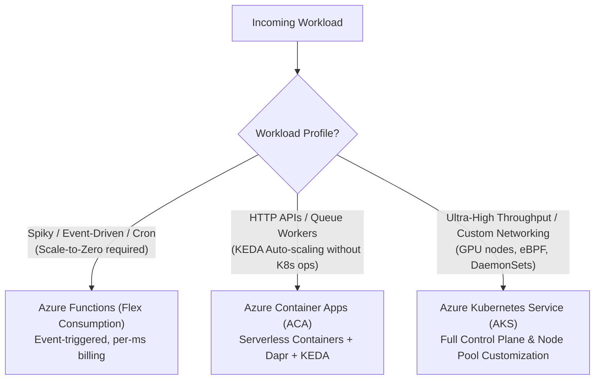
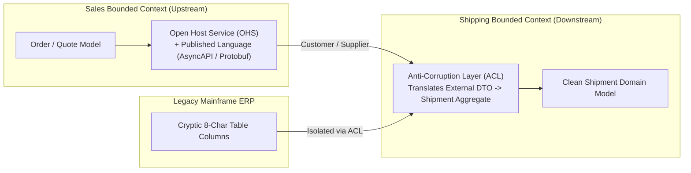
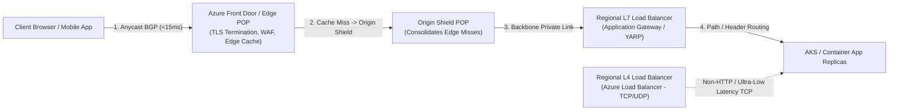
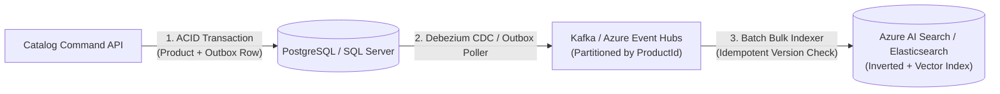
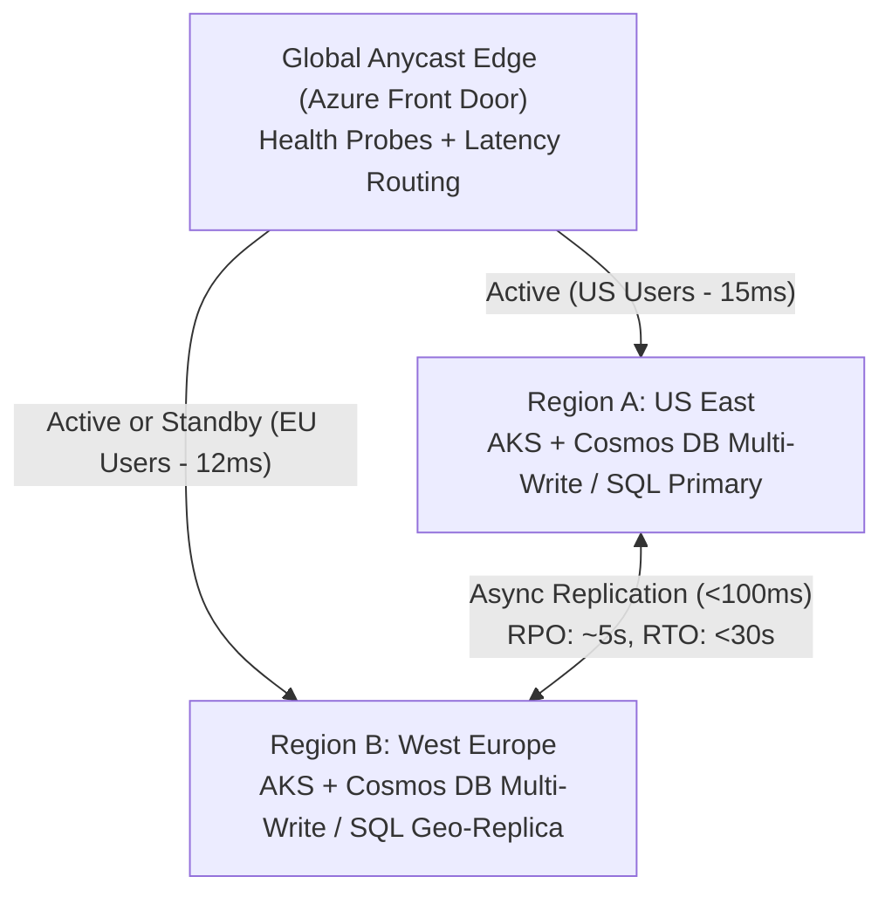
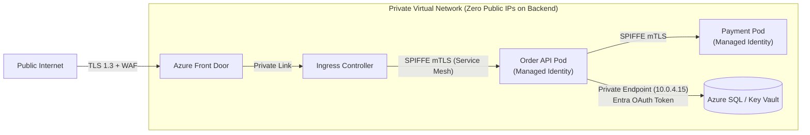
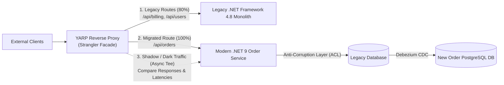
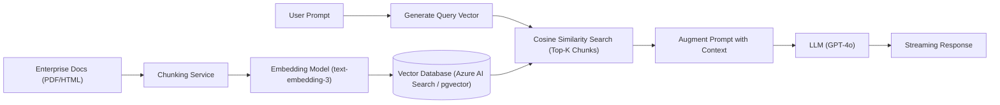
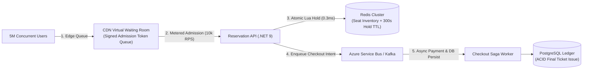
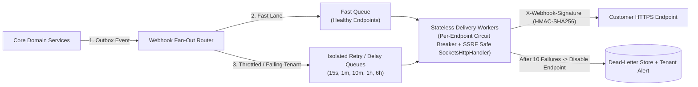

# Module 08 — System Design & Architecture

**Senior Software Engineer Academy · Module 08 of 12**

> **Learning objective:** Master large-scale system design, strategic and tactical Domain-Driven Design (DDD), high-availability multi-region architectures, quality attribute trade-offs, and modern AI-powered RAG systems. Develop the structured communication methodology required to lead 45–60 minute Senior and Staff Software Engineer system design interviews: gathering requirements, performing back-of-the-envelope capacity estimations, sketching high-level component diagrams, drilling into distributed bottlenecks, and defending architectural trade-offs with authority.
>
> **Audience:** Experienced C#/.NET engineers preparing for Senior, Lead, Staff, and Principal software engineering interviews and enterprise architecture reviews. Experience in cloud environments (Azure/AWS), microservices, and databases is assumed; capacity math, context mapping, and multi-tenant isolation patterns are taught with rigorous precision.
>
> **Version note:** Architectural reference designs target modern Microsoft Azure and cloud-native patterns (.NET 8/9, Azure Front Door, Azure Container Apps, AKS, Azure Cosmos DB, Azure Service Bus, Azure Key Vault, Azure AI Search).

## How to use this module

Every section in Part II provides comprehensive senior-level instruction:
1. **Methodology & Estimation Framework:** Step-by-step interview time-boxing, QPS calculations, and storage sizing.
2. **Architectural Schematics:** Concrete Mermaid component diagrams illustrating end-to-end cloud flows.
3. **Enterprise Production Scenarios:** Diagnosing noisy neighbors, multi-region failover splits, hot partition throttling, and cascading service outages.
4. **Trade-offs, Alternatives & Failure Modes:** When microservices fail, when to choose a modular monolith, and when active-active geo-replication is too costly.
5. **What a Senior Engineer Is Expected to Know:** Mid-level vs Senior/Staff architectural judgment.
6. **Interview Questions with Model Answers:** Real interview questions with structured, senior-level responses.
7. **Practical Exercises:** Full design challenges with requirements and capacity constraints.

## Module boundaries

- **This module owns:** System design interview framework, back-of-the-envelope estimation, high-level cloud architecture, strategic/tactical DDD, architectural styles, multi-tenancy models, high availability/disaster recovery, ADRs, C4 modeling, and RAG architectures.
- **Related topics owned by other modules:**
  - Object-oriented mechanics, SOLID principles, and coupling/cohesion → Module 01
  - Data structure selection and Big O analysis → Module 02
  - CoreCLR runtime memory layouts, thread pool, and async internals → Module 03
  - In-process design patterns, GoF patterns, and Clean Architecture → Module 04
  - Relational database indexing, SQL tuning, and transactions → Module 05
  - HTTP protocols, REST, gRPC, and OAuth2/OIDC → Module 06
  - Distributed systems theory (CAP/PACELC, Sagas, Outbox, Raft, messaging) → Module 07
  - DevOps, Kubernetes, CI/CD, and IaC → Module 11

---

# Part I — Complete Curriculum

## Section 1 — The Senior System Design Interview Framework & Estimation
- 1.1 The 5-Stage System Design Interview Protocol:
  - Stage 1: Clarify Requirements & Scope (Functional vs Non-Functional) (5 mins).
  - Stage 2: Back-of-the-Envelope Capacity Estimation (QPS, Bandwidth, Storage, Memory) (5 mins).
  - Stage 3: High-Level Architectural Blueprint (API, Core Components, Data Flow) (15 mins).
  - Stage 4: Deep Dive into Critical Bottlenecks & Failure Modes (20 mins).
  - Stage 5: Wrap-up, Trade-offs & Future Evolution (5 mins).
- 1.2 Back-of-the-Envelope Estimation Mastery: Converting Daily Active Users (DAU) to Queries Per Second (QPS); Peak QPS multiplier ($2\times \text{ to } 5\times$); Storage calculations across 5-year retention windows; Memory cache sizing using the Pareto 80/20 rule.

## Section 2 — Quality Attributes, SLAs & Availability Mathematics
- 2.1 The "-ilities": Scalability, Availability, Reliability, Latency, Throughput, Durability, Maintainability, Cost.
- 2.2 Service Level Terminology: SLA (commitment), SLO (target), SLI (actual measured metric), Error Budget.
- 2.3 The Availability Math of "Nines":
  - 99% (Two 9s) = 3.65 days downtime / year.
  - 99.9% (Three 9s) = 8.76 hours downtime / year.
  - 99.99% (Four 9s) = 52.6 minutes downtime / year.
  - 99.999% (Five 9s) = 5.26 minutes downtime / year.
- 2.4 Composite Availability: Series dependency ($A_{\text{total}} = A_1 \times A_2$) vs Parallel redundancy ($A_{\text{total}} = 1 - (1 - A_1) \times (1 - A_2)$).

## Section 3 — Scaling Infrastructure: Compute, Load Balancing & Networking
- 3.1 Scaling Dimensions: Vertical Scaling (Scale Up) vs Horizontal Scaling (Scale Out); The Stateless Service Imperative.
- 3.2 Load Balancing Topology: Layer 4 (Transport TCP/UDP - high throughput packet forwarding) vs Layer 7 (Application HTTP/HTTPS - URL routing, SSL termination, cookie affinity).
- 3.3 Azure Load Balancing Hierarchy: Azure Front Door (Global L7 + WAF + CDN), Azure Application Gateway (Regional L7), Azure Load Balancer (Regional L4).

## Section 4 — System-Level Caching Architecture & CDN Topologies
- 4.1 Multi-Tier Caching Strategy: Client Browser $\to$ CDN (Edge) $\to$ API Gateway $\to$ Application Cache (Redis) $\to$ Database Buffer Pool.
- 4.2 Cache Topologies: Distributed Shared Cache (Redis Cluster) vs Local In-Memory Cache (MemoryCache) vs Replicated Cache.
- 4.3 Cache Invalidation & Consistency: Write-Through vs Cache-Aside vs Write-Behind; Thundering Herd / Cache Stampede mitigation via distributed mutexes and .NET 9 `HybridCache`.

## Section 5 — Storage Tier Selection & Polyglot Persistence
- 5.1 Storage Archetypes: Relational (SQL Server, PostgreSQL), Document (Azure Cosmos DB, MongoDB), Key-Value (Redis), Blob/Object (Azure Blob Storage), Search Engine (Azure AI Search, Elasticsearch), Vector Database (pgvector, Qdrant).
- 5.2 Polyglot Persistence Architecture: Designing a system where each business capability utilizes the storage engine optimized for its specific read/write access patterns.

## Section 6 — Strategic Domain-Driven Design (DDD) & Context Mapping
- 6.1 Subdomain Categorization: Core Domain (competitive advantage), Supporting Subdomain (custom but non-differentiating), Generic Subdomain (off-the-shelf software).
- 6.2 Bounded Contexts: Defining explicit conceptual boundaries within which a domain model and Ubiquitous Language are strictly valid.
- 6.3 Context Mapping Relationships: Shared Kernel, Customer/Supplier, Conformist, Anti-Corruption Layer (ACL), Open Host Service (OHS) / Published Language.

## Section 7 — Tactical Domain-Driven Design (DDD) in C#
- 7.1 Tactical Building Blocks: Entities (identity), Value Objects (structural immutability), Aggregate Roots (consistency boundary), Domain Events, Domain Services.
- 7.2 Aggregate Sizing Rules: Keeping aggregates small; referencing other aggregates by Identity (`OrderId`), never by object reference; modifying only one aggregate per transaction.

## Section 8 — Architectural Styles: Monolith, Microservices & Serverless
- 8.1 Architectural Spectrum: Layered Monolith, Modular Monolith, Microservices, Event-Driven Architecture, Serverless (Azure Functions).
- 8.2 The Microservices Distributed Tax: Network latency, distributed transactions, data consistency, operational complexity, CI/CD overhead; why starting with a Modular Monolith is often the superior choice.
- 8.3 Migration Strategies: The Strangler Fig Pattern for migrating legacy monoliths to microservices incrementally without high-risk rewrites.

## Section 9 — High Availability (HA), Multi-Region & Disaster Recovery (DR)
- 9.1 Redundancy Topologies: Active-Passive (Hot/Cold Standby, Warm Standby) vs Active-Active (Multi-Region read/write).
- 9.2 Disaster Recovery Metrics: Recovery Point Objective (RPO) and Recovery Time Objective (RTO).
- 9.3 Azure Availability Zones & Traffic Routing: Zone-redundant services; global traffic routing via Azure Front Door / Traffic Manager.

## Section 10 — Multi-Tenant SaaS Architecture & Isolation Models
- 10.1 Tenancy Models:
  - Silo Model: Dedicated compute and dedicated database per tenant (maximum isolation, highest cost).
  - Pool Model: Shared compute and shared database with `TenantId` column (lowest cost, multi-tenant noisy neighbor risk).
  - Bridge / Hybrid Model: Shared compute with dedicated databases per tenant, or pooled basic tier with siloed enterprise tier.
- 10.2 Tenant Routing & Context Resolution: Resolving tenant identity via subdomain (`tenant1.app.com`), HTTP header, or JWT claims in ASP.NET Core middleware.

## Section 11 — Enterprise Security Architecture & Threat Modeling (STRIDE)
- 11.1 Zero Trust Principles: Verify explicitly, use least privileged access, assume breach.
- 11.2 Network Security in Azure: Virtual Networks (VNets), Subnets, Network Security Groups (NSGs), Private Endpoints, Azure Bastion.
- 11.3 STRIDE Threat Modeling: Spoofing, Tampering, Repudiation, Information Disclosure, Denial of Service, Elevation of Privilege.

## Section 12 — Architecture Decisions, Documentation & C4 Modeling
- 12.1 Architecture Decision Records (ADRs): Title, Status, Context, Decision, Consequences.
- 12.2 The C4 Model: Context (System-level actors), Containers (Deployable applications/databases), Components (Internal architectural modules), Code (Class diagrams).

## Section 13 — AI-Powered System Design: RAG & Vector Search Architectures
- 13.1 Retrieval-Augmented Generation (RAG) Architecture: Ingestion pipeline (Document parsing $\to$ Chunking $\to$ Embedding generation $\to$ Vector indexing); Retrieval pipeline (User query $\to$ Query embedding $\to$ Vector similarity search $\to$ Prompt augmentation $\to$ LLM generation).
- 13.2 Vector Search Mechanics: Cosine similarity vs Dot Product; Approximate Nearest Neighbors (HNSW algorithm).
- 13.3 Production Considerations: Semantic caching, token cost management, rate limiting, and guardrails.

## Section 14 — Classic System Design Case Studies & Capstone
- 14.1 Case Study 1: High-Scale URL Shortener (TinyURL) — 100M URLs/month, Base62 encoding, distributed collision-free key generation.
- 14.2 Case Study 2: Distributed Rate Limiter — 500,000 QPS, Redis sliding window counter, token bucket fallback.
- 14.3 Case Study 3: Global Notification Platform — Push, SMS, Email, prioritization, provider failover.
- 14.4 Case Study 4: Multi-Tenant Enterprise Document Processing Engine on Azure — End-to-end cloud architecture.

---

# Part II — Lessons

## Section 1 — The Senior System Design Interview Framework & Estimation

### 1.1 The 5-Stage System Design Interview Protocol

A 45-to-60-minute system design interview tests your ability to navigate ambiguity, drive technical consensus, make explicit trade-offs, and design scalable architectures under time pressure.

```text
[ 00:00 - 05:00 ]  STAGE 1: Clarify Requirements & Scope (Functional & Non-Functional)
[ 05:00 - 10:00 ]  STAGE 2: Back-of-the-Envelope Estimation (QPS, Storage, Bandwidth, Memory)
[ 10:00 - 25:00 ]  STAGE 3: High-Level Architecture (API Contracts, Components, Data Flow)
[ 25:00 - 45:00 ]  STAGE 4: Deep Dive into Bottlenecks, Data Models & Failure Modes
[ 45:00 - 50:00 ]  STAGE 5: Wrap-up, Trade-offs, Operational Monitoring & Future Evolution
```

---

### 1.2 Back-of-the-Envelope Estimation Mastery

#### The Golden Conversion Rule:
There are **86,400 seconds in a day** ($\approx 10^5 \text{ seconds}$).
$$\text{Average QPS} = \frac{\text{Daily Requests}}{86,400}\approx \frac{\text{Daily Requests}}{10^5}$$
$$\text{Peak QPS} = \text{Average QPS} \times 2 \text{ (or } 3\times \text{ to } 5\times \text{ for spiky traffic)}$$

#### Example Worked Estimation: High-Scale URL Shortener
- **Traffic Assumptions:**
  - 100 Million new URLs created per month.
  - Read-to-Write ratio: $10:1$ (1 Billion reads per month).
- **Write QPS:**
  $$\text{Write QPS} = \frac{100,000,000 \text{ writes}}{30 \times 86,400}\approx \frac{10^8}{2.6 \times 10^6}\approx \mathbf{40 \text{ writes/second}}$$
- **Read QPS:**
  $$\text{Read QPS} = 40 \times 10 = \mathbf{400 \text{ reads/second}}$$
  $$\text{Peak Read QPS} = 400 \times 3 = \mathbf{1,200 \text{ reads/second}}$$
- **Storage Calculations (5-Year Horizon):**
  - Total URLs stored in 5 years: $100\text{M} \times 12 \times 5 = \mathbf{6 \text{ Billion URLs}}$.
  - Bytes per record:
    - `ShortURL` (7 chars): 7 bytes
    - `OriginalURL` (string): 500 bytes
    - `CreatedAt` (timestamp): 8 bytes
    - `UserId` (UUID): 16 bytes
    - Total per row $\approx 550 \text{ bytes}$.
  - Total 5-Year Storage:
    $$\text{Storage} = 6 \times 10^9 \times 550 \text{ bytes}\approx 3.3 \text{ Terabytes (TB)}$$
    *(Senior Insight: 3.3 TB is small enough to fit on a single modern high-capacity SSD or small relational/NoSQL cluster! We do NOT need massive sharding for storage volume alone.)*
- **Memory Cache Sizing (Pareto 80/20 Rule):**
  - Cache the top 20% most popular URLs requested daily:
  - Daily read requests: $\frac{10^9}{30}\approx 33.3 \text{ Million reads/day}$.
  - Memory required to cache 20% of daily reads:
    $$\text{Cache Memory} = 33.3 \times 10^6 \times 0.20 \times 550 \text{ bytes}\approx 3.66 \text{ GB of RAM}$$
    *(Senior Insight: A single modest 16 GB Redis cluster can easily cache 20% of daily traffic with plenty of headroom!)*

### Section 1 Review: Interview Questions & Practice Exercises

#### Interview Questions & Model Answers

**Q1: In a 45-minute system design interview, candidates often run out of time before reaching the deep dive or operational failure modes. How do you structure your time and steer the conversation as a Staff-level candidate?**
> **Model Answer:** I treat the 45-minute interview as a structured architectural review with explicit time-boxes and checkpoints:
> 1. **Minutes 0–5 (Requirements & Scope):** I never draw a single box until I clarify functional boundaries (top 3–4 core user journeys) and non-functional quality attributes (read-to-write ratio, P99 latency target, consistency vs. availability preference under CAP/PACELC, and scale targets).
> 2. **Minutes 5–10 (Back-of-the-Envelope Math):** I translate DAU into average and peak QPS, bandwidth, memory cache size (80/20 Pareto rule), and 5-year storage footprint. Crucially, I always state the *architectural conclusion* of each number (e.g., *"At 40 writes/sec and 3.3 TB over 5 years, a single primary PostgreSQL instance with read replicas suffices for storage; our real bottleneck is peak read concurrency and hot keys"*).
> 3. **Minutes 10–25 (High-Level Blueprint):** I sketch the end-to-end data flow for both the write path and read path: API contracts (REST/gRPC headers, status codes, idempotency keys), edge routing, stateless services, caching tier, and primary data stores.
> 4. **Minutes 25–40 (Deep Dive into Bottlenecks):** I proactively identify the 2–3 hardest distributed engineering problems in my diagram (e.g., hot partition mitigation, distributed lock contention, dual-write avoidance via transactional outbox) and ask the interviewer which area they want to drill into first.
> 5. **Minutes 40–45 (Wrap-Up & Operational Readiness):** I summarize key trade-offs, observability (SLIs/SLOs, error budgets, distributed tracing), and how the architecture evolves at $10\times$ scale.

**Q2: Why is performing back-of-the-envelope capacity estimation before drawing the architecture considered a critical senior signal, and when can naive estimation mislead you?**
> **Model Answer:** Capacity estimation prevents both **premature over-engineering** (e.g., introducing complex multi-master sharded NoSQL clusters for a workload that generates 500 GB over 5 years and 80 writes/sec) and **fatal under-engineering** (e.g., trying to funnel 150,000 writes/sec through a single relational primary). However, naive *average* QPS math is a classic trap. Traffic is rarely uniform: a flash sale, breaking news event, or celebrity post can create a $10\times\text{–}50\times$ spike on a single partition key within seconds. Therefore, senior engineers always estimate **Peak QPS** ($2\times\text{–}5\times$ average) and evaluate **data skew / hot-key concentration** alongside raw averages.

**Q3: How do you apply the Pareto Principle (80/20 rule) when sizing a distributed memory cache like Azure Managed Redis?**
> **Model Answer:** The Pareto Principle states that roughly 80% of read traffic is generated by 20% of active items. Instead of sizing RAM to hold the entire 5-year historical dataset, we size the cache to hold **20% of the daily active unique records**, multiplied by the serialized object size plus ~30% Redis hash-table/pointer metadata overhead and a fragmentation safety buffer (keeping memory utilization below 75% to avoid eviction thrashing).

#### Practice Exercises

1. **Exercise 1.1 — Pastebin / GitHub Gist Capacity Estimation:**
   Design the capacity math for a global Pastebin service with **50 Million DAU**, where each user creates on average **0.1 pastes/day** (average paste size: **10 KB** of text) and reads **5 pastes/day**. Retention is **10 years**. Calculate:
   - Average and Peak ($3\times$) Write QPS and Read QPS.
   - Ingress and Egress network bandwidth in $\text{MB/s}$ at peak.
   - Total 10-year raw storage + $1.5\times$ index/replication overhead in $\text{TB}$.
   - Redis memory required to cache the top 20% of daily read pastes.
2. **Exercise 1.2 — Scoping an Ambiguous Prompt:**
   You are given the prompt: *"Design Uber Eats."* Write out the exact 6–8 clarifying questions (functional and non-functional) you would ask in the first 4 minutes, and define explicit numeric assumptions for DAU, concurrent active orders, driver GPS ping frequency, and P99 latency targets.

---

## Section 2 — Quality Attributes, SLAs & Availability Mathematics

### 2.1 Composite Availability Math

When services depend on one another, their individual availabilities compound:

#### 1. Series Dependency (Weakest Link):
If Service A ($99.9\%$) requires Service B ($99.9\%$) synchronously to complete a request:
$$A_{\text{total}} = A_1 \times A_2 = 0.999 \times 0.999 = 0.998001\approx \mathbf{99.8\%}$$
*Senior Takeaway:* Synchronously chaining five $99.9\%$ microservices drops your composite system availability to **$99.5\%$ (over 43 hours of downtime per year!)**.

#### 2. Parallel Redundancy (Resilient Fallback):
If Service A has a primary instance and an active-active secondary replica, both with $99.9\%$ availability:
$$A_{\text{total}} = 1 - (1 - A_1) \times (1 - A_2) = 1 - (0.001 \times 0.001) = 1 - 0.000001 = \mathbf{99.9999\%}$$

---

### 2.2 Latency Numbers Every Senior Engineer Must Know & Full Worked Estimation (100M DAU Notification Platform)

To defend architectural choices in an interview, you must have an intuitive grasp of order-of-magnitude hardware and network latencies.

#### Latency Reference Table (Modern Cloud Hardware)

| Operation | Typical Latency | Order of Magnitude | Architectural Implication |
|---|---|---|---|
| **L1 Cache Reference** | $0.5\text{ ns}\text{–}1\text{ ns}$ | Nanoseconds | CPU register / L1 hot loop |
| **L2 Cache Reference** | $4\text{ ns}\text{–}7\text{ ns}$ | Nanoseconds | Cache-line friendly structs (`Span<T>`) |
| **Branch Mispredict / Mutex Lock** | $5\text{ ns}\text{–}25\text{ ns}$ | Tens of ns | Uncontended `Interlocked` / lock |
| **Main Memory (RAM) Reference** | $80\text{ ns}\text{–}100\text{ ns}$ | $0.1\ \mu\text{s}$ | Local in-memory cache (`IMemoryCache`) |
| **Compress 1 KB with Snappy / LZ4** | $2\ \mu\text{s}\text{–}3\ \mu\text{s}$ | Microseconds | Always compress payloads before network/disk I/O |
| **NVMe SSD Random Read (4 KB)** | $20\ \mu\text{s}\text{–}100\ \mu\text{s}$ | $0.1\text{ ms}$ | Local NVMe is $100\times$ faster than spinning disk |
| **Intra-Datacenter Round Trip (Same AZ)** | $0.2\text{ ms}\text{–}0.5\text{ ms}$ | Sub-millisecond | Redis / DB call within the same Availability Zone |
| **Inter-Zone RTT (Cross-AZ in Same Region)** | $1\text{ ms}\text{–}2\text{ ms}$ | Low milliseconds | Synchronous replication tax across 3 AZs |
| **Read 1 MB Sequentially from SSD** | $0.5\text{ ms}\text{–}1\text{ ms}$ | $1\text{ ms}$ | Sequential log append (Kafka / WAL) is blazingly fast |
| **Cross-Continent RTT (US East $\leftrightarrow$ EU West)** | $75\text{ ms}\text{–}150\text{ ms}$ | $\sim 100\text{ ms}$ | Speed-of-light in fiber limit; requires CDN / geo-routing |

#### Full Worked Estimation: 100M DAU Global Notification Platform

Suppose we are designing an enterprise notification platform (Push, SMS, Email, In-App) serving **100 Million Daily Active Users (DAU)**:

1. **Traffic & Request Volume Assumptions:**
   - Each DAU receives an average of **20 notifications/day** (15 Push, 3 Email, 1.5 In-App, 0.5 SMS).
   - Total notifications dispatched per day:
     $$\text{Daily Volume} = 100 \times 10^6 \times 20 = 2 \times 10^9\text{ notifications/day (2 Billion/day)}$$
   - Average payload size (JSON metadata + rendered body + device tokens): **$2\text{ KB}$**.

2. **Average RPS & Peak RPS:**
   - Using $1\text{ day} = 86,400\text{ s} \approx 10^5\text{ s}$:
     $$\text{Average RPS} = \frac{2 \times 10^9}{86,400} \approx \mathbf{23,150\text{ notifications/sec}}$$
   - Marketing campaigns and breaking alerts cause sharp bursts ($4\times$ peak multiplier):
     $$\text{Peak RPS} = 23,150 \times 4 \approx \mathbf{92,600\text{ notifications/sec}} \ (\approx 100,000\text{ RPS})$$

3. **Network Bandwidth ($\text{MB/s}$):**
   - **Average Egress Bandwidth:**
     $$\text{Bandwidth}_{\text{avg}} = 23,150\text{ req/s} \times 2\text{ KB} \approx 46.3\text{ MB/s} \ (\approx 370\text{ Mbps})$$
   - **Peak Egress Bandwidth:**
     $$\text{Bandwidth}_{\text{peak}} = 92,600\text{ req/s} \times 2\text{ KB} \approx \mathbf{185.2\text{ MB/s}} \ (\approx 1.48\text{ Gbps})$$

4. **Redis RAM Sizing (User Preferences, Device Tokens & Deduplication):**
   - We cache active user device tokens & notification opt-in preferences ($500\text{ bytes}$ per user) for all $100\text{M}$ DAU:
     $$\text{User Cache} = 100 \times 10^6 \times 500\text{ bytes} = 50\text{ GB}$$
   - We store 24-hour idempotency keys (`NotificationId` + status = $64\text{ bytes}$) for all $2\text{B}$ daily events to guarantee at-most-once user-visible delivery:
     $$\text{Dedup Cache} = 2 \times 10^9 \times 64\text{ bytes} = 128\text{ GB}$$
   - Adding $30\%$ Redis overhead: $(50 + 128) \times 1.3 \approx \mathbf{231.4\text{ GB of Redis RAM}}$ (e.g., an Azure Managed Redis Enterprise cluster with 10 shards $\times$ 32 GB).

5. **5-Year Audit & Delivery Log Storage ($\text{TB}$):**
   - Only compact metadata ($500\text{ bytes}$ per notification) is archived for 5 years for compliance/analytics:
     $$\text{5-Year Storage} = 2 \times 10^9\text{ /day} \times 365\text{ days} \times 5\text{ years} \times 500\text{ bytes} \approx \mathbf{1,825\text{ TB}} \ (\approx 1.83\text{ PB})$$
   - *Architectural Conclusion:* $1.83\text{ PB}$ cannot live in hot relational storage (\$\$). We keep **30 days** ($\approx 30\text{ TB}$) in partitioned hot storage (Cosmos DB / Cassandra) and tier older logs into compressed Parquet files on **Azure Blob Cool/Archive Storage** at a fraction of the cost.

---

### Section 2 Review: Interview Questions & Practice Exercises

#### Interview Questions & Model Answers

**Q1: Explain the difference between SLI, SLO, SLA, and Error Budget. How do you use an Error Budget to resolve tension between product velocity and SRE stability?**
> **Model Answer:**
> - **SLI (Service Level Indicator):** The quantitative telemetry metric measuring service health from the user's perspective—for example, the proportion of HTTP requests returning non-`5xx` responses with P99 latency $< 200\text{ ms}$.
> - **SLO (Service Level Objective):** The internal engineering target for an SLI over a rolling window (e.g., $99.95\%$ of requests succeed under $200\text{ ms}$ over 30 days).
> - **SLA (Service Level Agreement):** The external legal/commercial contract with customers (usually looser than the internal SLO, e.g., $99.9\%$), carrying financial penalties or service credits if breached.
> - **Error Budget:** $\text{Error Budget} = 1 - \text{SLO}$. For a $99.9\%$ monthly SLO, the error budget is $0.1\%$, or $43.2\text{ minutes}$ of allowable unavailability per month. While the team has remaining error budget, they can ship risky features and experiments rapidly; if a faulty deployment burns through the monthly error budget, feature releases are frozen until reliability regressions and post-mortem action items are resolved.

**Q2: Your payment checkout API calls four downstream microservices synchronously (Cart, Fraud, Inventory, Ledger), and also depends on an Azure SQL Database. Every service has a $99.9\%$ SLO. What is your effective availability, and how do you redesign the flow to achieve $99.99\%$?**
> **Model Answer:** Five synchronous components in series each at $99.9\%$ yield a composite availability of $0.999^5 \approx 99.50\%$ ($\approx 43.8\text{ hours}$ of downtime/year)—far below $99.99\%$ ($52.6\text{ minutes}$/year). To reach $99.99\%$:
> 1. **Eliminate synchronous serial coupling:** Decouple non-blocking steps (e.g., Ledger posting, receipt emails, analytics) behind an asynchronous durable message bus (Azure Service Bus) using the Transactional Outbox pattern.
> 2. **Cache read dependencies locally:** Replicate product/inventory reference data locally or in a multi-AZ Redis cluster so Cart/Inventory checks don't require cross-service RPCs.
> 3. **Deploy multi-region active-active redundancy:** Deploying the streamlined checkout core across two independent Azure regions in parallel raises availability from $A = 0.999$ per region to $1 - (1 - 0.999)^2 = 99.9999\%$.

#### Practice Exercises

1. **Exercise 2.1 — Composite Availability Calculation:**
   An API Gateway ($99.99\%$) routes to a stateless compute tier deployed redundantly across 2 Availability Zones (each zone has $99.9\%$ availability), which then queries a single-primary database ($99.95\%$). Calculate the exact end-to-end availability percentage and total expected downtime in minutes per year.
2. **Exercise 2.2 — Latency Budget Allocation:**
   Your product requires a strict **P99 latency of $150\text{ ms}$** for a personalized feed endpoint accessed across the Atlantic (US user hitting an EU datacenter). Using the latency reference table, prove why a single-region EU deployment with 3 sequential database queries will violate the budget, and allocate a millisecond-by-millisecond latency budget using Anycast CDN edge termination and regional read replicas.

---

## Section 3 — Architectural Styles: Modular Monoliths, Microservices & Serverless

### 3.1 Modular Monolith vs Microservices Trade-Off Matrix & Module Boundary Enforcement

One of the highest-signal discussions in a Senior/Staff interview is explaining **why starting with a Modular Monolith is frequently superior to jumping straight into Microservices**, and how to enforce strict module boundaries inside a single deployment unit so it doesn't degrade into a "Big Ball of Mud."

#### Architectural Trade-Off Matrix

| Dimension | Layered Monolith (Big Ball of Mud) | Modular Monolith | Microservices Architecture |
|---|---|---|---|
| **Communication Latency** | In-process memory call ($\sim 1\text{ ns}$) | In-process interface / mediator call ($\sim 10\text{ ns}$) | Network RPC + serialization ($0.5\text{ ms}\text{–}5\text{ ms}$) |
| **Data Consistency** | Shared tables, uncontrolled joins | Logical schema isolation per module; ACID or local Outbox | Strict DB-per-service; eventual consistency via Sagas |
| **Deployment Unit** | Single binary | Single binary (independent module assemblies) | Independent container/process per service |
| **Operational / DevOps Tax** | Low | Low (single CI/CD pipeline, simple debugging) | High (Service Mesh, distributed tracing, k8s, contract testing) |
| **Team Scaling Sweet Spot** | 1–5 engineers | 5–40 engineers across domain squads | 40+ engineers with independent release cadences |
| **Failure Blast Radius** | Total process crash | Shared memory/CPU blast radius (mitigated via bulkheads) | Process-isolated (if circuit breakers & timeouts exist) |

#### Enforcing Modular Monolith Boundaries in C#

A Modular Monolith only succeeds if **compile-time and test-time guardrails** forbid Module A (`Ordering`) from referencing internal types or querying database tables owned by Module B (`Billing`):

1. **Project & Visibility Isolation:** Each module splits into `Modules.Ordering.Contracts` (public integration events and DTOs) and `Modules.Ordering.Internal` (`internal` domain entities, handlers, and EF Core `DbContext`).
2. **Separate Database Schemas per Module:** Even inside a single PostgreSQL/SQL Server database, `OrderingDbContext` maps exclusively to schema `ordering.*` and `BillingDbContext` maps to `billing.*`, with cross-schema foreign keys and joins strictly forbidden.
3. **Automated Architecture Tests (ArchUnitNET / NetArchTest):** Run in CI on every pull request to fail the build if a boundary violation is introduced.

```csharp
using System.Reflection;
using Microsoft.EntityFrameworkCore;

namespace EnterpriseArchitecture.ModularMonolith;

// 1. Public Contract Assembly: Only immutable DTOs and Integration Events are public
public sealed record OrderPlacedIntegrationEvent(
    Guid OrderId,
    Guid CustomerId,
    decimal TotalAmount,
    string Currency,
    DateTimeOffset OccurredAtUtc);

public interface IBillingModuleClient
{
    Task<InvoiceResultDto> IssueInvoiceAsync(Guid orderId, decimal amount, CancellationToken ct);
}

public sealed record InvoiceResultDto(Guid InvoiceId, bool IsSuccess);

// 2. Isolated DbContext per Module enforcing distinct database schemas
internal sealed class OrderingDbContext : DbContext
{
    public OrderingDbContext(DbContextOptions<OrderingDbContext> options) : base(options) { }

    protected override void OnModelCreating(ModelBuilder modelBuilder)
    {
        // Strict schema boundary: Ordering module only touches the 'ordering' schema
        modelBuilder.HasDefaultSchema("ordering");
        modelBuilder.ApplyConfigurationsFromAssembly(Assembly.GetExecutingAssembly());
    }
}
```

---

### 3.2 Event-Driven & Serverless Compute Topologies (AKS vs Azure Container Apps vs Azure Functions)

Choosing the right cloud compute substrate requires balancing **control, cold-start latency, scale-to-zero economics, and operational overhead**:



1. **Azure Functions (Serverless FaaS):**
   - **Strengths:** True pay-per-execution and sub-second KEDA event scaling; **Durable Functions** provide stateful workflow orchestration (Fan-Out/Fan-In, Async HTTP polling, Saga compensation) via event-sourced storage queues.
   - **Trade-offs:** Cold starts ($500\text{ ms}\text{–}3\text{ s}$ on standard consumption plans unless using Flex Consumption pre-warmed instances or Native AOT). Execution duration limits make it unsuitable for long-lived WebSockets or heavy steady-state compute.
2. **Azure Container Apps (ACA):**
   - **Strengths:** Abstracts away Kubernetes cluster upgrades and node management while providing native **KEDA (Kubernetes Event-Driven Autoscaling)** rules (scale from 0 to 100 replicas based on Azure Service Bus queue depth, Kafka lag, or concurrent HTTP requests) and built-in **Dapr** sidecars.
   - **Trade-offs:** Less low-level control over Linux kernel flags, custom CNI plugins, or DaemonSets than raw AKS.
3. **Azure Kubernetes Service (AKS):**
   - **Strengths:** Complete control over node pools (spot instances, confidential VMs, GPU nodes), service mesh (Istio/Linkerd), eBPF networking (Cilium), and custom scheduling.
   - **Trade-offs:** High operational burden—requires dedicated platform engineering for cluster upgrades, pod disruption budgets, and node bin-packing.

---

### Section 3 Review: Interview Questions & Practice Exercises

#### Interview Questions & Model Answers

**Q1: A startup CTO tells you: "We have 8 backend developers and we're building 15 microservices from day one so we never have to rewrite our monolith." How do you advise them?**
> **Model Answer:** I would strongly advise against starting with 15 microservices for an 8-person team. In an early-stage domain, bounded contexts are not yet well understood—getting service boundaries wrong across network boundaries results in a **Distributed Monolith**, which combines the worst of both worlds: tight logical coupling where every feature requires coordinated deployments across 5 services, plus the full **Microservices Distributed Tax** (network serialization latency, distributed transactions/Sagas, partial failure handling, and 15 CI/CD pipelines). Instead, start with a **Modular Monolith**: isolate domains into strict C# assemblies and separate database schemas (`ordering.*`, `billing.*`, `catalog.*`), communicate via in-process contracts or an internal event bus, and extract a specific module into an independent microservice later *only* when independent scaling, resource isolation (e.g., CPU-heavy media encoding), or organizational growth (Conway's Law) demands it.

**Q2: How do you mitigate Serverless cold starts in .NET 8/9 when using Azure Functions or Azure Container Apps scaled to zero?**
> **Model Answer:** Cold starts comprise container/environment provisioning, .NET runtime initialization, DI container build, and JIT compilation. We mitigate them at three layers:
> 1. **Compiler / Runtime Level:** Publish with **Native AOT (`<PublishAot>true</PublishAot>`)** or **ReadyToRun (`<PublishReadyToRun>true</PublishReadyToRun>`)**, trimming unused assemblies and eliminating JIT compilation overhead on the first request (reducing .NET startup from $>1\text{ s}$ to $<80\text{ ms}$).
> 2. **Dependency Injection Hygiene:** Defer heavy SDK client initialization (`Lazy<T>`) and avoid synchronous key-vault/config network fetches inside `Program.cs` startup.
> 3. **Infrastructure Level:** Use **Azure Functions Flex Consumption** with always-ready instances for latency-sensitive HTTP paths, or configure KEDA `minReplicas: 1` during business hours with predictive scaling before known traffic peaks.

#### Practice Exercises

1. **Exercise 3.1 — Modular Monolith Extraction Plan:**
   You have a Modular Monolith with three modules (`Users`, `Catalog`, `SearchIndexing`). `SearchIndexing` consumes $85\%$ of CPU during bulk merchant catalog uploads, starving `Users` login requests. Design the step-by-step extraction of `SearchIndexing` into an Azure Container App scaled via KEDA without changing the `Catalog` module's public domain logic.
2. **Exercise 3.2 — Compute Cost & Latency Trade-Off Analysis:**
   Compare running a steady-state $5,000\text{ RPS}$ payment API on Azure Functions vs. AKS reserved instances, and compare running a nightly 15-minute PDF statement generator (500,000 PDFs once a day) on the same two platforms. Justify which compute model wins for each workload.

---

## Section 4 — Domain-Driven Design (DDD): Strategic & Tactical Patterns

### 4.1 Strategic DDD: Ubiquitous Language, Subdomains, Bounded Contexts & Context Mapping

Strategic DDD solves the hardest problem in enterprise architecture: preventing a single bloated "canonical data model" (e.g., a 200-column `Customer` or `Product` class shared by every team) from paralyzing engineering velocity.

#### 1. Subdomain Classification
- **Core Subdomain:** Where the company generates its proprietary competitive edge (e.g., dynamic surge pricing & driver matching at Uber; algorithmic risk engine at a hedge fund). *Strategy:* Assign your strongest senior engineers, apply full tactical DDD, build in-house, never outsource.
- **Supporting Subdomain:** Necessary for the business and tailored to its workflows, but not a market differentiator (e.g., driver onboarding document verification, merchant promotions catalog). *Strategy:* Keep simple (CRUD / Active Record / Transaction Script) so it doesn't drain engineering bandwidth from the Core Domain.
- **Generic Subdomain:** Solved problems common to all businesses (e.g., Identity/OAuth2, payment card clearing, email/SMS delivery, general ledger accounting). *Strategy:* Buy SaaS (Auth0/Entra ID, Stripe, SendGrid) or adopt battle-tested open-source solutions.

#### 2. Bounded Contexts & Ubiquitous Language
A **Bounded Context** is an explicit semantic boundary within which a particular **Ubiquitous Language** (shared vocabulary between domain experts and code) has a single, unambiguous meaning.
- Inside the **Catalog Context**, a `Product` has a `Title`, `Description`, `MediaUrls`, and `DisplayPrice`.
- Inside the **Inventory/Fulfillment Context**, a `Product` (or `StockItem`) has a `SKU`, `WarehouseBinLocation`, `WeightGrams`, and `Dimensions`—it does not care about marketing descriptions!
- Inside the **Billing Context**, an item is simply an `InvoiceLineItem` with a `TaxCode` and `NetAmount`.

#### 3. Context Mapping Patterns (Integrating Bounded Contexts)



| Context Mapping Pattern | Relationship Dynamics | When to Use |
|---|---|---|
| **Customer / Supplier** | Upstream team prioritizes downstream team's requirements via agreed roadmaps and contract tests. | Two internal teams working in cooperative product alignment. |
| **Open Host Service (OHS) + Published Language** | Upstream exposes a versioned, standardized protocol (e.g., Protobuf/gRPC or CloudEvents JSON schema) consumed by many downstream contexts. | Platform services (Orders, Identity, Payments) consumed by 5+ downstream teams. |
| **Anti-Corruption Layer (ACL)** | Downstream builds a translation adapter that converts foreign/legacy models into its own pure domain model. | Integrating with legacy mainframes, external 3rd-party APIs, or messy upstream services. |
| **Conformist** | Downstream blindly adopts Upstream's model without translation to save translation effort. | When Upstream's model is already clean/industry-standard (e.g., ISO financial messages) and you have zero leverage over Upstream. |
| **Shared Kernel** | Two contexts share a small, co-owned subset of domain code/library. | Use sparingly! High coupling risk—only justified for tightly coupled sub-teams sharing core value objects. |

---

### 4.2 Tactical DDD in C#: Entities, Value Objects, Aggregates & Domain Events

Tactical DDD keeps complex business rules inside an expressive, persistence-ignorant domain model rather than scattering `if/else` validation across 50 controller actions and stored procedures.

#### The Four Golden Rules of Aggregate Roots (Vaughn Vernon)
1. **Protect True Business Invariants within Aggregate Boundaries:** An Aggregate is a transactional consistency boundary. Everything inside the Aggregate must be strongly consistent when `SaveChangesAsync()` commits.
2. **Design Small Aggregates:** Never load a `Customer` aggregate containing 10,000 historical `Orders`. Large aggregates cause severe memory overhead and database optimistic concurrency (`DbUpdateConcurrencyException`) conflicts.
3. **Reference Other Aggregates Strictly by Identity (`Guid` / `StrongId`), Never by Object Reference:** `Order` holds `CustomerId`, not a `public Customer Customer { get; set; }` navigation property. This prevents accidental cross-aggregate mutation in the same transaction.
4. **Update Other Aggregates via Eventual Consistency (Domain Events):** Mutate **only one Aggregate instance per database transaction**. Side effects on other aggregates (`Inventory`, `LoyaltyPoints`) happen via Domain Events.

#### Production C# Implementation: `Money` Value Object & `Order` Aggregate Root

```csharp
namespace EnterpriseCommerce.Domain.Orders;

public interface IDomainEvent
{
    Guid EventId { get; }
    DateTimeOffset OccurredOnUtc { get; }
}

// 1. Value Object: Structural equality, completely immutable, self-validating
// Using C# record struct or sealed record guarantees value-based equality out of the box.
public readonly record struct Money
{
    public decimal Amount { get; }
    public string Currency { get; }

    public Money(decimal amount, string currency)
    {
        if (string.IsNullOrWhiteSpace(currency) || currency.Length != 3)
            throw new ArgumentException("Currency must be a 3-letter ISO-4217 code.", nameof(currency));
        if (amount < 0)
            throw new ArgumentOutOfRangeException(nameof(amount), "Monetary amount cannot be negative.");

        Amount = decimal.Round(amount, 2, MidpointRounding.ToEven);
        Currency = currency.ToUpperInvariant();
    }

    public static Money Zero(string currency) => new(0m, currency);

    public Money Add(Money other)
    {
        EnsureSameCurrency(other);
        return new Money(Amount + other.Amount, Currency);
    }

    public Money Multiply(int quantity)
    {
        if (quantity < 0) throw new ArgumentOutOfRangeException(nameof(quantity));
        return new Money(Amount * quantity, Currency);
    }

    private void EnsureSameCurrency(Money other)
    {
        if (!string.Equals(Currency, other.Currency, StringComparison.Ordinal))
            throw new InvalidOperationException($"Cannot combine {Currency} and {other.Currency} without an explicit exchange rate.");
    }
}

// Strongly-typed IDs prevent accidentally passing a CustomerId where an OrderId is expected
public readonly record struct OrderId(Guid Value);
public readonly record struct CustomerId(Guid Value);
public readonly record struct ProductId(Guid Value);

public enum OrderStatus { Draft = 0, Submitted = 1, Paid = 2, Cancelled = 3 }

public sealed record OrderSubmittedDomainEvent(
    Guid EventId,
    OrderId OrderId,
    CustomerId CustomerId,
    Money TotalPrice,
    DateTimeOffset OccurredOnUtc) : IDomainEvent;

// 2. Internal Entity owned by the Order Aggregate Root (cannot be mutated outside Order)
public sealed class OrderLine
{
    public Guid Id { get; private set; }
    public ProductId ProductId { get; private set; }
    public int Quantity { get; private set; }
    public Money UnitPrice { get; private set; }
    public Money LineTotal => UnitPrice.Multiply(Quantity);

    private OrderLine() { } // For EF Core

    internal OrderLine(ProductId productId, int quantity, Money unitPrice)
    {
        if (quantity <= 0) throw new ArgumentOutOfRangeException(nameof(quantity), "Quantity must be positive.");
        Id = Guid.NewGuid();
        ProductId = productId;
        Quantity = quantity;
        UnitPrice = unitPrice;
    }

    internal void IncreaseQuantity(int additionalQuantity)
    {
        if (additionalQuantity <= 0) throw new ArgumentOutOfRangeException(nameof(additionalQuantity));
        Quantity += additionalQuantity;
    }
}

// 3. Aggregate Root: Enforces all invariants and raises Domain Events
public sealed class Order
{
    private const int MaxDistinctItems = 50;
    private readonly List<OrderLine> _lines = new();
    private readonly List<IDomainEvent> _domainEvents = new();

    public OrderId Id { get; private set; }
    public CustomerId CustomerId { get; private set; } // Rule 3: Reference other aggregate by ID only!
    public OrderStatus Status { get; private set; }
    public Money TotalPrice { get; private set; }
    public uint RowVersion { get; private set; } // Optimistic concurrency token (PostgreSQL xmin / SQL rowversion)

    public IReadOnlyCollection<OrderLine> Lines => _lines.AsReadOnly();
    public IReadOnlyCollection<IDomainEvent> DomainEvents => _domainEvents.AsReadOnly();

    private Order() { } // Required by EF Core materialization

    public static Order CreateDraft(CustomerId customerId, string currency)
    {
        return new Order
        {
            Id = new OrderId(Guid.NewGuid()),
            CustomerId = customerId,
            Status = OrderStatus.Draft,
            TotalPrice = Money.Zero(currency)
        };
    }

    public void AddItem(ProductId productId, int quantity, Money unitPrice)
    {
        if (Status != OrderStatus.Draft)
            throw new InvalidOperationException("Cannot modify items on an order that has already been submitted.");

        var existingLine = _lines.FirstOrDefault(l => l.ProductId == productId);
        if (existingLine is not null)
        {
            existingLine.IncreaseQuantity(quantity);
        }
        else
        {
            if (_lines.Count >= MaxDistinctItems)
                throw new InvalidOperationException($"An order cannot exceed {MaxDistinctItems} distinct line items.");

            _lines.Add(new OrderLine(productId, quantity, unitPrice));
        }

        RecalculateTotal();
    }

    public void Submit(DateTimeOffset nowUtc)
    {
        if (Status != OrderStatus.Draft)
            throw new InvalidOperationException($"Order in status {Status} cannot be submitted.");
        if (_lines.Count == 0)
            throw new InvalidOperationException("Cannot submit an empty order without line items.");

        Status = OrderStatus.Submitted;
        _domainEvents.Add(new OrderSubmittedDomainEvent(
            Guid.NewGuid(), Id, CustomerId, TotalPrice, nowUtc));
    }

    public void ClearDomainEvents() => _domainEvents.Clear();

    private void RecalculateTotal()
    {
        var total = Money.Zero(TotalPrice.Currency);
        foreach (var line in _lines)
        {
            total = total.Add(line.LineTotal);
        }
        TotalPrice = total;
    }
}
```

---

### Section 4 Review: Interview Questions & Practice Exercises

#### Interview Questions & Model Answers

**Q1: Why is it an anti-pattern in Tactical DDD to have a direct object reference from one Aggregate Root to another (e.g., `Order.Customer`), and why should you only mutate one Aggregate per transaction?**
> **Model Answer:** An Aggregate Root is a **transactional consistency and concurrency boundary**. If `Order` holds a direct navigation reference to `Customer` and a command handler mutates both `order.Submit()` and `customer.UpdateLoyaltyTier()` in the same database transaction, two severe problems occur:
> 1. **Lock Contention & Concurrency Collisions:** In a high-throughput system where multiple processes touch `Customer` (e.g., profile updates, concurrent orders, reward redemptions), tying `Order` creation to `Customer` row locks or optimistic concurrency tokens causes `Order` transactions to fail unnecessarily.
> 2. **Boundary Leakage:** If you later partition the database or extract `Customer` into a separate microservice, any code traversing `order.Customer.Address` breaks. Referencing `CustomerId` by value and propagating cross-aggregate changes asynchronously via `OrderSubmittedDomainEvent` keeps aggregates small, lock-free, and ready for horizontal partitioning.

**Q2: What is an Anemic Domain Model, why does Martin Fowler criticize it, and when is a simple Transaction Script / Anemic Model actually the *right* engineering choice?**
> **Model Answer:** An **Anemic Domain Model** consists of data bags (classes with only public getters and setters) while all business logic lives in procedural `OrderService` / `OrderManager` classes. This violates object-oriented encapsulation because any caller can mutate `order.Status = OrderStatus.Paid` or `order.TotalPrice = -50` directly, bypassing domain invariants.
> However, full Tactical DDD has a real cognitive and mapping cost. Using Strategic DDD's **Subdomain Classification**, we should reserve rich Aggregate Roots for the **Core Domain** (where complex invariants, state machines, and high business value exist). For **Supporting** or simple CRUD subdomains (e.g., managing admin lookup tables or basic user settings), a simple Transaction Script or Vertical Slice handler writing directly via EF Core is faster to build and maintain.

#### Practice Exercises

1. **Exercise 4.1 — Refactoring an Anemic Model to a Rich Aggregate Root:**
   Take a legacy `BankAccount` class with public setters (`Balance`, `OverdraftLimit`, `IsFrozen`) and an `AccountService.Withdraw()` method. Refactor it into a rich C# Aggregate Root that enforces overdraft invariants, prevents withdrawals when frozen, uses a `Money` value object, and raises an `AccountOverdrawnDomainEvent` when balance drops below zero.
2. **Exercise 4.2 — Context Mapping an Enterprise E-Commerce Acquisition:**
   Your company acquires a warehouse logistics firm running an older Oracle system where inventory items are identified by a compound `WarehouseCode + LegacyPartNumber`. Draw a Mermaid Context Map showing how your modern `OrderFulfillment` Bounded Context integrates with the acquired warehouse system using an **Anti-Corruption Layer (ACL)**.

---

## Section 5 — Clean, Hexagonal, Onion & Vertical Slice Architectures

### 5.1 Dependency Inversion in Clean & Hexagonal (Ports and Adapters) Architecture

Clean Architecture (Robert C. Martin), Onion Architecture (Jeffrey Palermo), and Hexagonal / Ports-and-Adapters Architecture (Alistair Cockburn) all share one foundational rule: **All source code dependencies must point strictly inward toward the Domain Core.**

```text
+-----------------------------------------------------------------------------------+
|                        HEXAGONAL (PORTS & ADAPTERS) / CLEAN                       |
|                                                                                   |
|   PRIMARY (DRIVING) ADAPTERS                     SECONDARY (DRIVEN) ADAPTERS      |
|  +--------------------------+                   +------------------------------+  |
|  | ASP.NET Minimal API      |                   | EF Core PostgreSQL Repo      |  |
|  | gRPC Service             |                   | Azure Service Bus Publisher  |  |
|  | MassTransit Consumer     |                   | Stripe Payment HTTP Adapter  |  |
|  +------------+-------------+                   +--------------+---------------+  |
|               | Calls                                          | Implements       |
|               v                                                v                  |
|  +-----------------------------------------------------------------------------+  |
|  |                        APPLICATION LAYER (USE CASES)                        |  |
|  |  - Inbound Ports:  PlaceOrderCommand / PlaceOrderHandler                    |  |
|  |  - Outbound Ports: IOrderRepository, IPaymentGateway, IOutboxPublisher      |  |
|  |                                     |                                       |  |
|  |                                     v Depends On                            |  |
|  |  +-----------------------------------------------------------------------+  |  |
|  |  |                      DOMAIN CORE (ZERO DEPENDENCIES)                  |  |  |
|  |  |  - Entities & Aggregate Roots (Order, OrderLine)                      |  |  |
|  |  |  - Value Objects (Money, Address)                                     |  |  |
|  |  |  - Domain Events & Pure Domain Services                               |  |  |
|  |  +-----------------------------------------------------------------------+  |  |
|  +-----------------------------------------------------------------------------+  |
+-----------------------------------------------------------------------------------+
```

#### Key Architectural Principles:
- **Zero Infrastructure Leakage in Domain:** The `Domain` project has **zero NuGet package references** to Entity Framework, Azure SDKs, Redis, or ASP.NET Core. It can be unit-tested in milliseconds without mocks or containers.
- **Inbound Ports (Driving) vs Outbound Ports (Driven):**
  - *Driving Adapters* (Controllers, CLI, Queue Consumers) **call** the Application Layer's Inbound Ports (Use Case handlers).
  - *Driven Adapters* (SQL Repositories, External HTTP Clients) **implement** the Application Layer's Outbound Port interfaces (`IPaymentGateway`), wired up at runtime via Dependency Injection at the Composition Root (`Program.cs`).

---

### 5.2 Vertical Slice Architecture (VSA) & Pragmatic CQRS

While Clean/Layered Architecture organizes code horizontally by technical concern (`/Controllers`, `/Services`, `/Repositories`, `/Models`), modifying a single feature often forces developers to touch 6 different projects and 12 files ("shotgun surgery").

**Vertical Slice Architecture (championed by Jimmy Bogard)** flips the axis of organization from **technical layers** to **business features (use cases)**:
- **High Cohesion Within a Slice, Low Coupling Between Slices:** Everything needed for `/Features/Orders/PlaceOrder.cs` or `/Features/Orders/GetOrderSummary.cs`—the HTTP endpoint, request DTO, FluentValidation rules, handler, and data access—lives together in one cohesive file or folder.
- **Pragmatic Per-Slice Architecture:** Each slice chooses the right level of complexity for its job:
  - A **Query Slice (`GetOrderSummary`)** bypasses the rich Domain Aggregate entirely and projects directly from the database into a read DTO using `AsNoTracking()` or Dapper (Pragmatic CQRS).
  - A **Complex Command Slice (`PlaceOrder`)** loads the rich `Order` Aggregate Root from EF Core, executes domain methods that enforce invariants, and commits via the Outbox.

```csharp
using Microsoft.AspNetCore.Builder;
using Microsoft.AspNetCore.Http;
using Microsoft.AspNetCore.Routing;
using Microsoft.EntityFrameworkCore;

namespace EnterpriseCommerce.Features.Orders;

// A complete, self-contained Vertical Slice in a single cohesive file
public static class GetOrderSummarySlice
{
    // 1. Request & Response Contracts local to this slice
    public sealed record OrderSummaryResponse(
        Guid OrderId,
        string Status,
        decimal TotalAmount,
        string Currency,
        int ItemCount,
        DateTimeOffset CreatedAtUtc);

    // 2. Endpoint Registration (Minimal API)
    public static IEndpointRouteBuilder MapGetOrderSummaryEndpoint(this IEndpointRouteBuilder app)
    {
        app.MapGet("/api/v1/orders/{orderId:guid}/summary", HandleAsync)
           .WithName("GetOrderSummary")
           .Produces<OrderSummaryResponse>(StatusCodes.Status200OK)
           .Produces(StatusCodes.Status404NotFound);

        return app;
    }

    // 3. Handler: Pragmatic CQRS Read Path (No Aggregate overhead, direct SQL projection)
    public static async Task<IResult> HandleAsync(
        Guid orderId,
        AppReadDbContext db,
        CancellationToken ct)
    {
        var summary = await db.Orders
            .AsNoTracking()
            .Where(o => o.Id == orderId)
            .Select(o => new OrderSummaryResponse(
                o.Id,
                o.Status.ToString(),
                o.TotalAmount,
                o.Currency,
                o.Lines.Count(),
                o.CreatedAtUtc))
            .FirstOrDefaultAsync(ct);

        return summary is not null
            ? Results.Ok(summary)
            : Results.NotFound(new { Message = $"Order {orderId} was not found." });
    }
}

// Stub read context for compilation clarity
public abstract class AppReadDbContext : DbContext
{
    public DbSet<OrderReadModel> Orders => Set<OrderReadModel>();
}

public sealed class OrderReadModel
{
    public Guid Id { get; set; }
    public string Status { get; set; } = string.Empty;
    public decimal TotalAmount { get; set; }
    public string Currency { get; set; } = "USD";
    public DateTimeOffset CreatedAtUtc { get; set; }
    public List<OrderLineReadModel> Lines { get; set; } = new();
}

public sealed class OrderLineReadModel { public Guid Id { get; set; } }
```

---

### Section 5 Review: Interview Questions & Practice Exercises

#### Interview Questions & Model Answers

**Q1: How do Clean Architecture and Vertical Slice Architecture differ, and can you combine them in an enterprise .NET solution?**
> **Model Answer:** Clean Architecture organizes code around concentric rings of dependency inversion (`Domain` $\leftarrow$ `Application` $\leftarrow$ `Infrastructure`/`Presentation`), optimizing for strict decoupling of core domain rules from infrastructure frameworks. However, when applied dogmatically with generic repositories (`IRepository<T>`) and rigid horizontal layers, adding a simple feature requires editing 4 projects.
> **Vertical Slice Architecture (VSA)** organizes code by feature use case (`/Features/Checkout/SubmitOrder`), maximizing feature cohesion and minimizing coupling *between* features.
> In mature enterprise .NET systems, **combining VSA with a shared Tactical DDD Domain Core** gives the best of both worlds:
> - Organize the Application/API layer as **Vertical Slices** (`/Features/...`).
> - **Query slices** project directly from EF Core `AsNoTracking()` or Dapper without touching domain entities.
> - **Command slices** with rich business invariants orchestrate the shared **Domain Core** Aggregates (`Order`, `Subscription`).

**Q2: Why is creating a generic `IRepository<TEntity>` wrapper around EF Core's `DbContext` frequently considered an anti-pattern in modern .NET architecture?**
> **Model Answer:** `DbContext` and `DbSet<T>` already implement the **Unit of Work** and **Repository** patterns natively. Wrapping EF Core in a generic `IRepository<T>` with methods like `IEnumerable<T> Find(Expression<Func<T, bool>> predicate)` either:
> 1. **Leaks `IQueryable<T>`** (which exposes provider-specific LINQ translation quirks and defeats the abstraction), or
> 2. **Forces premature in-memory materialization** or an explosion of 40 bespoke repository methods (`GetOrderWithLinesAndCustomerByStatusAsync`).
> In Clean/DDD architectures, repositories should exist **only for Aggregate Roots** (`IOrderRepository` with `GetByIdAsync(OrderId)` and `Add(Order)`), while query handlers use `DbContext` directly (or Dapper) to write optimized SQL projections.

#### Practice Exercises

1. **Exercise 5.1 — Converting a Layered Feature to a Vertical Slice:**
   Take a traditional `OrderController` $\to$ `IOrderService` $\to$ `OrderService` $\to$ `IOrderRepository` $\to$ `OrderRepository` flow for cancelling an order (`POST /api/orders/{id}/cancel`) and refactor it into a single Vertical Slice (`CancelOrderSlice.cs`) that loads the `Order` Aggregate Root, invokes `order.Cancel(reason)`, and returns `ProblemDetails` on domain validation failures.
2. **Exercise 5.2 — Port & Adapter Testing Without Mocks:**
   Design an outbound port `ICurrencyExchangeRateProvider` in the Application layer, a production adapter `ECBHttpExchangeRateAdapter`, and an in-memory Fake adapter `InMemoryExchangeRateAdapter` for fast deterministic integration testing of multi-currency order checkout.

---

## Section 6 — Strategic Domain-Driven Design (DDD)

### 6.1 Subdomain Mapping & Context Boundaries

In enterprise architecture, systems must be partitioned around business capabilities rather than technical layers:
- **Core Domain:** The unique business differentiator that creates competitive advantage (e.g., proprietary fraud detection algorithm in a bank). High investment, custom in-house build.
- **Supporting Subdomain:** Complements the core domain, but is not differentiating (e.g., an invoice PDF rendering engine). Build custom or use simple frameworks.
- **Generic Subdomain:** Standard industry problems with zero competitive differentiation (e.g., user identity authentication, payment gateway processing). Purchase off-the-shelf software or use third-party SaaS (Stripe, Auth0).

---

### 6.2 Global Load Balancing (L4 vs L7, Anycast DNS) & CDN Edge Caching

Before a request ever reaches a Bounded Context or microservice, it traverses the global edge and load-balancing hierarchy.



#### 1. Layer 4 (Transport) vs Layer 7 (Application) Load Balancing
- **Layer 4 Load Balancer (TCP/UDP — e.g., Azure Standard Load Balancer, AWS NLB):**
  - Inspects only network/transport 5-tuple (`Source IP`, `Dest IP`, `Source Port`, `Dest Port`, `Protocol`).
  - Uses **Direct Server Return (DSR)** or ultra-fast packet forwarding without terminating TLS or parsing HTTP payloads.
  - **Best for:** Millions of concurrent TCP/UDP packets/sec, raw gRPC/TCP streams, database connection load balancing, or gaming servers.
- **Layer 7 Load Balancer (HTTP/HTTPS — e.g., Azure Front Door, Application Gateway, Envoy, YARP):**
  - Terminates client TLS connections, decrypts HTTP/2 or HTTP/3 (QUIC) frames, and inspects URLs, HTTP headers, JWT claims, and cookies.
  - Performs path-based routing (`/api/orders` $\to$ Order Service), WAF inspection (SQLi/XSS filtering), rate limiting, and canary traffic splitting.
- **Anycast Routing at the Edge:**
  - Global L7 edges (Azure Front Door, Cloudflare) advertise the **same IP address** from $190+$ global Points of Presence (POPs) via BGP Anycast. A user in Tokyo completes the TCP + TLS handshake at the local Tokyo POP ($<10\text{ ms}$ RTT) rather than making multiple round-trips across the Pacific Ocean to a US East origin ($160\text{ ms}$ RTT per handshake step).

#### 2. Advanced CDN Edge Caching Semantics & Origin Shield
- **HTTP Cache Directives:**
  - `Cache-Control: public, max-age=60, s-maxage=3600, stale-while-revalidate=120, stale-if-error=86400`
  - `max-age=60`: Client browsers cache the response for 60 seconds.
  - `s-maxage=3600`: Shared proxy caches (CDN Edge) cache the response for 1 hour (overriding `max-age`).
  - `stale-while-revalidate=120`: When the 1-hour TTL expires, the CDN immediately serves the slightly stale cached response to the user in $2\text{ ms}$ while refreshing the cache from the origin asynchronously in the background!
  - `stale-if-error=86400`: If the origin backend returns `5xx` or times out during an outage, the CDN continues serving cached data for up to 24 hours.
- **Cache Key Normalization:** By default, CDNs include the full URL query string in the cache key. If marketing adds `?utm_source=twitter&fbclid=12345`, every user gets a unique URL and bypasses the CDN cache ($0\%$ hit ratio!). Always normalize cache keys at the edge by stripping tracking parameters (`utm_*`, `fbclid`), lowercasing paths, and sorting allowed query parameters alphabetically.
- **Origin Shield:** Without an Origin Shield, if a popular key expires simultaneously across 200 global Edge POPs, all 200 POPs send a cache-miss request to your origin database at once. An **Origin Shield** is a designated middle-tier POP that consolidates misses from all 200 edge POPs into a **single request** to your origin.

---

### Section 6 Review: Interview Questions & Practice Exercises

#### Interview Questions & Model Answers

**Q1: Explain why terminating TLS at an Anycast CDN Edge (like Azure Front Door) reduces latency even for dynamic, uncacheable `POST /api/checkout` requests.**
> **Model Answer:** Even when a `POST` request cannot be cached, establishing a new HTTPS connection over TCP + TLS 1.3 requires **2 network round trips** (1 RTT for the TCP 3-way handshake, 1 RTT for the TLS 1.3 key exchange) before the first byte of the HTTP payload is transmitted. If a user in Sydney connects directly to an origin server in Virginia ($200\text{ ms}$ RTT), connection setup alone wastes $400\text{ ms}$. With Anycast Edge termination, the client completes the TCP and TLS handshakes with the local Sydney Edge POP ($8\text{ ms} \times 2 = 16\text{ ms}$). The Sydney POP then forwards the request to Virginia over a **pre-warmed, persistent, multiplexed HTTP/2 connection** running over Microsoft's private fiber backbone, shaving nearly $400\text{ ms}$ off cold-connection latency.

**Q2: A viral marketing campaign launches with unique `fbclid` and `utm_campaign` query parameters per user, and your origin API immediately melts down despite having a CDN in front. Why did this happen and how do you fix it in 60 seconds?**
> **Model Answer:** The CDN is using the raw request URI (including query string) as its cache key. Because `fbclid` is unique per click, the CDN treats every single request as a distinct cache key, dropping the CDN cache hit ratio from $99\%$ to $0\%$ and forwarding $100\%$ of viral traffic straight to the origin.
> **Immediate Fix:** Configure a **Cache Key Normalization Rule** on the CDN route to **ignore query strings** (or whitelist only functional query parameters like `page` and `category`), and enable **Origin Shield + Request Coalescing (Collapsed Forwarding)** so concurrent misses for the normalized key collapse into a single origin fetch.

#### Practice Exercises

1. **Exercise 6.1 — Designing `Cache-Control` Headers for a Product Catalog API:**
   Write the exact HTTP response headers (`Cache-Control`, `ETag`, `Vary`) for a product details endpoint (`GET /api/products/{id}`) where browsers should cache for 30 seconds, the CDN should cache for 10 minutes, expired CDN entries should re-validate asynchronously for up to 5 minutes, and responses vary by `Accept-Encoding` and `X-Currency`.
2. **Exercise 6.2 — Azure Load Balancing Topology:**
   Draw an architecture diagram combining Azure Front Door, Azure Application Gateway (WAF v2), and an internal Azure Standard Load Balancer for an AKS cluster hosting both public REST APIs and an internal high-throughput TCP syslog ingestion service.

---

## Section 7 — Multi-Layer Caching & Hot-Key Mitigation at Scale

### 7.1 Multi-Tier Caching Topology (Browser -> CDN -> L1 In-Memory -> L2 Redis -> DB)

At extreme scale ($100,000+\text{ RPS}$), relying on a single caching layer is insufficient. Every layer in the multi-tier hierarchy filters out an order of magnitude of traffic and protects the layer beneath it:

```text
[ Client Browser ]      (L0 Cache: Memory/Disk, 0ms network RTT)
        |
        v (Miss)
[ CDN Edge POP ]        (Edge Cache: s-maxage + Origin Shield, 2-10ms RTT)
        |
        v (Miss)
[ API Pod: L1 Memory ]  (IMemoryCache inside .NET process, ~100ns access, 0 network I/O)
        |
        v (Miss)
[ Distributed L2 Redis ](Azure Managed Redis Cluster, 0.3-1ms intra-AZ RTT)
        |
        v (Miss + Single-Flight Lock)
[ Primary Database ]    (PostgreSQL / Cosmos DB Buffer Pool + NVMe SSD, 2-15ms)
```

#### Preventing Synchronized Expiration (TTL Jitter) & Cache Stampedes
- **Synchronized Expiration Trap:** If a background job pre-warms $50,000$ catalog items into Redis at midnight with a fixed `TTL = 3600s`, all $50,000$ keys expire at the exact same millisecond at 01:00:00 AM, causing a catastrophic **Cache Avalanche** that overwhelms the database.
- **Mitigation 1 — Randomized TTL Jitter:** Always add a random jitter ($\pm 10\%\text{ to }20\%$) to every cache TTL:
  $$\text{TTL}_{\text{actual}} = \text{TTL}_{\text{base}} + \text{Random}(-\Delta, +\Delta)$$
- **Mitigation 2 — Single-Flight Locking (Request Coalescing):** When a cache miss occurs on a cold key, use .NET 9 `HybridCache` or a keyed `SemaphoreSlim` so only **1 request per pod** queries Redis/DB while 500 concurrent requests on that pod await the same `Task<T>`.

---

### 7.2 Solving the "Celebrity / Flash-Sale Hot Key" Problem

#### Why a Single Redis Shard Melts at 500,000 RPS on One Key
A common interview misconception is: *"Redis is fast, so if a celebrity tweets or an iPhone flash sale goes live at 500,000 RPS, we'll just put that key in our 20-shard Redis cluster."*
- **The Physics Problem:** Redis Cluster partitions keys across shards using CRC16 hashing (`CRC16(key) mod 16384`). A single key (e.g., `product:iphone16:stock` or `celebrity:messi:profile`) hashes to **one specific slot on one single Redis shard**.
- Because Redis's core command execution loop is **single-threaded**, one Redis shard tops out around **$80,000\text{–}120,000\text{ ops/sec}$**. Funneling $500,000\text{ RPS}$ onto a single key saturates that single shard's CPU at $100\%$, causing timeouts across all other keys co-located on that shard while the other 19 shards sit idle!

#### Two Production Solutions for Read Hot Keys

1. **Key Salting / Key Replication Across Shards (`key#1` .. `key#N`):**
   - For known or dynamically detected read hot keys, append a random shard suffix `1..N` (e.g., `N = 20`): `celebrity:messi:profile#1` through `celebrity:messi:profile#20`.
   - Readers pick a random suffix `Random.Shared.Next(1, 21)`, spreading the $500,000\text{ RPS}$ evenly across all 20 Redis shards ($25,000\text{ RPS}$ per shard).
2. **Short-Lived L1 In-Process Cache + Redis Pub/Sub Invalidation (`.NET HybridCache` Pattern):**
   - Cache hot keys in local pod memory (`IMemoryCache`) for a very short duration (**$2\text{–}5\text{ seconds}$**) alongside a Redis Pub/Sub invalidation channel.
   - If 50 API pods each cache the hot key in local RAM for $2\text{ seconds}$, each pod only calls Redis **once every 2 seconds** (total load on Redis drops from $500,000\text{ RPS}$ to **$25\text{ RPS}$**!).

```csharp
using System.Collections.Concurrent;
using Microsoft.Extensions.Caching.Distributed;
using Microsoft.Extensions.Caching.Memory;

namespace EnterpriseScale.Caching;

public sealed class HotKeyResilientCache
{
    private readonly IMemoryCache _l1Cache;
    private readonly IDistributedCache _l2Redis;
    private readonly ConcurrentDictionary<string, SemaphoreSlim> _keyLocks = new();
    private const int HotKeySaltBuckets = 16;

    public HotKeyResilientCache(IMemoryCache l1Cache, IDistributedCache l2Redis)
    {
        _l1Cache = l1Cache;
        _l2Redis = l2Redis;
    }

    public async Task<string?> GetOrFetchHotKeyAsync(
        string baseKey,
        Func<CancellationToken, Task<string>> dbFallback,
        TimeSpan l1Ttl,
        TimeSpan l2BaseTtl,
        CancellationToken ct)
    {
        // 1. L1 Local Memory Check (~100ns, absorbs 99.99% of hot-key spikes)
        if (_l1Cache.TryGetValue(baseKey, out string? cachedValue))
            return cachedValue;

        // 2. Single-flight lock per key on this pod to prevent stampeding L2/DB
        var gate = _keyLocks.GetOrAdd(baseKey, _ => new SemaphoreSlim(1, 1));
        await gate.WaitAsync(ct);
        try
        {
            if (_l1Cache.TryGetValue(baseKey, out cachedValue))
                return cachedValue;

            // 3. Salted L2 Redis Lookup: spread reads across 16 hash slots/shards
            int bucket = Random.Shared.Next(1, HotKeySaltBuckets + 1);
            string saltedRedisKey = $"{baseKey}:shard:{bucket}";

            cachedValue = await _l2Redis.GetStringAsync(saltedRedisKey, ct);
            if (cachedValue is null)
            {
                // 4. Fallback to DB and write with +/- 15% TTL Jitter to prevent synchronized expiry
                cachedValue = await dbFallback(ct);
                double jitterFactor = 0.85 + (Random.Shared.NextDouble() * 0.30);
                var jitteredL2Ttl = TimeSpan.FromMilliseconds(l2BaseTtl.TotalMilliseconds * jitterFactor);

                await _l2Redis.SetStringAsync(
                    saltedRedisKey,
                    cachedValue,
                    new DistributedCacheEntryOptions { AbsoluteExpirationRelativeToNow = jitteredL2Ttl },
                    ct);
            }

            // Populate L1 cache with brief TTL (e.g., 2-5 seconds)
            _l1Cache.Set(baseKey, cachedValue, l1Ttl);
            return cachedValue;
        }
        finally
        {
            gate.Release();
        }
    }
}
```

---

### Section 7 Review: Interview Questions & Practice Exercises

#### Interview Questions & Model Answers

**Q1: Explain the difference between a Cache Stampede (Thundering Herd), a Cache Avalanche, and Cache Penetration, and how you defend against each.**
> **Model Answer:**
> 1. **Cache Stampede (Thundering Herd):** A single extremely popular key expires, and thousands of concurrent requests simultaneously miss the cache and hammer the database to recompute the same key. *Defense:* Single-flight request coalescing (`.NET 9 HybridCache` / keyed lock) or `stale-while-revalidate` logical early refresh before the physical TTL expires.
> 2. **Cache Avalanche:** Thousands of distinct keys expire at the exact same second (or an entire Redis cluster node fails), shifting massive aggregate read volume to the database. *Defense:* Add $\pm 15\%$ randomized **TTL jitter** to every cache write, and deploy multi-AZ Redis replicas.
> 3. **Cache Penetration:** Malicious or buggy clients repeatedly query non-existent IDs (e.g., `GET /users/-999` or random GUIDs). Because the ID is neither in Redis nor in the database, every request misses Redis and hits the database disk. *Defense:* Cache negative results (`null` sentinel value) with a short TTL ($30\text{–}60\text{ s}$), or place a **Bloom Filter** in front of the cache to reject keys guaranteed not to exist in $O(1)$ memory.

**Q2: Why does Cache-Aside occasionally suffer from stale data when a write happens concurrently with a read miss, and why do we prefer Cache Invalidation (Delete) over Cache Update on writes?**
> **Model Answer:** If two concurrent writers update the database (`Write A` then `Write B`) and also update the cache, network jitter can cause `Write B` to hit Redis *before* `Write A`, leaving Redis permanently poisoned with `Write A`'s older value until TTL expiry. Deleting (`DEL`) the cache key after committing the DB write is idempotent and avoids write-write ordering races. Even with `DEL`, a rare race exists where a slow Reader misses the cache, a Writer commits to DB and deletes the cache, and then the slow Reader writes its stale snapshot into Redis—mitigated via short TTLs, Redis Lua compare-and-set version numbers, or CDC-driven cache updates (Debezium/Outbox).

#### Practice Exercises

1. **Exercise 7.1 — Bloom Filter Sizing for Cache Penetration Defense:**
   Your catalog has $50\text{ Million}$ valid `ProductId` GUIDs, and attackers are spraying random GUIDs at $20,000\text{ RPS}$. Calculate the memory required for a Redis Bloom Filter (`BF.RESERVE`) with a $0.1\%$ false-positive rate ($\approx 14.4\text{ bits per item}$), and show the read flow.
2. **Exercise 7.2 — L1 Cache Invalidation via Redis Pub/Sub:**
   Extend `HotKeyResilientCache` so that when a product price is updated, the writer publishes an invalidation message to a Redis Pub/Sub channel (`cache:invalidate`) that immediately evicts the key from all 50 pods' local `IMemoryCache`.

---

## Section 8 — Asynchronous Processing, Backpressure & Load Shedding

### 8.1 Queue-Based Load Leveling & Little's Law ($L = \lambda W$)

When downstream dependencies (databases, payment processors, PDF generators) have a fixed throughput ceiling, synchronous coupling during traffic spikes causes cascading failures.

#### 1. Little's Law in Distributed Systems
Little's Law is the fundamental theorem of queueing theory:
$$L = \lambda \times W$$
Where:
- $L$: Average number of concurrent requests (or items queued/in-flight) inside the system.
- $\lambda$ (Lambda): Average arrival/throughput rate ($\text{requests/second}$).
- $W$: Average time a request spends in the system (Wait time + Service time, in seconds).

**Worked Example:**
- Suppose your API handles $\lambda = 2,000\text{ req/s}$ and each request normally takes $W = 0.05\text{ s}$ ($50\text{ ms}$).
  $$L = 2,000 \times 0.05 = \mathbf{100\text{ concurrent requests in flight}}$$
- Now, a downstream database query slows down from $50\text{ ms}$ to $W = 2.5\text{ seconds}$ due to lock contention:
  $$L = 2,000 \times 2.5 = \mathbf{5,000\text{ concurrent requests in flight}}$$
- Within seconds, those $5,000$ in-flight requests exhaust your connection pools, memory buffers, and sockets!

#### 2. Queue-Based Load Leveling & KEDA Autoscaling
By placing a durable broker (**Azure Service Bus / Kafka**) between the ingestion API and the worker tier:
- The API validates the payload, writes to the queue in $3\text{ ms}$, and returns `202 Accepted` with a status polling URL (`Location: /api/jobs/{id}`).
- Worker pods consume at their sustainable rate while **KEDA (Kubernetes Event-Driven Autoscaler)** monitors queue depth:
  $$\text{Desired Replicas} = \left\lceil \frac{\text{Current Queue Length}}{\text{Target Messages Per Pod}} \right\rceil$$

---

### 8.2 Backpressure, Bounded Channels & Priority Load Shedding in C#

#### Never Use `Channel.CreateUnbounded<T>()` in Production
An unbounded in-memory queue (`Channel.CreateUnbounded<T>()` or `ConcurrentQueue<T>`) is an **Out-Of-Memory (`OutOfMemoryException`) time bomb**. If producers enqueue at $10,000\text{ items/sec}$ while the consumer slows to $1,000\text{ items/sec}$, the process accumulates $9,000\text{ objects/sec}$ in Gen 2 heap until the container is OOM-killed by Kubernetes—losing all in-memory work!

#### Applying Backpressure & Priority-Based Load Shedding
1. **Bounded Channels (`Channel.CreateBounded<T>`):** Force producers to await capacity (`BoundedChannelFullMode.Wait`) or fail fast so upstream callers slow down.
2. **Priority Load Shedding Middleware:** When in-flight concurrency or CPU crosses a critical threshold ($>85\%$), **proactively shed low-priority traffic** (e.g., anonymous scraping, recommendations, analytics) with `HTTP 503 Service Unavailable` and a `Retry-After` header so **high-priority traffic** (checkout, payments, health checks) continues with $100\%$ success!

```csharp
using System.Threading.Channels;
using Microsoft.AspNetCore.Http;

namespace EnterpriseScale.Resilience;

public enum RequestPriority { Low = 0, Normal = 1, Critical = 2 }

// 1. Adaptive Priority Load Shedder Middleware
// Preserves capacity for Critical traffic (Checkout/Health) when the pod approaches saturation.
public sealed class PriorityLoadSheddingMiddleware
{
    private readonly RequestDelegate _next;
    private int _currentInFlight;
    private const int MaxConcurrency = 500;
    private const int ShedLowPriorityThreshold = 350;    // 70% capacity
    private const int ShedNormalPriorityThreshold = 450; // 90% capacity

    public PriorityLoadSheddingMiddleware(RequestDelegate next) => _next = next;

    public async Task InvokeAsync(HttpContext context)
    {
        int inFlight = Interlocked.Increment(ref _currentInFlight);
        try
        {
            var priority = ClassifyPriority(context.Request.Path);

            bool shouldShed =
                (priority == RequestPriority.Low && inFlight > ShedLowPriorityThreshold) ||
                (priority == RequestPriority.Normal && inFlight > ShedNormalPriorityThreshold) ||
                (inFlight > MaxConcurrency);

            if (shouldShed)
            {
                context.Response.StatusCode = StatusCodes.Status503ServiceUnavailable;
                context.Response.Headers["Retry-After"] = "5";
                await context.Response.WriteAsJsonAsync(new
                {
                    Error = "ServerBusy",
                    Message = $"Load shedding active (InFlight={inFlight}). Please retry after 5 seconds."
                });
                return;
            }

            await _next(context);
        }
        finally
        {
            Interlocked.Decrement(ref _currentInFlight);
        }
    }

    private static RequestPriority ClassifyPriority(PathString path)
    {
        if (path.StartsWithSegments("/health") || path.StartsWithSegments("/api/v1/checkout"))
            return RequestPriority.Critical;
        if (path.StartsWithSegments("/api/v1/recommendations") || path.StartsWithSegments("/api/v1/analytics"))
            return RequestPriority.Low;
        return RequestPriority.Normal;
    }
}

// 2. Bounded Channel Worker with Explicit Backpressure & Timeout
public sealed class BoundedTelemetryIngestionBuffer<T>
{
    private readonly Channel<T> _channel;

    public BoundedTelemetryIngestionBuffer(int capacity = 5_000)
    {
        _channel = Channel.CreateBounded<T>(new BoundedChannelOptions(capacity)
        {
            FullMode = BoundedChannelFullMode.Wait,
            SingleReader = false,
            SingleWriter = false
        });
    }

    public async ValueTask<bool> TryEnqueueWithBackpressureAsync(T item, TimeSpan maxWait, CancellationToken ct)
    {
        using var timeoutCts = CancellationTokenSource.CreateLinkedTokenSource(ct);
        timeoutCts.CancelAfter(maxWait);
        try
        {
            await _channel.Writer.WriteAsync(item, timeoutCts.Token);
            return true;
        }
        catch (OperationCanceledException) when (!ct.IsCancellationRequested)
        {
            // Bounded channel remained full past maxWait -> signal caller to shed load (HTTP 429/503)
            return false;
        }
    }

    public ChannelReader<T> Reader => _channel.Reader;
}
```

---

### Section 8 Review: Interview Questions & Practice Exercises

#### Interview Questions & Model Answers

**Q1: If your Kubernetes health check endpoint (`/healthz`) runs on the same HTTP request pipeline and thread pool as your overloaded API, what happens during a traffic spike, and how do you prevent cascading pod restarts?**
> **Model Answer:** If the pod is experiencing heavy load or thread-pool queuing and `/healthz` gets queued behind slow user requests (or rejected by a naive global rate limiter), Kubernetes's `livenessProbe` will time out and **kill and restart the healthy pod**. Killing 1 of 10 pods routes $100\%$ of the traffic to the remaining 9 pods, pushing them over the edge and causing a **domino-effect cascading outage** across the entire cluster!
> **Solution:**
> 1. Classify `/healthz` and `/readyz` as `RequestPriority.Critical` so load-shedding and rate-limiting middleware never reject them.
> 2. Never check external dependencies (like SQL or third-party APIs) inside a **Liveness Probe** (`livenessProbe` should only verify the local process isn't deadlocked; external dependency checks belong only in `readinessProbe` or startup probes).

**Q2: Explain how you use Little's Law ($L = \lambda W$) to size the `MaxPoolSize` of a database connection pool or the bounded queue capacity of a microservice.**
> **Model Answer:** If a database can execute at most $\lambda = 4,000\text{ queries/sec}$ before disk I/O saturates, and each query takes $W = 10\text{ ms}$ ($0.01\text{ s}$), Little's Law tells us the optimal number of concurrent active database operations across all API pods is $L = 4,000 \times 0.01 = 40\text{ connections}$. Setting `MaxPoolSize = 500` across 20 pods ($10,000$ connections) does *not* make the database faster—it causes heavy context-switching and lock contention inside the DB. Instead, we keep the connection pool tight and use bounded concurrency limiters in the API to fail fast if $W$ spikes.

#### Practice Exercises

1. **Exercise 8.1 — Little's Law Capacity & Queue Backlog Calculation:**
   An order processing worker pool has 10 pods. Each pod processes 50 messages/sec ($\lambda_{\text{total}} = 500\text{ msg/s}$). During a 10-minute flash sale, orders arrive at $2,000\text{ msg/s}$. Calculate the peak queue backlog at minute 10, how long it will take the 10 pods to drain the backlog after traffic returns to $200\text{ msg/s}$, and how many KEDA pods are required to drain the backlog in under 2 minutes.
2. **Exercise 8.2 — ASP.NET Core `ConcurrencyLimiter` Configuration:**
   Configure .NET 8/9's built-in `AddRateLimiter` with two separate concurrency policies: a strict queue limit for `/api/reports/export` (max 10 concurrent, queue limit 5) and a high-throughput token bucket for `/api/orders`.

---

## Section 9 — Data Partitioning, Sharding, Search & Polyglot Persistence

### 9.1 Horizontal Sharding Strategies, Routing & Rebalancing

When write throughput or dataset size exceeds the physical limits of a single vertical database node (e.g., $>10\text{ TB}$ of hot transactional data or $>50,000\text{ ACID writes/sec}$), we partition data horizontally (**Sharding**) across independent nodes.

#### Comparison of Sharding Strategies

| Strategy | Mechanism | Pros | Cons / Failure Modes |
|---|---|---|---|
| **Range-Based Sharding** | Partition by contiguous key ranges (e.g., `OrderDate` month or `ZipCode 00000-19999`). | Efficient range queries (`BETWEEN`); easy to archive old time partitions. | **Severe Hot-Spotting:** In time-range sharding, $100\%$ of current writes hit the latest month's shard while historical shards sit idle! |
| **Hash-Based (Consistent Hashing)** | `ShardId = Hash(PartitionKey) mod VNodes` (e.g., `CustomerId` or `TenantId`). | Uniform distribution of writes and reads across all physical shards. | Range queries across partition keys require expensive **Scatter-Gather** queries across all shards. |
| **Directory / Lookup-Based Sharding** | A dedicated lookup service/table maps each `EntityId` or `TenantId` to its physical `ShardConnectionString`. | Maximum flexibility: can migrate a single noisy-neighbor enterprise tenant to its own dedicated shard at runtime. | Lookup table is on the critical path (must be heavily cached in L1/L2 memory); directory corruption is catastrophic. |

#### The Scatter-Gather Anti-Pattern
In a sharded database (such as Azure Cosmos DB or Citus PostgreSQL), choosing the right **Partition Key (Shard Key)** is the single most critical schema decision:
- If `Orders` is sharded by `CustomerId`, querying `SELECT * FROM Orders WHERE CustomerId = @id` is a **$O(1)$ Single-Partition Point Query** ($2\text{ ms}$).
- However, if an admin dashboard runs `SELECT * FROM Orders WHERE Status = 'Pending' ORDER BY CreatedAt DESC LIMIT 50` *without* a `CustomerId`, the coordinator must perform a **Scatter-Gather fan-out query** to **all $N$ physical shards**, wait for the slowest shard (tail latency amplification!), and merge-sort the results in memory.
- **Solution:** Maintain a secondary materialized view / lookup table partitioned by the alternative access pattern, or offload cross-partition filtering and sorting to a dedicated **Search Index**.

---

### 9.2 Search Engines (Elasticsearch / Azure AI Search) & Blob Valet-Key Pattern

#### 1. Inverted Index Synchronization via Transactional Outbox / CDC
Relational and NoSQL document stores are optimized for point lookups and B-Tree range scans—not full-text fuzzy search, faceted aggregations, or typo-tolerant relevance scoring (`BM25`).
- **Never Dual-Write Synchronously:** Writing to SQL Server and then calling `elasticClient.IndexAsync()` in the same HTTP request risks permanent data drift if the second call fails or arrives out of order.
- **Event-Driven Synchronization Pipeline:**



#### 2. The Valet-Key Pattern for Large Blob Uploads/Downloads
A classic system design mistake is streaming $50\text{ MB}$ video/PDF uploads or downloads *through* your stateless ASP.NET Core web servers (`Client -> API Server -> Azure Blob Storage`). This ties up API memory buffers, network NIC bandwidth, and Kestrel connections for twice the transfer duration!

**The Valet-Key Pattern:**
1. The Client requests upload permission from the API (`POST /api/media/upload-intent`).
2. The API validates user authorization and quota, then generates a **cryptographically signed, time-limited, least-privilege Azure Blob SAS (Shared Access Signature) URI** (or AWS S3 Pre-Signed URL) valid for only **10 minutes** with **Create/Write (`cw`)** permission on that specific blob path.
3. The Client uploads the $50\text{ MB}$ binary stream **directly to Azure Blob Storage**, completely bypassing the API tier!
4. Once uploaded, **Azure Event Grid** triggers a `BlobCreated` event to an asynchronous worker for virus scanning and thumbnail generation.

```csharp
using Azure.Storage;
using Azure.Storage.Blobs;
using Azure.Storage.Sas;

namespace EnterpriseScale.Storage;

public sealed record ValetUploadTokenResponse(
    string BlobName,
    Uri UploadSasUri,
    DateTimeOffset ExpiresAtUtc,
    long MaxAllowedBytes);

public sealed class BlobValetKeyService
{
    private readonly BlobServiceClient _blobServiceClient;
    private const string ContainerName = "customer-uploads";

    public BlobValetKeyService(BlobServiceClient blobServiceClient)
    {
        _blobServiceClient = blobServiceClient;
    }

    public async Task<ValetUploadTokenResponse> IssueDirectUploadSasAsync(
        Guid tenantId,
        Guid userId,
        string originalExtension,
        CancellationToken ct)
    {
        // Strict path isolation by tenant and date
        string safeExt = Path.GetExtension(originalExtension).ToLowerInvariant();
        string blobName = $"{tenantId:N}/{DateTime.UtcNow:yyyy/MM/dd}/{Guid.NewGuid():N}{safeExt}";

        var containerClient = _blobServiceClient.GetBlobContainerClient(ContainerName);
        var blobClient = containerClient.GetBlobClient(blobName);

        // Obtain a User Delegation Key backed by Microsoft Entra ID (Zero storage account keys in config!)
        var now = DateTimeOffset.UtcNow;
        var expiresAt = now.AddMinutes(10);
        var userDelegationKey = await _blobServiceClient.GetUserDelegationKeyAsync(
            now.AddMinutes(-2), // Clock-skew tolerance
            expiresAt,
            ct);

        // Least-privilege SAS: Write + Create ONLY on this exact single blob
        var sasBuilder = new BlobSasBuilder
        {
            BlobContainerName = ContainerName,
            BlobName = blobName,
            Resource = "b", // Single blob
            StartsOn = now.AddMinutes(-2),
            ExpiresOn = expiresAt,
            Protocol = SasProtocol.Https
        };
        sasBuilder.SetPermissions(BlobSasPermissions.Create | BlobSasPermissions.Write);

        var sasQueryParams = sasBuilder.ToSasQueryParameters(userDelegationKey, _blobServiceClient.AccountName);
        var uploadUri = new UriBuilder(blobClient.Uri) { Query = sasQueryParams.ToString() }.Uri;

        return new ValetUploadTokenResponse(blobName, uploadUri, expiresAt, MaxAllowedBytes: 50 * 1024 * 1024);
    }
}
```

---

### Section 9 Review: Interview Questions & Practice Exercises

#### Interview Questions & Model Answers

**Q1: How do you design a Partition Key in Azure Cosmos DB or a sharded PostgreSQL cluster when a single large B2B tenant has 10 million records while 5,000 smaller tenants have only 1,000 records each?**
> **Model Answer:** In Azure Cosmos DB, a single logical partition has a strict **20 GB storage limit** and a **10,000 RU/s throughput ceiling**. If we partition purely by `TenantId`, the massive enterprise tenant will blow past the 20 GB limit and suffer `429 TooManyRequests` hot-partition throttling while other physical partitions sit empty.
> **Solutions:**
> 1. **Hierarchical Partition Keys (Sub-partitioning):** Use a multi-level partition key such as `[/TenantId, /YearMonth, /OrderId]`. Queries scoped to a `TenantId` and `YearMonth` hit only a small subset of partitions, while storage scales infinitely across months.
> 2. **Bridge / Hybrid Sharding for Enterprise Whales:** Use directory-based routing to place the top $1\%$ enterprise "whale" tenants into their own dedicated Cosmos DB containers (partitioned by `CustomerId` or `OrderId`), while keeping the $99\%$ small tenants in a shared container partitioned by `TenantId`.

**Q2: Why is using a Shared Access Signature (SAS) signed with a static Storage Account Key dangerous, and why does the `BlobValetKeyService` above use a `UserDelegationKey` instead?**
> **Model Answer:** A SAS token signed with the master Storage Account Key remains valid until its expiration unless you rotate the entire storage account's master key (which risks breaking all services using that key). Furthermore, storing master keys in app configuration violates Zero-Trust principles. A **User Delegation SAS** is signed using temporary OAuth 2.0 credentials obtained via the API's **Managed Identity (Microsoft Entra ID)**. There are zero secrets stored in configuration, access can be revoked immediately via Entra RBAC, and all token issuance is audited in Azure Activity Logs.

#### Practice Exercises

1. **Exercise 9.1 — Preventing Out-of-Order Search Index Updates:**
   A product price is updated twice within $50\text{ ms}$ (`v1: \$100` $\to$ `v2: \$80`). Due to consumer retries, the `v1` event arrives at Elasticsearch *after* `v2`. Show how to use Elasticsearch's `external_version` (`version_type=external`) with the database row's `RowVersion` / LSN to guarantee idempotent, monotonic updates.
2. **Exercise 9.2 — Polyglot Persistence Selection for an E-Commerce Platform:**
   For an Amazon-scale e-commerce site, justify the exact database engine you would choose for each of the following 5 workloads: (1) Shopping Cart, (2) Product Catalog & Faceted Search, (3) Order Financial Ledger, (4) Product Images/Videos, (5) "Customers Who Bought X Also Bought Y" recommendations.

---

## Section 10 — Multi-Tenant SaaS Architecture & Isolation Models

### 10.1 Tenancy Isolation Comparison Matrix

| Model | Architecture | Pros | Cons | Ideal Use Case |
|---|---|---|---|---|
| **Silo Model** | Dedicated compute and dedicated database per tenant | Maximum data isolation; compliance certified (HIPAA/PCI); zero noisy neighbors | Highest infrastructure cost; complex deployment management across 1,000+ tenants | Enterprise tier customers; highly regulated banking/healthcare |
| **Pool Model** | Shared compute and dedicated database with `TenantId` column | Lowest operational cost; maximum resource utilization; simple single-step deployments | Noisy neighbor risk; complex row-level security; high blast radius if DB fails | Free/Basic tiers; high-volume B2C SaaS |
| **Bridge (Hybrid)** | Shared compute with dedicated databases per tenant | Good data isolation; custom backup/restore per tenant; moderate cost | Database connection pooling overhead; schema migration coordination | Mid-market B2B enterprise SaaS |

---

### 10.2 Multi-Region Active-Active vs Active-Passive Topologies & Failover Math

To survive an entire cloud region outage (e.g., `East US 2` losing power or fiber connectivity) and meet strict **RPO (Recovery Point Objective — max data loss)** and **RTO (Recovery Time Objective — max downtime)** targets, systems must span multiple geographical regions.



#### 1. Multi-Region Topologies & RPO/RTO Matrix

| Topology | Mechanism | RTO (Downtime) | RPO (Data Loss) | Cost & Complexity |
|---|---|---|---|---|
| **Backup & Restore (Cold DR)** | Nightly geo-redundant backups (`GRS`) restored into a new region on disaster. | $4\text{–}24\text{ hours}$ | $1\text{–}24\text{ hours}$ | $1.1\times$ base cost; lowest complexity. |
| **Pilot Light (Warm Standby)** | Database replicates continuously to Region B; compute is scaled to 0/minimal until failover. | $10\text{–}30\text{ minutes}$ | $5\text{–}60\text{ seconds}$ | $1.3\times$ base cost; moderate complexity. |
| **Hot Standby (Active-Passive)** | Full compute & DB replica running in Region B; only Region A takes write traffic. | $30\text{ seconds}\text{–}2\text{ mins}$ | $< 5\text{ seconds}$ | $2.0\times$ base cost; requires automated failover testing. |
| **Multi-Region Active-Active** | Both regions accept reads and writes simultaneously near the user. | $\approx \mathbf{0\text{ seconds}}$ | $\approx 0\text{ (or conflict resolution)}$ | $2.2\times+$ base cost; requires CRDTs / LWW conflict resolution or Geo-Homed user sharding. |

#### 2. Composite Multi-Region Availability Math
Suppose a single Azure region stack (AKS + Database + Load Balancer) achieves **$99.99\%$ availability** ($52.6\text{ minutes}$ downtime/year).
When deployed in **Active-Active parallel redundancy** across two independent regions with automated edge failover:
$$A_{\text{multi-region}} = 1 - (1 - A_{\text{region}})^2 = 1 - (1 - 0.9999)^2 = 1 - (0.0001)^2 = 1 - 0.00000001 = \mathbf{99.999999\%\text{ (Eight 9s!)}}$$
*Practical Reality Check:* While the theoretical math yields eight 9s ($0.3\text{ seconds}$/year), in practice **shared control-plane dependencies** (global DNS, faulty global Terraform deployments, or schema migrations run globally at once) cap real-world availability around **$99.999\%$ ($5.26\text{ minutes}$/year)** unless deployments are strictly **Ring-Deployed** one region at a time with automated bake times.

#### 3. DNS Failover TTL Pitfalls vs Anycast L7 Edge Failover
- **The DNS Failover Trap:** If you rely on DNS (e.g., Azure Traffic Manager / Route53) to fail over from Region A to Region B, even if you set `DNS TTL = 60 seconds`, many corporate ISP resolvers and client OS / JVM DNS caches ignore short TTLs and cache the dead Region A IP for **5 to 30 minutes**!
- **The Anycast Edge Solution:** Terminate clients at an **Anycast Global L7 Proxy (Azure Front Door / Cloudflare)**. The client's DNS IP *never changes* because the Anycast IP is announced globally. When Region A fails health probes, the Edge POP reroutes backend origin requests to Region B in **$<3\text{ seconds}$** with zero client DNS cache dependency.

#### 4. Split-Brain Prevention During Failover
If the network link between Region A (Primary DB) and Region B (Standby DB) severs, Region B might promote itself to Primary while Region A is still accepting writes from US clients (**Split-Brain**—two primaries accepting conflicting financial writes!).
- **Prevention:** Use **Consensus Quorum (3 regions / witness zone)** and **Fencing Tokens (STONITH / Lease Epoch Numbers)**. When Region B acquires the new primary lease (`Epoch = 42`), storage nodes immediately reject any in-flight writes carrying Region A's stale `Epoch = 41`.

---

### Section 10 Review: Interview Questions & Practice Exercises

#### Interview Questions & Model Answers

**Q1: In an Active-Active multi-region architecture, two users (or the same user on two devices) update the same record in `US-East` and `EU-West` within $20\text{ ms}$ of each other. How do you avoid write-write conflicts?**
> **Model Answer:** Because cross-Atlantic fiber latency is $\sim 80\text{ ms}$, synchronous locking across continents destroys write latency. We use one of two patterns depending on the domain:
> 1. **Geo-Homing (User/Tenant Pinning — Preferred for Strong Consistency):** Route each user or tenant deterministically to their "Home Region" (e.g., EU users always read/write in `EU-West`; US users always read/write in `US-East`) via a lightweight routing claim in their JWT. Each region is the single writer for its homed tenants, while asynchronously replicating to the other region for read/DR failover.
> 2. **Multi-Master with Deterministic Conflict Resolution:** For collaborative or cart workloads in Azure Cosmos DB Multi-Write, use **CRDTs (Conflict-Free Replicated Data Types)** (e.g., grow-only counters, OR-Sets for shopping cart items) or custom stored-procedure conflict resolution rather than naive Last-Writer-Wins (`LWW`), which is vulnerable to NTP clock skew.

**Q2: Why can a global CI/CD pipeline destroy the availability guarantee of a multi-region Active-Active architecture, and how do you design safe deployment rings?**
> **Model Answer:** The composite availability formula $1 - (1 - A)^2$ assumes region failures are **statistically independent**. If a CI/CD pipeline deploys a bad configuration change or breaking database migration to `US-East` and `EU-West` simultaneously, both regions fail at the exact same second (a **correlated common-mode failure**). To preserve independence, enforce **Safe Deployment Practices (SDP)** with progressive rings: Ring 0 (Canary 1% in one AZ) $\to$ Ring 1 (Single small region, 2-hour automated SLO bake) $\to$ Ring 2 (Remaining regions sequentially, at least 24 hours apart).

#### Practice Exercises

1. **Exercise 10.1 — Calculating Real-World Multi-Region Availability with Control Plane Risk:**
   Two regions each have $99.95\%$ independent availability, but they share a global Identity Provider (IdP) that has $99.99\%$ availability. Calculate the true composite availability of the system ($A_{\text{IdP}} \times [1 - (1 - A_{\text{region}})^2]$) and identify which component is now the bottleneck.
2. **Exercise 10.2 — Designing an Automated Failover Runbook:**
   Design a zero-data-loss failover state machine for an Active-Passive PostgreSQL cluster across `East US` and `West US`, specifying when replication is asynchronous vs synchronous and how fencing tokens prevent split-brain writes.

---

## Section 11 — Security Architecture, Zero-Trust & Multi-Tenant SaaS Isolation

### 11.1 Zero-Trust Network Architecture, mTLS & Secret Rotation

Modern enterprise cloud architecture operates under the **Zero-Trust Mandate**: *"Never trust the internal network perimeter; verify every identity explicitly, enforce least privilege, and assume the network is already breached."*



#### 1. Eliminating Static Secrets with Workload Identity
- **Zero Passwords in `appsettings.json` or Environment Variables:** Connection strings with passwords (`Password=...`) and static API keys are the #1 vector for credential leaks.
- **Azure Workload Identity / Managed Identity:** Every Kubernetes Pod or Container App is federated with **Microsoft Entra ID** via OIDC projected service account tokens. When `OrderPod` connects to Azure SQL, Cosmos DB, Service Bus, or Key Vault, `DefaultAzureCredential` automatically exchanges the pod's short-lived OIDC token for an Entra access token—zero human-managed secrets exist!

#### 2. Mutual TLS (mTLS) & East-West Traffic Encryption
- Traditional perimeter security decrypts TLS at the ingress gateway and sends plaintext HTTP inside the Kubernetes cluster ("East-West traffic"). Under Zero-Trust ("Assume Breach"), an attacker who compromises a low-privilege pod could sniff internal network traffic or spoof requests to the Payment service.
- **Service Mesh mTLS (Istio / Linkerd / Cilium):** Every pod receives a short-lived X.509 cryptographic workload certificate (`SPIFFE ID`, e.g., `spiffe://cluster.local/ns/prod/sa/order-service`) rotated automatically every 24 hours.
- **Authorization Policies:** The Payment service cryptographically verifies the caller's client certificate and only accepts calls from `sa/order-service` on `POST /internal/payments/capture`.

#### 3. Envelope Encryption (DEK + KEK) for Sensitive Data at Rest
Why don't we send a $10\text{ MB}$ document directly to Azure Key Vault HSM to encrypt it? Because HSM network APIs have strict payload size limits (e.g., $4\text{ KB}$) and rate limits.
- **Envelope Encryption:**
  1. Generate a random 256-bit **Data Encryption Key (DEK)** locally in memory using `AesGcm`.
  2. Encrypt the large payload locally at gigabytes/sec using `AES-256-GCM` with the DEK.
  3. Call Azure Key Vault HSM (`WrapKeyAsync`) to encrypt *only the 32-byte DEK* using the master **Key Encryption Key (KEK)** stored inside the hardware HSM.
  4. Store the wrapped (encrypted) DEK alongside the ciphertext in the database, and zero out the plaintext DEK from RAM (`CryptographicOperations.ZeroMemory`).

---

### 11.2 Multi-Tenant SaaS Isolation Models (Silo, Pool & Bridge)

In a **Pool or Bridge** multi-tenant SaaS architecture, a single missing `WHERE TenantId = @tenantId` predicate causes a catastrophic **Cross-Tenant Data Leak**. Senior architects enforce isolation in depth across three layers:

1. **Application Layer — Tenant Context Propagation & EF Core Global Query Filters:**
   - Resolve `TenantId` strictly from the **cryptographically verified JWT claim (`tid` / `tenant_id`)**—never trust an unvalidated `X-Tenant-Id` query parameter or header from an untrusted client!
   - Inject `ITenantContext` into `DbContext` and apply a global `HasQueryFilter(e => e.TenantId == _tenantContext.TenantId)` to every `IMultiTenantEntity`, plus an `SaveChanges` interceptor that stamps `TenantId` on all inserted entities.
2. **Database Layer — PostgreSQL / SQL Server Row-Level Security (RLS):**
   - Even if a developer writes a raw Dapper SQL query and forgets the `WHERE` clause, database-level **Row-Level Security (`CREATE SECURITY POLICY`)** inspects `SESSION_CONTEXT(N'TenantId')` set when opening the connection and blocks access to rows belonging to other tenants at the storage engine level.
3. **Noisy Neighbor Protection & Per-Tenant Encryption Keys (CMK):**
   - **Per-Tenant Rate Limiting:** Partition rate-limiter buckets by `TenantId` so a runaway script from Tenant A gets throttled (`HTTP 429`) while Tenant B enjoys $100\%$ availability.
   - **Customer-Managed Keys (CMK):** In Envelope Encryption, wrap each tenant's DEK with that specific tenant's Key Vault KEK (`kek-tenant-{id}`). If an enterprise customer terminates their contract or revokes their key, revoking their KEK cryptographically shreds all of their data across shared backups instantly.

```csharp
using System.Security.Claims;
using Microsoft.AspNetCore.Http;
using Microsoft.EntityFrameworkCore;

namespace EnterpriseSaaS.MultiTenancy;

public interface IMultiTenantEntity
{
    Guid TenantId { get; set; }
}

public interface ITenantContext
{
    Guid TenantId { get; }
    string Tier { get; } // Basic, Pro, Enterprise
}

// 1. Resolve Tenant strictly from verified JWT Claims
public sealed class JwtTenantContextAccessor : ITenantContext
{
    public Guid TenantId { get; }
    public string Tier { get; }

    public JwtTenantContextAccessor(IHttpContextAccessor httpContextAccessor)
    {
        var user = httpContextAccessor.HttpContext?.User;
        var tenantClaim = user?.FindFirstValue("tenant_id");
        if (!Guid.TryParse(tenantClaim, out var tenantId) || tenantId == Guid.Empty)
            throw new UnauthorizedAccessException("Authenticated request is missing a valid 'tenant_id' claim.");

        TenantId = tenantId;
        Tier = user?.FindFirstValue("tenant_tier") ?? "Basic";
    }
}

// 2. Multi-Tenant DbContext enforcing both Read Isolation (Query Filter) and Write Stamping
public sealed class MultiTenantSaasDbContext : DbContext
{
    private readonly ITenantContext _tenantContext;

    public MultiTenantSaasDbContext(
        DbContextOptions<MultiTenantSaasDbContext> options,
        ITenantContext tenantContext) : base(options)
    {
        _tenantContext = tenantContext;
    }

    protected override void OnModelCreating(ModelBuilder modelBuilder)
    {
        // Automatically enforce WHERE TenantId = @currentTenantId on all queries
        modelBuilder.Entity<InvoiceRecord>()
            .HasQueryFilter(e => e.TenantId == _tenantContext.TenantId);
    }

    public override Task<int> SaveChangesAsync(CancellationToken cancellationToken = default)
    {
        foreach (var entry in ChangeTracker.Entries<IMultiTenantEntity>())
        {
            if (entry.State == EntityState.Added)
            {
                entry.Entity.TenantId = _tenantContext.TenantId;
            }
            else if (entry.State is EntityState.Modified or EntityState.Deleted &&
                     entry.Entity.TenantId != _tenantContext.TenantId)
            {
                throw new InvalidOperationException("Security Violation: Cross-tenant entity mutation blocked.");
            }
        }
        return base.SaveChangesAsync(cancellationToken);
    }
}

public sealed class InvoiceRecord : IMultiTenantEntity
{
    public Guid Id { get; set; }
    public Guid TenantId { get; set; }
    public decimal Amount { get; set; }
}
```

---

### Section 11 Review: Interview Questions & Practice Exercises

#### Interview Questions & Model Answers

**Q1: Why is relying solely on EF Core's `HasQueryFilter` insufficient for defense-in-depth in a Pooled Multi-Tenant database, and how do you back it up at the SQL engine layer?**
> **Model Answer:** EF Core's `HasQueryFilter` can be bypassed if a developer calls `.IgnoreQueryFilters()`, executes raw SQL via `FromSqlRaw` / Dapper, or runs an ad-hoc reporting query. For defense-in-depth, we combine EF Core query filters with **Database Row-Level Security (RLS)** (in PostgreSQL or Azure SQL). When a connection is leased from the pool, a `DbConnectionInterceptor` executes `EXEC sp_set_session_context @key=N'TenantId', @value=@tenantId` (or `SET app.current_tenant_id = ...` in Postgres). The database engine's security policy predicates every `SELECT`, `UPDATE`, and `DELETE` on that session variable—making cross-tenant data leakage impossible even under SQL injection or developer error.

**Q2: Walk through how Envelope Encryption works when encrypting sensitive PII fields per tenant, and why it enables instant key rotation without re-encrypting terabytes of database rows.**
> **Model Answer:** With Envelope Encryption, the actual database rows are encrypted with a fast symmetric **Data Encryption Key (DEK)** (`AES-256-GCM`), and that 32-byte DEK is encrypted ("wrapped") by the **Key Encryption Key (KEK)** inside Azure Key Vault HSM. When compliance requires rotating the KEK every 90 days, we generate a new KEK version in Key Vault and only need to unwrap and re-wrap the small set of 32-byte DEKs—we do *not* need to decrypt and re-encrypt terabytes of underlying customer rows immediately!

#### Practice Exercises

1. **Exercise 11.1 — STRIDE Threat Model for a Multi-Tenant File Sharing API:**
   Conduct a STRIDE analysis (Spoofing, Tampering, Repudiation, Information Disclosure, Denial of Service, Elevation of Privilege) on a multi-tenant document management API, listing one concrete attack scenario and one concrete architectural mitigation for each of the 6 categories.
2. **Exercise 11.2 — Implementing an EF Core `DbConnectionInterceptor` for SQL Row-Level Security:**
   Write a C# `DbConnectionInterceptor` (`ConnectionOpenedAsync`) that injects the current `ITenantContext.TenantId` into SQL Server's `sp_set_session_context` with `@read_only = 1` on every opened connection.

---

## Section 12 — Legacy Modernization: The Strangler Fig Pattern & Branch by Abstraction

### 12.1 Executing a Zero-Downtime Strangler Fig Migration

Big-bang rewrites of legacy monoliths almost always fail: they take 2+ years, freeze business feature delivery, and attempt to chase a moving target. **Martin Fowler's Strangler Fig Pattern** incrementally replaces specific capabilities of a legacy monolith behind an interception proxy until the legacy system shrinks and is safely decommissioned.



#### The 5-Phase Zero-Downtime Strangler Fig Playbook

1. **Phase 1 — Introduce the Strangler Facade (YARP / Envoy API Gateway):**
   - Place **YARP (Yet Another Reverse Proxy)** in front of the legacy monolith. Initially, $100\%$ of routes pass through to the monolith unchanged.
2. **Phase 2 — Build New Service with an Anti-Corruption Layer (ACL) & CDC Sync:**
   - Build the new `.NET 9 Order Service` with its own clean domain model.
   - Use **Change Data Capture (Debezium)** or a **Transactional Outbox** to stream writes from the legacy database into the new Order database in real time. An **ACL** translates legacy schema quirks (e.g., `ORD_STS_CD = 'P'`) into clean domain enums (`OrderStatus.Paid`).
3. **Phase 3 — Shadow Traffic (Dark Launching & Parity Verification):**
   - Before switching live customer reads to the new service, YARP duplicates incoming `GET /api/orders/{id}` requests asynchronously to the new service (**Shadow Traffic**).
   - A comparator compares the Legacy JSON response against the New Service JSON response, logging any field mismatches or P99 latency regressions without affecting the customer's response!
4. **Phase 4 — Canary Cutover ($1\% \to 10\% \to 50\% \to 100\%$):**
   - Once shadow parity reaches $100\%$ over 7 days, shift live traffic gradually via feature flags / YARP header weights, maintaining an **instant 1-second rollback toggle** back to the monolith.
5. **Phase 5 — Retire Legacy Code & Tables:**
   - Delete the dead code paths from the legacy monolith.

```csharp
using System.Text.Json;
using Microsoft.AspNetCore.Http;
using Microsoft.Extensions.Logging;

namespace EnterpriseModernization.Strangler;

// Shadow Traffic Parity Verifier Middleware:
// Fires an asynchronous, non-blocking request to the new microservice during Strangler migration
// and compares the payload with the legacy monolith's response.
public sealed class ShadowTrafficParityMiddleware
{
    private readonly RequestDelegate _next;
    private readonly IHttpClientFactory _httpClientFactory;
    private readonly ILogger<ShadowTrafficParityMiddleware> _logger;

    public ShadowTrafficParityMiddleware(
        RequestDelegate next,
        IHttpClientFactory httpClientFactory,
        ILogger<ShadowTrafficParityMiddleware> logger)
    {
        _next = next;
        _httpClientFactory = httpClientFactory;
        _logger = logger;
    }

    public async Task InvokeAsync(HttpContext context)
    {
        // Only shadow idempotent GET requests on the route being migrated
        if (!HttpMethods.IsGet(context.Request.Method) ||
            !context.Request.Path.StartsWithSegments("/api/v1/orders"))
        {
            await _next(context);
            return;
        }

        string pathAndQuery = context.Request.Path + context.Request.QueryString;

        // Capture legacy response body while streaming to caller
        var originalBodyStream = context.Response.Body;
        using var buffer = new MemoryStream();
        context.Response.Body = buffer;

        await _next(context);

        buffer.Position = 0;
        string legacyBody = await new StreamReader(buffer).ReadToEndAsync();
        buffer.Position = 0;
        await buffer.CopyToAsync(originalBodyStream);
        context.Response.Body = originalBodyStream;

        if (context.Response.StatusCode == StatusCodes.Status200OK)
        {
            // Fire-and-forget shadow comparison off the critical user request path
            _ = CompareWithCandidateServiceAsync(pathAndQuery, legacyBody);
        }
    }

    private async Task CompareWithCandidateServiceAsync(string pathAndQuery, string legacyJson)
    {
        try
        {
            using var cts = new CancellationTokenSource(TimeSpan.FromSeconds(2));
            var client = _httpClientFactory.CreateClient("ModernOrderCandidate");
            var shadowResponse = await client.GetAsync(pathAndQuery, cts.Token);
            string candidateJson = await shadowResponse.Content.ReadAsStringAsync(cts.Token);

            if (!JsonPayloadEquals(legacyJson, candidateJson))
            {
                _logger.LogWarning(
                    "Strangler Parity Mismatch on {Path}. LegacyLength={LegacyLen}, CandidateLength={CandidateLen}",
                    pathAndQuery, legacyJson.Length, candidateJson.Length);
            }
        }
        catch (Exception ex)
        {
            // Never let shadow traffic errors impact production stability
            _logger.LogDebug(ex, "Shadow traffic call failed for {Path}", pathAndQuery);
        }
    }

    private static bool JsonPayloadEquals(string a, string b)
    {
        using var docA = JsonDocument.Parse(a);
        using var docB = JsonDocument.Parse(b);
        return docA.RootElement.GetRawText() == docB.RootElement.GetRawText();
    }
}
```

---

### Section 12 Review: Interview Questions & Practice Exercises

#### Interview Questions & Model Answers

**Q1: When migrating a stateful module out of a legacy monolith, why is decomposing the shared database much harder than extracting the stateless API code, and how do you cut over writes safely?**
> **Model Answer:** In a legacy monolith, dozens of stored procedures and foreign keys join directly against the `Orders` table. Simply deleting the `Orders` table breaks the monolith immediately. To decouple the database safely:
> 1. **Stop Cross-Domain Joins in the Monolith (Branch by Abstraction):** Refactor the monolith to access Order data through an internal `IOrderDataGateway` interface rather than raw SQL joins.
> 2. **Replicate Legacy $\to$ New DB via CDC:** Stream changes from the legacy DB to the new service's DB and verify read parity via Shadow Traffic.
> 3. **Flip the System of Record & Reverse CDC:** Cut writes over to the new Order Service, and set up **Reverse CDC** (`New DB -> Legacy Orders Table`) so any remaining legacy batch reports reading the old table continue working until they are retired!

**Q2: Why must you only replay `GET` (or strictly idempotent) requests when running Shadow Traffic without special isolation?**
> **Model Answer:** If you shadow a non-idempotent `POST /api/orders/checkout` to the candidate service connected to real downstream systems, the customer's credit card will be charged twice and two shipments will be dispatched! For write-path dark launching, the candidate service must run against isolated sandbox/mock adapters for external side effects (`IPaymentGateway`, `IShippingGateway`) and write to a shadow database schema.

#### Practice Exercises

1. **Exercise 12.1 — Writing an Architecture Decision Record (ADR) for a Strangler Migration:**
   Write a complete, formal **ADR-014: Strangler Fig Migration of Legacy Billing Engine to .NET 9** containing `Status`, `Context`, `Options Considered` (Big-Bang Rewrite vs In-Place Upgrade vs Strangler Fig with YARP), `Decision`, and `Consequences` (both positive and negative).
2. **Exercise 12.2 — Branch by Abstraction Refactoring:**
   Design a C# `CompositeOrderRepository` controlled by an `IFeatureManager` flag (`UseNewOrderServiceForReads`, `DualWriteWithShadowCheck`) that allows toggling reads and writes between a legacy SQL repository and a new gRPC client at runtime without redeploying.

---

## Section 13 — AI-Powered System Design: RAG Architectures

### 13.1 Retrieval-Augmented Generation (RAG) End-to-End Pipeline



#### Key Architecture Trade-Offs in RAG:
1. **Chunking Strategy:** Fixed-size chunking (e.g., 500 tokens with 50-token overlap) vs Semantic chunking (chunking by paragraph/section).
2. **Hybrid Search:** Combining **Vector Similarity Search (Dense)** with **BM25 Keyword Search (Sparse)** and a Reranker produces vastly superior retrieval accuracy than pure vector search alone.
3. **Semantic Caching:** Caching user query embeddings in Redis. If a new prompt has a cosine similarity $> 0.98$ to a cached query, return the cached answer immediately, saving LLM cost and 1-3 seconds of latency!

---

### 13.2 Quantitative Fitness Functions & FinOps Cloud Cost Engineering

In *Building Evolutionary Architectures* (Neal Ford et al.), an **Architectural Fitness Function** is an objective, automated integrity check that continuously verifies a system's architectural characteristics (modularity, latency, security, and cloud cost efficiency) in CI/CD and production.

#### 1. Automated Architecture Fitness Tests in C# (Enforcing Clean/DDD Boundaries)
Without automated checks, architectural boundaries erode under deadline pressure ("architectural drift"). Putting fitness tests in your xUnit test suite fails the PR build immediately if a developer adds an illegal dependency:

```csharp
using System.Reflection;

namespace EnterpriseArchitecture.FitnessTests;

public static class ArchitectureFitnessVerifier
{
    // Automated Fitness Function 1: Domain Layer Purity Check
    public static void AssertDomainLayerHasZeroInfrastructureDependencies(Assembly domainAssembly)
    {
        string[] forbiddenPrefixes =
        {
            "Microsoft.EntityFrameworkCore",
            "Microsoft.AspNetCore",
            "Azure.",
            "StackExchange.Redis",
            "System.Data.SqlClient"
        };

        var referencedAssemblies = domainAssembly.GetReferencedAssemblies();
        var violations = referencedAssemblies
            .Where(a => forbiddenPrefixes.Any(prefix =>
                a.Name != null && a.Name.StartsWith(prefix, StringComparison.OrdinalIgnoreCase)))
            .Select(a => a.Name!)
            .ToList();

        if (violations.Count > 0)
        {
            throw new InvalidOperationException(
                $"Architectural Fitness Violation! Domain assembly '{domainAssembly.GetName().Name}' " +
                $"illegally references infrastructure packages: {string.Join(", ", violations)}");
        }
    }

    // Automated Fitness Function 2: All Domain Events Must Be Sealed & Immutable
    public static void AssertAllDomainEventsAreSealed(Assembly domainAssembly, Type domainEventInterface)
    {
        var unsealedEvents = domainAssembly.GetTypes()
            .Where(t => t is { IsClass: true, IsAbstract: false } &&
                        domainEventInterface.IsAssignableFrom(t) &&
                        !t.IsSealed)
            .Select(t => t.FullName)
            .ToList();

        if (unsealedEvents.Count > 0)
        {
            throw new InvalidOperationException(
                $"Architectural Fitness Violation! Domain events must be sealed: {string.Join(", ", unsealedEvents)}");
        }
    }
}
```

#### 2. FinOps & Cloud Cost Engineering (Unit Economics Telemetry)
At Staff/Principal level, **Cost is a first-class Non-Functional Requirement** alongside latency and availability. In AI/RAG and Multi-Tenant SaaS systems, a single runaway tenant or unoptimized vector/LLM pipeline can burn **\$50,000/month** in days.
- **Unit Economics Telemetry (Cost-Per-Tenant & Token Budgeting):**
  - Instrument every request with OpenTelemetry metrics tracking **Cosmos DB Request Units (`RU`) consumed**, **LLM Prompt + Completion Tokens**, and **Compute CPU-milliseconds**, tagged by `tenant.id` and `tenant.tier`.
  - Compare each tenant's monthly resource consumption cost against their subscription revenue to detect unprofitable "margin-negative" tenants early.
- **High-ROI Cloud FinOps Levers:**
  1. **Storage Tiering Lifecycle Policies:** Automatically transition blobs/logs from Hot (\$0.018/GB) $\to$ Cool (after 30 days, \$0.01/GB) $\to$ Archive (after 90 days, \$0.00099/GB — **$95\%$ cost reduction**).
  2. **Model Routing in RAG:** Route simple classification/summarization queries to a small model (`GPT-4o-mini` at \$0.15/1M tokens) and reserve frontier reasoning models (`GPT-4o` / `o3-mini`) only for complex multi-hop queries (**$15\times$ cost reduction**).
  3. **Cross-AZ Egress Elimination:** Cloud providers charge ~\$0.01/GB for cross-Availability-Zone data transfer. Configure zone-aware service routing (Kubernetes **Topology Aware Hints**) so API pods in `AZ-1` prefer reading from Redis and DB read-replicas in `AZ-1`.

---

### Section 13 Review: Interview Questions & Practice Exercises

#### Interview Questions & Model Answers

**Q1: In an enterprise Multi-Tenant RAG system, how do you prevent an LLM from retrieving document chunks belonging to Tenant B when answering a prompt from Tenant A?**
> **Model Answer:** You must **never** rely on system prompt instructions (e.g., *"Ignore documents not belonging to Tenant A"*) for security—that is trivially defeated by prompt injection! Security enforcement must happen strictly at the **Vector Database retrieval layer before the LLM ever sees the chunks**:
> 1. Stamp every document chunk indexed in Azure AI Search / Qdrant with a mandatory metadata field `tenant_id` (and document-level RBAC ACL tags `allowed_group_ids`).
> 2. In the retrieval API, extract `tenant_id` from the caller's verified JWT and apply a mandatory **Pre-Filter (`$filter=tenant_id eq '...'`)** on the HNSW vector search query so similarity scoring only evaluates vectors owned by that tenant.
> 3. For regulated Silo tenants, use separate physical vector indexes or namespace partitions per tenant.

**Q2: What is an Architectural Fitness Function, and give three examples across modularity, performance, and FinOps that you would wire into a CI/CD pipeline?**
> **Model Answer:** An Architectural Fitness Function is an automated test or telemetry gate that objectively measures whether a system satisfies a target architectural quality attribute:
> 1. **Modularity Fitness Function (Compile/PR Gate):** An ArchUnitNET test verifying that the `Ordering` module has zero references to `Billing.Internal` types and that `Domain` has zero infrastructure dependencies.
> 2. **Performance Fitness Function (Staging Deployment Gate):** A k6 load test asserting that P99 latency stays $< 120\text{ ms}$ and memory allocations per request stay $< 8\text{ KB}$ before promoting to production.
> 3. **FinOps Fitness Function (Runtime Alert Gate):** An OpenTelemetry metric alert that triggers if average Cosmos DB RUs per checkout exceed `25 RUs` or LLM cost per customer conversation exceeds `\$0.02`.

#### Practice Exercises

1. **Exercise 13.1 — RAG Token & Vector Storage FinOps Estimation:**
   Your enterprise RAG assistant processes $500,000\text{ queries/day}$. Each query retrieves 5 chunks ($400\text{ tokens}$ each) + $300\text{ tokens}$ of system/user prompt, and generates a $300\text{ token}$ answer. If $1\text{M}$ input tokens cost `\$2.50` and $1\text{M}$ output tokens cost `\$10.00`, calculate the monthly LLM bill, and calculate how much money you save per month by introducing a Redis Semantic Cache with a $35\%$ cache hit rate.
2. **Exercise 13.2 — Writing a Cyclic Dependency Fitness Function:**
   Extend `ArchitectureFitnessVerifier` in C# to inspect all namespaces under `EnterpriseCommerce.Modules.*` and assert that no two modules have a circular reference between their assemblies.

---

## Section 14 — Classic System Design Case Studies & Capstone

### 14.1 Capstone Architecture: High-Scale URL Shortener (TinyURL)

```text
[ Client (Browser/App) ]
           |
           v
[ Global CDN / Azure Front Door ] (Caches top redirects at edge)
           |
           v
[ Application Gateway (L7 Load Balancer) ]
           |
           +-----------------------+-----------------------+
           |                                               |
           v                                               v
[ Write Service (POST /shorten) ]              [ Read Service (GET /{shortCode}) ]
           |                                               |
           v                                               v
[ Base62 Token Generator ]                     [ Distributed Cache (Redis Cluster) ]
(Pre-allocated ID ranges via ZooKeeper/Redis)              | (Cache Hit -> 301 Redirect)
           |                                               | (Cache Miss)
           v                                               v
[ Primary NoSQL / Relational DB ] <------------------------+
(Cosmos DB / PostgreSQL: { ShortCode, OriginalUrl, CreatedAt })
```

#### Key Design Decisions:
1. **Base62 Encoding:** Short codes use characters `[a-z, A-Z, 0-9]` ($26 + 26 + 10 = 62$ characters).
   A 7-character Base62 string yields:
   $$62^7\approx \mathbf{3.5 \text{ Trillion unique URLs}}$$
   Sufficient to handle 100M URLs per month for over 3,000 years!
2. **Distributed ID Generation:** To prevent collisions without expensive database locks, worker nodes lease discrete ranges of 64-bit integers from a coordinator (e.g. Node 1 gets IDs `1 - 1,000,000`; Node 2 gets `1,000,001 - 2,000,000`). Each node converts its local integer into a Base62 string in $O(1)$ memory.
3. **HTTP 301 vs 302 Redirect:**
   - `301 Moved Permanently`: Browser caches the redirect locally. Subsequent clicks bypass your server entirely (lowest server load, but loses click analytics).
   - `302 Found`: Browser requests the redirect from your server every time (enables accurate real-time click tracking, slightly higher server load).

---

### 14.2 Capstone 2: Distributed Rate Limiter (500,000 QPS Sliding Window & Local Fallback)

At **500,000 QPS** across 100 API Gateway pods, a rate limiter must add $<1\text{ ms}$ of P99 latency, avoid race conditions across distributed nodes, and degrade gracefully if Redis experiences a network partition.

#### Algorithm Selection Matrix
1. **Fixed Window Counter:** Simple `INCR key` + `EXPIRE`. *Flaw:* Allows $2\times$ burst traffic across the boundary of two windows (e.g., 100 requests at `00:59` and 100 requests at `01:01`).
2. **Sliding Window Log (`ZSET`):** Stores every request timestamp in a Redis Sorted Set. Exact precision, but high memory footprint ($64\text{ bytes}$ per request) for high-volume tiers.
3. **Sliding Window Counter (Weighted Hybrid — Production Gold Standard):** Approximates the sliding window using only **two integer counters** (`previous_window` and `current_window`):
   $$\text{EstimatedCount} = \text{Count}_{\text{prev}} \times \left(1 - \frac{t_{\text{elapsed}}}{\text{WindowSize}}\right) + \text{Count}_{\text{curr}}$$
4. **Resilient Fallback:** If Redis times out ($>5\text{ ms}$), immediately fall back to an in-memory `System.Threading.RateLimiting.TokenBucketRateLimiter` per pod (configured at $\frac{\text{GlobalLimit}}{\text{PodCount}}$) rather than failing open or blocking customer traffic!

---

### 14.3 Capstone 3: High-Concurrency Flash Sale / Ticketmaster Reservation System

#### Problem Statement & Scale Bottlenecks
Suppose **5 Million concurrent users** attempt to purchase **50,000 Taylor Swift concert seats** (or 10,000 limited-edition GPUs) at exactly 10:00:00 AM (`500,000+ RPS` at the moment the sale opens):
- **Why Traditional Database Transactions Melt Down:** Executing `BEGIN TRAN; SELECT Status FROM Seats WHERE SeatId = @id FOR UPDATE;` across 500,000 concurrent requests causes catastrophic row-lock contention, connection pool starvation, and complete database collapse within 2 seconds.
- **Core Requirements:**
  1. Zero overselling (strict inventory/seat uniqueness).
  2. When a user selects a seat (or reserves 1 flash-sale unit), hold it exclusively for **5 minutes (300 seconds)** while they enter credit card details.
  3. If payment succeeds within 5 minutes, finalize the ticket; if payment fails or the 5-minute timer expires, automatically release the seat back to the pool.

#### End-to-End Flash Sale Architecture



#### Deep Dive: The 3-Layer Defense
1. **Layer 1 — Edge Virtual Waiting Room (Cloudflare / Azure Front Door + WebSockets):**
   - Absorb the 5M user stampede at the CDN Edge. Users enter a cryptographically signed FIFO waiting room queue and only receive a short-lived **Signed Admission JWT** into the Reservation API at a metered rate that matches backend capacity (e.g., $10,000\text{ admissions/sec}$).
2. **Layer 2 — Atomic Redis Lua Inventory Reservation with 5-Minute TTL Hold:**
   - Because Redis executes a **Lua script (`EVAL` / `EVALSHA`) atomically** without interleaving any other commands, we check seat availability (or flash-sale stock), decrement available stock, and create a per-user reservation key with a **300-second TTL (`SET key val EX 300 NX`)** in a single sub-millisecond operation ($0.3\text{ ms}$) with **zero database locks**!
3. **Layer 3 — Asynchronous Payment Checkout & Hold Expiration Reconciliation:**
   - Once the Lua script returns `1` (`Reserved`), the user has 300 seconds to complete Stripe/Adyen payment using `ReservationId` as the **Idempotency Key**.
   - Before capturing payment at second $t$, verify the hold still has $>15\text{ seconds}$ remaining (`PTTL`) so a late payment doesn't race with hold expiration.

```csharp
using StackExchange.Redis;

namespace EnterpriseScale.Capstones;

public sealed record FlashSaleReservationResult(
    bool IsReserved,
    string? ReservationToken,
    DateTimeOffset? ExpiresAtUtc,
    string Reason);

public sealed class FlashSaleInventoryCoordinator
{
    private readonly IConnectionMultiplexer _redis;

    // Atomic Lua Script:
    // KEYS[1] = inventory counter key (e.g., "{event:99}:available_stock")
    // KEYS[2] = user hold key        (e.g., "{event:99}:hold:user:42")
    // ARGV[1] = reservation token GUID
    // ARGV[2] = hold TTL in seconds (300)
    // Note: Hash tags {event:99} ensure both keys live in the exact same Redis Cluster hash slot!
    private const string AtomicReserveLuaScript = @"
        if redis.call('EXISTS', KEYS[2]) == 1 then
            return -1 -- User already holds an active reservation for this event
        end
        local stock = tonumber(redis.call('GET', KEYS[1]) or '0')
        if stock <= 0 then
            return 0  -- Sold out!
        end
        redis.call('DECR', KEYS[1])
        redis.call('SET', KEYS[2], ARGV[1], 'EX', tonumber(ARGV[2]))
        return 1      -- Successfully reserved with 5-minute TTL hold
    ";

    // Atomic Lua Script for releasing an expired or cancelled hold back into stock
    private const string AtomicReleaseHoldLuaScript = @"
        if redis.call('GET', KEYS[2]) == ARGV[1] then
            redis.call('DEL', KEYS[2])
            redis.call('INCR', KEYS[1])
            return 1
        end
        return 0
    ";

    public FlashSaleInventoryCoordinator(IConnectionMultiplexer redis) => _redis = redis;

    public async Task<FlashSaleReservationResult> TryReserveTicketAsync(
        string eventId,
        string userId,
        TimeSpan holdDuration)
    {
        var db = _redis.GetDatabase();
        string stockKey = $"{{event:{eventId}}}:available_stock";
        string userHoldKey = $"{{event:{eventId}}}:hold:user:{userId}";
        string reservationToken = Guid.NewGuid().ToString("N");
        int ttlSeconds = (int)holdDuration.TotalSeconds;

        var result = (long)await db.ScriptEvaluateAsync(
            AtomicReserveLuaScript,
            new RedisKey[] { stockKey, userHoldKey },
            new RedisValue[] { reservationToken, ttlSeconds });

        return result switch
        {
            1 => new FlashSaleReservationResult(
                true, reservationToken, DateTimeOffset.UtcNow.AddSeconds(ttlSeconds), "Reserved"),
            -1 => new FlashSaleReservationResult(
                false, null, null, "DuplicateHold: User already has an active reservation."),
            _ => new FlashSaleReservationResult(
                false, null, null, "SoldOut: No remaining inventory available.")
        };
    }

    public async Task<bool> CancelAndReleaseHoldAsync(string eventId, string userId, string reservationToken)
    {
        var db = _redis.GetDatabase();
        string stockKey = $"{{event:{eventId}}}:available_stock";
        string userHoldKey = $"{{event:{eventId}}}:hold:user:{userId}";

        var released = (long)await db.ScriptEvaluateAsync(
            AtomicReleaseHoldLuaScript,
            new RedisKey[] { stockKey, userHoldKey },
            new RedisValue[] { reservationToken });

        return released == 1;
    }
}
```

---

### 14.4 Capstone 4: Multi-Tenant Webhook Delivery Platform

#### Problem Statement
Payment platforms (Stripe), source control providers (GitHub), and B2B SaaS platforms must deliver millions of outgoing HTTP webhooks per minute (`order.paid`, `invoice.failed`) to thousands of customer-owned HTTPS endpoints:
- **Key Engineering Challenges:**
  1. **Unreliable / Slow Customer Endpoints:** Customer servers crash, take 15 seconds to respond, or return `502 Bad Gateway`.
  2. **Noisy Neighbor / Head-of-Line Blocking:** If Tenant A's endpoint is timing out and Tenant A generates 500,000 events, Tenant A must **never** delay webhook delivery for Tenant B!
  3. **Security & Authenticity:** Customers must verify that the webhook genuinely came from your platform and is not a replay attack (**HMAC-SHA256 signature with timestamp**).
  4. **SSRF (Server-Side Request Forgery) Prevention:** A malicious tenant might register `http://169.254.169.254/metadata/instance` (cloud IMDS) or `https://10.0.1.5/admin` as their webhook URL to probe your internal network!

#### End-to-End Webhook Delivery Architecture



#### Critical Production Design Decisions
1. **Fast-Lane vs Slow-Lane Queue Isolation (Preventing Head-of-Line Blocking):**
   - Maintain a per-endpoint health score and **Circuit Breaker** in Redis.
   - Endpoints with $<95\%$ success rate or average latency $>2\text{ s}$ are automatically demoted from the **Fast Queue** to a **Slow / Retry Queue** with per-tenant concurrency caps so healthy tenants always experience sub-second webhook delivery.
2. **Exponential Backoff with Jitter & Dead-Lettering:**
   - Schedule retries via delayed messages (`15s -> 1m -> 5m -> 30m -> 2h -> 6h -> 24h`). If an endpoint fails continuously for 72 hours, trip its status to `Disabled` and email the tenant administrator.
3. **Cryptographic HMAC-SHA256 Signing + Timestamp Replay Protection:**
   - Sign `"{timestamp}.{rawJsonBody}"` using the tenant's webhook signing secret so the customer can verify integrity and reject payloads older than 5 minutes.
4. **SSRF-Safe `SocketsHttpHandler` ConnectCallback:**
   - Resolve the customer's hostname DNS and inspect the resolved IP address **inside `ConnectCallback` before opening the TCP socket**, blocking loopback (`127.0.0.0/8`), RFC-1918 private networks (`10.0.0.0/8`, `172.16.0.0/12`, `192.168.0.0/16`), and cloud link-local metadata (`169.254.169.254`).

```csharp
using System.Net;
using System.Net.Sockets;
using System.Security.Cryptography;
using System.Text;

namespace EnterpriseScale.Capstones;

public static class WebhookSecurityDispatcher
{
    // 1. Generate Stripe-style HMAC-SHA256 Signature Header with Replay Timestamp
    public static string ComputeSignatureHeader(string webhookSecret, long unixTimestampSeconds, string rawBody)
    {
        string signedPayload = $"{unixTimestampSeconds}.{rawBody}";
        byte[] keyBytes = Encoding.UTF8.GetBytes(webhookSecret);
        byte[] payloadBytes = Encoding.UTF8.GetBytes(signedPayload);

        byte[] hash = HMACSHA256.HashData(keyBytes, payloadBytes);
        string hexSignature = Convert.ToHexString(hash).ToLowerInvariant();

        return $"t={unixTimestampSeconds},v1={hexSignature}";
    }

    // 2. SSRF-Safe SocketsHttpHandler preventing tenants from probing internal VNet / Cloud IMDS IPs
    public static SocketsHttpHandler CreateSsrfSafeHttpHandler()
    {
        return new SocketsHttpHandler
        {
            AllowAutoRedirect = false, // Never follow redirects into internal private IPs!
            ConnectTimeout = TimeSpan.FromSeconds(5),
            ConnectCallback = async (context, ct) =>
            {
                IPAddress[] addresses = await Dns.GetHostAddressesAsync(context.DnsEndPoint.Host, ct);
                foreach (var ip in addresses)
                {
                    if (IsPrivateOrReservedIp(ip))
                    {
                        throw new InvalidOperationException(
                            $"SSRF Security Block: Webhook target '{context.DnsEndPoint.Host}' resolved to forbidden internal IP {ip}.");
                    }
                }

                var socket = new Socket(SocketType.Stream, ProtocolType.Tcp) { NoDelay = true };
                try
                {
                    await socket.ConnectAsync(addresses, context.DnsEndPoint.Port, ct);
                    return new NetworkStream(socket, ownsSocket: true);
                }
                catch
                {
                    socket.Dispose();
                    throw;
                }
            }
        };
    }

    private static bool IsPrivateOrReservedIp(IPAddress ip)
    {
        if (IPAddress.IsLoopback(ip)) return true;
        if (ip.AddressFamily == AddressFamily.InterNetwork)
        {
            byte[] b = ip.GetAddressBytes();
            return b[0] == 10 ||                                // 10.0.0.0/8
                   (b[0] == 172 && b[1] >= 16 && b[1] <= 31) || // 172.16.0.0/12
                   (b[0] == 192 && b[1] == 168) ||              // 192.168.0.0/16
                   (b[0] == 169 && b[1] == 254) ||              // 169.254.0.0/16 (Cloud IMDS!)
                   b[0] == 127 || b[0] == 0;
        }
        return ip.IsIPv6LinkLocal || ip.IsIPv6SiteLocal;
    }
}
```

---

### Section 14 Review: Interview Questions & Practice Exercises

#### Interview Questions & Model Answers

**Q1: In the Flash Sale / Ticketmaster architecture (`FlashSaleInventoryCoordinator`), why did we wrap `{event:99}` in curly braces in both Redis key names (`{event:99}:available_stock` and `{event:99}:hold:user:42`), and what happens when a user's 300-second hold key expires automatically in Redis without explicit cancellation?**
> **Model Answer:**
> 1. **Redis Cluster Hash Tags (`{...}`):** In a multi-shard Redis Cluster, a Lua script (`EVAL`) can only execute if **all `KEYS` it touches reside on the exact same hash slot and shard** (otherwise Redis throws a `CROSSSLOT Keys in request don't hash to the same slot` error). Wrapping `{event:99}` in curly braces instructs Redis Cluster to compute `CRC16("event:99") mod 16384` for both keys, guaranteeing atomic execution on the same shard.
> 2. **Handling Silent TTL Expiration:** When `SET ... EX 300` expires automatically because the user closed their browser without paying, Redis deletes the hold key, which does *not* automatically increment `available_stock`! To reclaim expired holds accurately, we also insert `(userId, expiresAtUnixTimestamp)` into a per-event Redis Sorted Set (`{event:99}:active_holds_zset`). A lightweight background reaper runs every second (or piggybacks on reserve requests), queries `ZRANGEBYSCORE {event:99}:active_holds_zset -inf <now>` inside a Lua script, removes expired entries, and increments `available_stock` atomically.

**Q2: In the Multi-Tenant Webhook Delivery Platform, why must SSRF IP validation happen inside `SocketsHttpHandler.ConnectCallback` rather than validating `Dns.GetHostAddressesAsync(url.Host)` before calling `httpClient.PostAsync(url)`?**
> **Model Answer:** Validating DNS *before* calling `HttpClient.PostAsync()` is vulnerable to a **DNS Rebinding (Time-of-Check to Time-of-Use / TOCTOU) attack**: an attacker configures their authoritative DNS server with `TTL = 0`. On the first DNS lookup (your validation check), it returns a safe public IP (`93.184.216.34`). Milliseconds later, when `HttpClient` performs its own internal DNS resolution to open the socket, the attacker's DNS server returns `169.254.169.254` (the Azure/AWS Instance Metadata Service) and steals the worker pod's IAM credentials! Performing DNS resolution and IP validation inside `ConnectCallback`—and passing the exact validated `IPAddress[]` array directly into `socket.ConnectAsync(addresses, ...)`—eliminates the second DNS lookup and makes DNS rebinding impossible.

#### Practice Exercises

1. **Exercise 14.1 — Extending the Flash Sale Coordinator with a Sorted Set Expiration Reaper:**
   Write the Redis Lua script and C# wrapper method `ReclaimExpiredHoldsAsync(string eventId, long nowUnixSeconds)` that atomically pops up to 100 expired reservations from `{event:99}:active_holds_zset` using `ZRANGEBYSCORE` and increments `{event:99}:available_stock` by the exact count of reclaimed seats.
2. **Exercise 14.2 — Designing a Customer-Side Webhook Receiver with Idempotency & Replay Defense:**
   Write an ASP.NET Core Minimal API endpoint (`POST /webhooks/incoming`) that verifies the `X-Webhook-Signature` (`t=...,v1=...`) using constant-time comparison (`CryptographicOperations.FixedTimeEquals`), rejects timestamps older than 300 seconds, and deduplicates `EventId` in Redis.

---

# Part III — Interview Readiness

## 1. Mid-Level vs Senior-Level System Design Comparison

| Dimension | Mid-Level Candidate Response | Senior / Staff-Level Candidate Response |
|---|---|---|
| **Requirements Gathering** | Asks generic questions or immediately starts sketching boxes on a whiteboard. | Distinguishes functional requirements from non-functional quality attributes (availability, P99 latency, data retention); clarifies read-to-write ratios and spikiness. |
| **Capacity Estimation** | Skips estimation or guesses random huge numbers without math. | Performs disciplined back-of-the-envelope calculations: converts DAU to QPS, sizes storage over a 5-year horizon, and calculates memory cache sizing using the 80/20 rule. |
| **Microservices vs Monolith** | "Always use microservices because they scale better and are modern." | "Microservices introduce a heavy distributed tax (network latency, eventual consistency, operational complexity). We favor a Modular Monolith initially, decomposing into microservices only when distinct scaling characteristics or team boundaries demand it." |
| **Data Storage Selection** | Defaults to whatever database they know best (e.g. SQL Server for everything). | Evaluates polyglot persistence based on access patterns: relational for transactional ACID integrity, document/NoSQL for high-velocity key-partitioned reads, and vector search for semantic retrieval. |
| **Handling Bottlenecks** | "Just add another server or put Redis in front of it." | Identifies root bottlenecks (hot partitions, database connection pool exhaustion, network serialization overhead); proposes multi-tier caching, read-through patterns, and asynchronous messaging queues. |

---

## 2. Rapid-Fire Revision Sheet (50 Senior-Level Truths)

1. There are 86,400 seconds in a day; average QPS is calculated by dividing daily requests by $10^5$.
2. Peak QPS should be estimated as $2\times$ to $5\times$ average QPS depending on traffic spikiness.
3. In back-of-the-envelope calculations, always size storage for a 5-year horizon including indexing overhead ($\approx 1.5\times$ raw data).
4. Sizing memory caches using the Pareto Principle (80/20 rule) requires calculating RAM needed for 20% of daily read volume.
5. Composite availability across synchronous series dependencies degrades multiplicatively ($A_1 \times A_2$).
6. Composite availability across parallel redundant paths improves dramatically ($1 - (1 - A_1)(1 - A_2)$).
7. Three 9s of availability (99.9%) permits 8.76 hours of downtime per year; four 9s (99.99%) permits only 52.6 minutes.
8. Layer 4 load balancing operates at the TCP/UDP transport layer; Layer 7 load balancing inspects HTTP headers, cookies, and URLs.
9. Azure Front Door combines global Layer 7 anycast routing, Web Application Firewall (WAF), and CDN caching at edge locations.
10. Multi-tier caching spans Browser $\to$ CDN Edge $\to$ API Gateway $\to$ In-Memory Cache (Redis) $\to$ Database Buffer Pool.
11. The Cache-Aside pattern requires the application to query the cache, read from DB on a miss, and write back to cache.
12. Write-Behind (Write-Back) caching acknowledges writes immediately to in-memory cache and asynchronously flushes to DB, risking data loss on crash.
13. Cache Stampede (thundering herd) occurs when a hot key expires and concurrent requests overload the database.
14. .NET 9 `HybridCache` provides built-in single-flight locking to ensure only one request queries the database on a cache miss.
15. Polyglot persistence selects specialized storage engines based on access patterns rather than forcing all data into one database.
16. Relational databases excel at complex multi-table joins, ACID transactions, and strict foreign-key integrity constraints.
17. Document stores (Cosmos DB) excel at horizontal scale-out when queries can be routed by a specific Partition Key.
18. Strategic DDD partitions systems into Core Domains (differentiating), Supporting Subdomains, and Generic Subdomains (off-the-shelf).
19. A Bounded Context defines the explicit boundary within which a specific domain model and Ubiquitous Language are strictly valid.
20. In DDD Context Mapping, an Anti-Corruption Layer (ACL) translates external models into clean internal domain concepts.
21. Aggregate Roots define the transactional consistency boundary in tactical DDD; external objects must only reference the root by ID.
22. Aggregates should be kept small to minimize lock contention and improve concurrency.
23. The Microservices Distributed Tax includes network latency, eventual consistency, operational complexity, and serialization overhead.
24. A Modular Monolith delivers clean domain boundaries within a single deployable artifact, avoiding distributed microservices complexity.
25. The Strangler Fig pattern migrates legacy monoliths by placing a proxy in front and intercepting routes incrementally to new services.
26. Active-Passive failover deploys standby infrastructure that takes over when the primary region fails, risking downtime during failover.
27. Active-Active multi-region architecture routes traffic to both regions simultaneously, requiring multi-region data replication and conflict handling.
28. Recovery Point Objective (RPO) defines the maximum allowable data loss measured in time; RTO defines allowable downtime duration.
29. In multi-tenant SaaS, the Silo model provides dedicated databases per tenant, offering maximum compliance at highest infrastructure cost.
30. The Pool model shares database infrastructure across tenants using a `TenantId` column, maximizing resource utilization at noisy neighbor risk.
31. The Bridge (Hybrid) model shares compute while providing dedicated databases for high-paying enterprise tenants.
32. The Noisy Neighbor problem occurs when one tenant consumes excessive shared compute or I/O resources, degrading service for other tenants.
33. Zero Trust architecture enforces explicit verification, least-privilege access, and assumes breach across all network perimeters.
34. Azure Private Endpoints assign private IP addresses to PaaS services (SQL, Storage), keeping traffic entirely off the public internet.
35. STRIDE threat modeling categorizes security threats: Spoofing, Tampering, Repudiation, Information Disclosure, Denial of Service, Elevation of Privilege.
36. Architecture Decision Records (ADRs) document the context, decision, consequences, and trade-offs of significant architectural choices.
37. The C4 model visualizes software architecture across four hierarchical levels: Context, Containers, Components, and Code.
38. Retrieval-Augmented Generation (RAG) augments LLM prompts with relevant enterprise document chunks retrieved via vector similarity search.
39. In RAG architectures, document chunking balances semantic context against LLM token context window limits.
40. Vector similarity search uses Cosine Similarity or Dot Product over high-dimensional vector embeddings generated by models like `text-embedding-3`.
41. Hierarchical Navigable Small World (HNSW) graphs enable fast Approximate Nearest Neighbor (ANN) search across millions of vectors in milliseconds.
42. Hybrid Search combines vector similarity search (semantic) with BM25 keyword search (exact matches) and a reranker for optimal RAG accuracy.
43. Semantic Caching caches LLM query embeddings in Redis, returning cached responses for semantically identical questions to save cost and latency.
44. Base62 encoding (`[a-zA-Z0-9]`) represents large 64-bit integers in compact URL strings; a 7-character Base62 string yields 3.5 trillion URLs.
45. In URL shorteners, distributed ID generators lease blocks of numbers to worker nodes, eliminating database round-trips for unique ID generation.
46. HTTP 301 Moved Permanently instructs browsers to cache redirects locally; HTTP 302 Found forces requests through the server to track click metrics.
47. Distributed rate limiters use Redis Sorted Sets (ZSET) or sliding-window counters to prevent API abuse across distributed worker nodes.
48. Notification platforms prioritize critical alerts (password resets, 2FA) on dedicated high-priority queues separate from bulk marketing blasts.
49. Serverless architectures (Azure Functions) scale to zero during idle periods, but incur cold-start latency when scaling rapidly.
50. High-level system design requires making trade-offs explicit; there are no perfect solutions in software architecture, only trade-offs.

---

## 3. Self-Assessment Rubric

| Dimension | Needs Work (Junior) | Developing (Mid-Level) | Senior-Ready | Strong Senior / Staff-Level |
|---|---|---|---|---|
| **Interview Leadership & Structure** | Jumps into sketching boxes; does not clarify scope; runs out of time. | Follows a rough structure; gathers basic functional requirements. | Methodically drives the 5-stage framework; clarifies non-functional bounds; leads collaborative architectural dialogue. | Shapes the problem space; guides interviewers through high-level trade-offs; manages time with precision. |
| **Capacity Estimation** | Skips calculations; cannot estimate QPS or storage volume. | Calculates basic QPS; struggles with storage or memory cache math. | Confidently derives QPS, peak multipliers, 5-year storage horizons, and memory cache sizing via the 80/20 rule. | Uses estimations to drive concrete technical decisions (e.g. single-node capacity vs distributed sharding limits). |
| **Architectural Trade-Offs** | Advocates microservices or tools dogmatically without justification. | Understands basic trade-offs between SQL and NoSQL. | Evaluates monolithic vs microservice distributed taxes; weighs Active-Active vs Active-Passive failover costs. | Quantifies composite availability; articulates CAP/PACELC trade-offs; defends pragmatic evolutionary architectures. |
| **Domain-Driven Design** | Unaware of DDD concepts; couples domain logic to database schemas. | Understands entities and value objects; creates basic layers. | Partitions systems by Bounded Contexts; sizes aggregates conservatively; applies Context Mapping (ACL, OHS). | Aligns business domain strategies with organizational team structures (Conway's Law); leads Event Storming. |
| **Modern Cloud & AI Architecture** | Relies on single-server setups; unaware of multi-region or RAG. | Configures standard Azure App Service and SQL databases. | Architects multi-tenant SaaS (Silo/Pool/Bridge); designs Zero-Trust networks; implements end-to-end RAG vector pipelines. | Designs planet-scale active-active architectures; formulates enterprise governance with ADRs and C4 modeling. |

---

# Part IV — References

1. **Foundational Architecture Literature:**
   - Kleppmann, Martin. *Designing Data-Intensive Applications: The Big Ideas Behind Reliable, Scalable, and Maintainable Systems*. O'Reilly Media, 2017.
   - Xu, Alex. *System Design Interview – An Insider's Guide* (Vol 1 & Vol 2). ByteByteGo, 2020-2022.
   - Evans, Eric. *Domain-Driven Design: Tackling Complexity in the Heart of Software*. Addison-Wesley, 2003.
   - Newman, Sam. *Building Microservices: Designing Fine-Grained Systems* (2nd ed.). O'Reilly Media, 2021.
   - Richards, M., & Ford, N. *Fundamentals of Software Architecture: An Engineering Approach*. O'Reilly Media, 2020.
2. **Microsoft Azure & Industry Architecture Centers:**
   - [Microsoft Azure Architecture Center](https://learn.microsoft.com/azure/architecture/)
   - [Microsoft Azure Well-Architected Framework](https://learn.microsoft.com/azure/well-architected/)
   - [The C4 Model for Visualizing Software Architecture](https://c4model.com/)
   - [Retrieval-Augmented Generation (RAG) Architecture on Azure](https://learn.microsoft.com/azure/architecture/ai-ml/guide/rag/rag-architecture)
