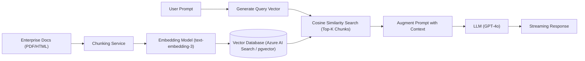

# Module 08 — System Design & Architecture

**Senior Software Engineer Academy · Module 08 of 12**

> **Learning objective:** Master large-scale system design, strategic and tactical Domain-Driven Design (DDD), high-availability multi-region architectures, quality attribute trade-offs, and modern AI-powered RAG systems. Develop the structured communication methodology required to lead 45–60 minute Senior and Staff Software Engineer system design interviews: gathering requirements, performing back-of-the-envelope capacity estimations, sketching high-level component diagrams, drilling into distributed bottlenecks, and defending architectural trade-offs with authority.
>
> **Audience:** Experienced C#/.NET engineers preparing for Senior, Lead, Staff, and Principal software engineering interviews and enterprise architecture reviews. Experience in cloud environments (Azure/AWS), microservices, and databases is assumed; capacity math, context mapping, and multi-tenant isolation patterns are taught with rigorous precision.
>
> **Version note:** Architectural reference designs target modern Microsoft Azure and cloud-native patterns (.NET 8/9, Azure Front Door, Azure Container Apps, AKS, Azure Cosmos DB, Azure Service Bus, Azure Key Vault, Azure AI Search).

## How to use this module

Every section in Part II provides comprehensive senior-level instruction:
1. **Methodology & Estimation Framework:** Step-by-step interview time-boxing, QPS calculations, and storage sizing.
2. **Architectural Schematics:** Concrete Mermaid component diagrams illustrating end-to-end cloud flows.
3. **Enterprise Production Scenarios:** Diagnosing noisy neighbors, multi-region failover splits, hot partition throttling, and cascading service outages.
4. **Trade-offs, Alternatives & Failure Modes:** When microservices fail, when to choose a modular monolith, and when active-active geo-replication is too costly.
5. **What a Senior Engineer Is Expected to Know:** Mid-level vs Senior/Staff architectural judgment.
6. **Interview Questions with Model Answers:** Real interview questions with structured, senior-level responses.
7. **Practical Exercises:** Full design challenges with requirements and capacity constraints.

## Progress tracker

| Section | Topic | Status |
|---|---|---|
| Section 1 | The Senior System Design Interview Framework & Estimation | Complete |
| Section 2 | Quality Attributes, SLAs & Availability Mathematics | Complete |
| Section 3 | Scaling Infrastructure: Compute, Load Balancing & Networking | Complete |
| Section 4 | System-Level Caching Architecture & CDN Topologies | Complete |
| Section 5 | Storage Tier Selection & Polyglot Persistence | Complete |
| Section 6 | Strategic Domain-Driven Design (DDD) & Context Mapping | Complete |
| Section 7 | Tactical Domain-Driven Design (DDD) in C# | Complete |
| Section 8 | Architectural Styles: Monolith, Microservices & Serverless | Complete |
| Section 9 | High Availability (HA), Multi-Region & Disaster Recovery (DR) | Complete |
| Section 10 | Multi-Tenant SaaS Architecture & Isolation Models | Complete |
| Section 11 | Enterprise Security Architecture & Threat Modeling (STRIDE) | Complete |
| Section 12 | Architecture Decisions, Documentation & C4 Modeling | Complete |
| Section 13 | AI-Powered System Design: RAG & Vector Search Architectures | Complete |
| Section 14 | Classic System Design Case Studies & Capstone | Complete |

**Current position:** Full curriculum complete. Ready for self-study, exercises, and interview drills.

## Module boundaries

- **This module owns:** System design interview framework, back-of-the-envelope estimation, high-level cloud architecture, strategic/tactical DDD, architectural styles, multi-tenancy models, high availability/disaster recovery, ADRs, C4 modeling, and RAG architectures.
- **Related topics owned by other modules:**
  - Object-oriented mechanics, SOLID principles, and coupling/cohesion → Module 01
  - Data structure selection and Big O analysis → Module 02
  - CoreCLR runtime memory layouts, thread pool, and async internals → Module 03
  - In-process design patterns, GoF patterns, and Clean Architecture → Module 04
  - Relational database indexing, SQL tuning, and transactions → Module 05
  - HTTP protocols, REST, gRPC, and OAuth2/OIDC → Module 06
  - Distributed systems theory (CAP/PACELC, Sagas, Outbox, Raft, messaging) → Module 07
  - DevOps, Kubernetes, CI/CD, and IaC → Module 11

---

# Part I — Complete Curriculum

## Section 1 — The Senior System Design Interview Framework & Estimation
- 1.1 The 5-Stage System Design Interview Protocol:
  - Stage 1: Clarify Requirements & Scope (Functional vs Non-Functional) (5 mins).
  - Stage 2: Back-of-the-Envelope Capacity Estimation (QPS, Bandwidth, Storage, Memory) (5 mins).
  - Stage 3: High-Level Architectural Blueprint (API, Core Components, Data Flow) (15 mins).
  - Stage 4: Deep Dive into Critical Bottlenecks & Failure Modes (20 mins).
  - Stage 5: Wrap-up, Trade-offs & Future Evolution (5 mins).
- 1.2 Back-of-the-Envelope Estimation Mastery: Converting Daily Active Users (DAU) to Queries Per Second (QPS); Peak QPS multiplier ($2	imes 	ext{ to } 5	imes$); Storage calculations across 5-year retention windows; Memory cache sizing using the Pareto 80/20 rule.

## Section 2 — Quality Attributes, SLAs & Availability Mathematics
- 2.1 The "-ilities": Scalability, Availability, Reliability, Latency, Throughput, Durability, Maintainability, Cost.
- 2.2 Service Level Terminology: SLA (commitment), SLO (target), SLI (actual measured metric), Error Budget.
- 2.3 The Availability Math of "Nines":
  - 99% (Two 9s) = 3.65 days downtime / year.
  - 99.9% (Three 9s) = 8.76 hours downtime / year.
  - 99.99% (Four 9s) = 52.6 minutes downtime / year.
  - 99.999% (Five 9s) = 5.26 minutes downtime / year.
- 2.4 Composite Availability: Series dependency ($A_{	ext{total}} = A_1 	imes A_2$) vs Parallel redundancy ($A_{	ext{total}} = 1 - (1 - A_1) 	imes (1 - A_2)$).

## Section 3 — Scaling Infrastructure: Compute, Load Balancing & Networking
- 3.1 Scaling Dimensions: Vertical Scaling (Scale Up) vs Horizontal Scaling (Scale Out); The Stateless Service Imperative.
- 3.2 Load Balancing Topology: Layer 4 (Transport TCP/UDP - high throughput packet forwarding) vs Layer 7 (Application HTTP/HTTPS - URL routing, SSL termination, cookie affinity).
- 3.3 Azure Load Balancing Hierarchy: Azure Front Door (Global L7 + WAF + CDN), Azure Application Gateway (Regional L7), Azure Load Balancer (Regional L4).

## Section 4 — System-Level Caching Architecture & CDN Topologies
- 4.1 Multi-Tier Caching Strategy: Client Browser $	o$ CDN (Edge) $	o$ API Gateway $	o$ Application Cache (Redis) $	o$ Database Buffer Pool.
- 4.2 Cache Topologies: Distributed Shared Cache (Redis Cluster) vs Local In-Memory Cache (MemoryCache) vs Replicated Cache.
- 4.3 Cache Invalidation & Consistency: Write-Through vs Cache-Aside vs Write-Behind; Thundering Herd / Cache Stampede mitigation via distributed mutexes and .NET 9 `HybridCache`.

## Section 5 — Storage Tier Selection & Polyglot Persistence
- 5.1 Storage Archetypes: Relational (SQL Server, PostgreSQL), Document (Azure Cosmos DB, MongoDB), Key-Value (Redis), Blob/Object (Azure Blob Storage), Search Engine (Azure AI Search, Elasticsearch), Vector Database (pgvector, Qdrant).
- 5.2 Polyglot Persistence Architecture: Designing a system where each business capability utilizes the storage engine optimized for its specific read/write access patterns.

## Section 6 — Strategic Domain-Driven Design (DDD) & Context Mapping
- 6.1 Subdomain Categorization: Core Domain (competitive advantage), Supporting Subdomain (custom but non-differentiating), Generic Subdomain (off-the-shelf software).
- 6.2 Bounded Contexts: Defining explicit conceptual boundaries within which a domain model and Ubiquitous Language are strictly valid.
- 6.3 Context Mapping Relationships: Shared Kernel, Customer/Supplier, Conformist, Anti-Corruption Layer (ACL), Open Host Service (OHS) / Published Language.

## Section 7 — Tactical Domain-Driven Design (DDD) in C#
- 7.1 Tactical Building Blocks: Entities (identity), Value Objects (structural immutability), Aggregate Roots (consistency boundary), Domain Events, Domain Services.
- 7.2 Aggregate Sizing Rules: Keeping aggregates small; referencing other aggregates by Identity (`OrderId`), never by object reference; modifying only one aggregate per transaction.

## Section 8 — Architectural Styles: Monolith, Microservices & Serverless
- 8.1 Architectural Spectrum: Layered Monolith, Modular Monolith, Microservices, Event-Driven Architecture, Serverless (Azure Functions).
- 8.2 The Microservices Distributed Tax: Network latency, distributed transactions, data consistency, operational complexity, CI/CD overhead; why starting with a Modular Monolith is often the superior choice.
- 8.3 Migration Strategies: The Strangler Fig Pattern for migrating legacy monoliths to microservices incrementally without high-risk rewrites.

## Section 9 — High Availability (HA), Multi-Region & Disaster Recovery (DR)
- 9.1 Redundancy Topologies: Active-Passive (Hot/Cold Standby, Warm Standby) vs Active-Active (Multi-Region read/write).
- 9.2 Disaster Recovery Metrics: Recovery Point Objective (RPO) and Recovery Time Objective (RTO).
- 9.3 Azure Availability Zones & Traffic Routing: Zone-redundant services; global traffic routing via Azure Front Door / Traffic Manager.

## Section 10 — Multi-Tenant SaaS Architecture & Isolation Models
- 10.1 Tenancy Models:
  - Silo Model: Dedicated compute and dedicated database per tenant (maximum isolation, highest cost).
  - Pool Model: Shared compute and shared database with `TenantId` column (lowest cost, multi-tenant noisy neighbor risk).
  - Bridge / Hybrid Model: Shared compute with dedicated databases per tenant, or pooled basic tier with siloed enterprise tier.
- 10.2 Tenant Routing & Context Resolution: Resolving tenant identity via subdomain (`tenant1.app.com`), HTTP header, or JWT claims in ASP.NET Core middleware.

## Section 11 — Enterprise Security Architecture & Threat Modeling (STRIDE)
- 11.1 Zero Trust Principles: Verify explicitly, use least privileged access, assume breach.
- 11.2 Network Security in Azure: Virtual Networks (VNets), Subnets, Network Security Groups (NSGs), Private Endpoints, Azure Bastion.
- 11.3 STRIDE Threat Modeling: Spoofing, Tampering, Repudiation, Information Disclosure, Denial of Service, Elevation of Privilege.

## Section 12 — Architecture Decisions, Documentation & C4 Modeling
- 12.1 Architecture Decision Records (ADRs): Title, Status, Context, Decision, Consequences.
- 12.2 The C4 Model: Context (System-level actors), Containers (Deployable applications/databases), Components (Internal architectural modules), Code (Class diagrams).

## Section 13 — AI-Powered System Design: RAG & Vector Search Architectures
- 13.1 Retrieval-Augmented Generation (RAG) Architecture: Ingestion pipeline (Document parsing $	o$ Chunking $	o$ Embedding generation $	o$ Vector indexing); Retrieval pipeline (User query $	o$ Query embedding $	o$ Vector similarity search $	o$ Prompt augmentation $	o$ LLM generation).
- 13.2 Vector Search Mechanics: Cosine similarity vs Dot Product; Approximate Nearest Neighbors (HNSW algorithm).
- 13.3 Production Considerations: Semantic caching, token cost management, rate limiting, and guardrails.

## Section 14 — Classic System Design Case Studies & Capstone
- 14.1 Case Study 1: High-Scale URL Shortener (TinyURL) — 100M URLs/month, Base62 encoding, distributed collision-free key generation.
- 14.2 Case Study 2: Distributed Rate Limiter — 500,000 QPS, Redis sliding window counter, token bucket fallback.
- 14.3 Case Study 3: Global Notification Platform — Push, SMS, Email, prioritization, provider failover.
- 14.4 Case Study 4: Multi-Tenant Enterprise Document Processing Engine on Azure — End-to-end cloud architecture.

---

# Part II — Lessons

## Section 1 — The Senior System Design Interview Framework & Estimation

### 1.1 The 5-Stage System Design Interview Protocol

A 45-to-60-minute system design interview tests your ability to navigate ambiguity, drive technical consensus, make explicit trade-offs, and design scalable architectures under time pressure.

```text
[ 00:00 - 05:00 ]  STAGE 1: Clarify Requirements & Scope (Functional & Non-Functional)
[ 05:00 - 10:00 ]  STAGE 2: Back-of-the-Envelope Estimation (QPS, Storage, Bandwidth, Memory)
[ 10:00 - 25:00 ]  STAGE 3: High-Level Architecture (API Contracts, Components, Data Flow)
[ 25:00 - 45:00 ]  STAGE 4: Deep Dive into Bottlenecks, Data Models & Failure Modes
[ 45:00 - 50:00 ]  STAGE 5: Wrap-up, Trade-offs, Operational Monitoring & Future Evolution
```

---

### 1.2 Back-of-the-Envelope Estimation Mastery

#### The Golden Conversion Rule:
There are **86,400 seconds in a day** ($pprox 10^5 	ext{ seconds}$).
$$	ext{Average QPS} = rac{	ext{Daily Requests}}{86,400} pprox rac{	ext{Daily Requests}}{10^5}$$
$$	ext{Peak QPS} = 	ext{Average QPS} 	imes 2 	ext{ (or } 3	imes 	ext{ to } 5	imes 	ext{ for spiky traffic)}$$

#### Example Worked Estimation: High-Scale URL Shortener
- **Traffic Assumptions:**
  - 100 Million new URLs created per month.
  - Read-to-Write ratio: $10:1$ (1 Billion reads per month).
- **Write QPS:**
  $$	ext{Write QPS} = rac{100,000,000 	ext{ writes}}{30 	imes 86,400} pprox rac{10^8}{2.6 	imes 10^6} pprox \mathbf{40 	ext{ writes/second}}$$
- **Read QPS:**
  $$	ext{Read QPS} = 40 	imes 10 = \mathbf{400 	ext{ reads/second}}$$
  $$	ext{Peak Read QPS} = 400 	imes 3 = \mathbf{1,200 	ext{ reads/second}}$$
- **Storage Calculations (5-Year Horizon):**
  - Total URLs stored in 5 years: $100	ext{M} 	imes 12 	imes 5 = \mathbf{6 	ext{ Billion URLs}}$.
  - Bytes per record:
    - `ShortURL` (7 chars): 7 bytes
    - `OriginalURL` (string): 500 bytes
    - `CreatedAt` (timestamp): 8 bytes
    - `UserId` (UUID): 16 bytes
    - Total per row $pprox 550 	ext{ bytes}$.
  - Total 5-Year Storage:
    $$	ext{Storage} = 6 	imes 10^9 	imes 550 	ext{ bytes} pprox 3.3 	ext{ Terabytes (TB)}$$
    *(Senior Insight: 3.3 TB is small enough to fit on a single modern high-capacity SSD or small relational/NoSQL cluster! We do NOT need massive sharding for storage volume alone.)*
- **Memory Cache Sizing (Pareto 80/20 Rule):**
  - Cache the top 20% most popular URLs requested daily:
  - Daily read requests: $rac{10^9}{30} pprox 33.3 	ext{ Million reads/day}$.
  - Memory required to cache 20% of daily reads:
    $$	ext{Cache Memory} = 33.3 	imes 10^6 	imes 0.20 	imes 550 	ext{ bytes} pprox 3.66 	ext{ GB of RAM}$$
    *(Senior Insight: A single modest 16 GB Redis cluster can easily cache 20% of daily traffic with plenty of headroom!)*

---

## Section 2 — Quality Attributes, SLAs & Availability Mathematics

### 2.1 Composite Availability Math

When services depend on one another, their individual availabilities compound:

#### 1. Series Dependency (Weakest Link):
If Service A ($99.9\%$) requires Service B ($99.9\%$) synchronously to complete a request:
$$A_{	ext{total}} = A_1 	imes A_2 = 0.999 	imes 0.999 = 0.998001 pprox \mathbf{99.8\%}$$
*Senior Takeaway:* Synchronously chaining five $99.9\%$ microservices drops your composite system availability to **$99.5\%$ (over 43 hours of downtime per year!)**.

#### 2. Parallel Redundancy (Resilient Fallback):
If Service A has a primary instance and an active-active secondary replica, both with $99.9\%$ availability:
$$A_{	ext{total}} = 1 - (1 - A_1) 	imes (1 - A_2) = 1 - (0.001 	imes 0.001) = 1 - 0.000001 = \mathbf{99.9999\%}$$

---

## Section 6 — Strategic Domain-Driven Design (DDD)

### 6.1 Subdomain Mapping & Context Boundaries

In enterprise architecture, systems must be partitioned around business capabilities rather than technical layers:
- **Core Domain:** The unique business differentiator that creates competitive advantage (e.g., proprietary fraud detection algorithm in a bank). High investment, custom in-house build.
- **Supporting Subdomain:** Complements the core domain, but is not differentiating (e.g., an invoice PDF rendering engine). Build custom or use simple frameworks.
- **Generic Subdomain:** Standard industry problems with zero competitive differentiation (e.g., user identity authentication, payment gateway processing). Purchase off-the-shelf software or use third-party SaaS (Stripe, Auth0).

---

## Section 10 — Multi-Tenant SaaS Architecture & Isolation Models

### 10.1 Tenancy Isolation Comparison Matrix

| Model | Architecture | Pros | Cons | Ideal Use Case |
|---|---|---|---|---|
| **Silo Model** | Dedicated compute and dedicated database per tenant | Maximum data isolation; compliance certified (HIPAA/PCI); zero noisy neighbors | Highest infrastructure cost; complex deployment management across 1,000+ tenants | Enterprise tier customers; highly regulated banking/healthcare |
| **Pool Model** | Shared compute and shared database with `TenantId` column | Lowest operational cost; maximum resource utilization; simple single-step deployments | Noisy neighbor risk; complex row-level security; high blast radius if DB fails | Free/Basic tiers; high-volume B2C SaaS |
| **Bridge (Hybrid)** | Shared compute with dedicated databases per tenant | Good data isolation; custom backup/restore per tenant; moderate cost | Database connection pooling overhead; schema migration coordination | Mid-market B2B enterprise SaaS |

---

## Section 13 — AI-Powered System Design: RAG Architectures

### 13.1 Retrieval-Augmented Generation (RAG) End-to-End Pipeline



#### Key Architecture Trade-Offs in RAG:
1. **Chunking Strategy:** Fixed-size chunking (e.g., 500 tokens with 50-token overlap) vs Semantic chunking (chunking by paragraph/section).
2. **Hybrid Search:** Combining **Vector Similarity Search (Dense)** with **BM25 Keyword Search (Sparse)** and a Reranker produces vastly superior retrieval accuracy than pure vector search alone.
3. **Semantic Caching:** Caching user query embeddings in Redis. If a new prompt has a cosine similarity $> 0.98$ to a cached query, return the cached answer immediately, saving LLM cost and 1-3 seconds of latency!

---

## Section 14 — Classic System Design Case Studies & Capstone

### 14.1 Capstone Architecture: High-Scale URL Shortener (TinyURL)

```text
[ Client (Browser/App) ]
           |
           v
[ Global CDN / Azure Front Door ] (Caches top redirects at edge)
           |
           v
[ Application Gateway (L7 Load Balancer) ]
           |
           +-----------------------+-----------------------+
           |                                               |
           v                                               v
[ Write Service (POST /shorten) ]              [ Read Service (GET /{shortCode}) ]
           |                                               |
           v                                               v
[ Base62 Token Generator ]                     [ Distributed Cache (Redis Cluster) ]
(Pre-allocated ID ranges via ZooKeeper/Redis)              | (Cache Hit -> 301 Redirect)
           |                                               | (Cache Miss)
           v                                               v
[ Primary NoSQL / Relational DB ] <------------------------+
(Cosmos DB / PostgreSQL: { ShortCode, OriginalUrl, CreatedAt })
```

#### Key Design Decisions:
1. **Base62 Encoding:** Short codes use characters `[a-z, A-Z, 0-9]` ($26 + 26 + 10 = 62$ characters).
   A 7-character Base62 string yields:
   $$62^7 pprox \mathbf{3.5 	ext{ Trillion unique URLs}}$$
   Sufficient to handle 100M URLs per month for over 3,000 years!
2. **Distributed ID Generation:** To prevent collisions without expensive database locks, worker nodes lease discrete ranges of 64-bit integers from a coordinator (e.g. Node 1 gets IDs `1 - 1,000,000`; Node 2 gets `1,000,001 - 2,000,000`). Each node converts its local integer into a Base62 string in $O(1)$ memory.
3. **HTTP 301 vs 302 Redirect:**
   - `301 Moved Permanently`: Browser caches the redirect locally. Subsequent clicks bypass your server entirely (lowest server load, but loses click analytics).
   - `302 Found`: Browser requests the redirect from your server every time (enables accurate real-time click tracking, slightly higher server load).

---

# Part III — Interview Readiness

## 1. Mid-Level vs Senior-Level System Design Comparison

| Dimension | Mid-Level Candidate Response | Senior / Staff-Level Candidate Response |
|---|---|---|
| **Requirements Gathering** | Asks generic questions or immediately starts sketching boxes on a whiteboard. | Distinguishes functional requirements from non-functional quality attributes (availability, P99 latency, data retention); clarifies read-to-write ratios and spikiness. |
| **Capacity Estimation** | Skips estimation or guesses random huge numbers without math. | Performs disciplined back-of-the-envelope calculations: converts DAU to QPS, sizes storage over a 5-year horizon, and calculates memory cache sizing using the 80/20 rule. |
| **Microservices vs Monolith** | "Always use microservices because they scale better and are modern." | "Microservices introduce a heavy distributed tax (network latency, eventual consistency, operational complexity). We favor a Modular Monolith initially, decomposing into microservices only when distinct scaling characteristics or team boundaries demand it." |
| **Data Storage Selection** | Defaults to whatever database they know best (e.g. SQL Server for everything). | Evaluates polyglot persistence based on access patterns: relational for transactional ACID integrity, document/NoSQL for high-velocity key-partitioned reads, and vector search for semantic retrieval. |
| **Handling Bottlenecks** | "Just add another server or put Redis in front of it." | Identifies root bottlenecks (hot partitions, database connection pool exhaustion, network serialization overhead); proposes multi-tier caching, read-through patterns, and asynchronous messaging queues. |

---

## 2. Rapid-Fire Revision Sheet (50 Senior-Level Truths)

1. There are 86,400 seconds in a day; average QPS is calculated by dividing daily requests by $10^5$.
2. Peak QPS should be estimated as $2	imes$ to $5	imes$ average QPS depending on traffic spikiness.
3. In back-of-the-envelope calculations, always size storage for a 5-year horizon including indexing overhead ($pprox 1.5	imes$ raw data).
4. Sizing memory caches using the Pareto Principle (80/20 rule) requires calculating RAM needed for 20% of daily read volume.
5. Composite availability across synchronous series dependencies degrades multiplicatively ($A_1 	imes A_2$).
6. Composite availability across parallel redundant paths improves dramatically ($1 - (1 - A_1)(1 - A_2)$).
7. Three 9s of availability (99.9%) permits 8.76 hours of downtime per year; four 9s (99.99%) permits only 52.6 minutes.
8. Layer 4 load balancing operates at the TCP/UDP transport layer; Layer 7 load balancing inspects HTTP headers, cookies, and URLs.
9. Azure Front Door combines global Layer 7 anycast routing, Web Application Firewall (WAF), and CDN caching at edge locations.
10. Multi-tier caching spans Browser $	o$ CDN Edge $	o$ API Gateway $	o$ In-Memory Cache (Redis) $	o$ Database Buffer Pool.
11. The Cache-Aside pattern requires the application to query the cache, read from DB on a miss, and write back to cache.
12. Write-Behind (Write-Back) caching acknowledges writes immediately to in-memory cache and asynchronously flushes to DB, risking data loss on crash.
13. Cache Stampede (thundering herd) occurs when a hot key expires and concurrent requests overload the database.
14. .NET 9 `HybridCache` provides built-in single-flight locking to ensure only one request queries the database on a cache miss.
15. Polyglot persistence selects specialized storage engines based on access patterns rather than forcing all data into one database.
16. Relational databases excel at complex multi-table joins, ACID transactions, and strict foreign-key integrity constraints.
17. Document stores (Cosmos DB) excel at horizontal scale-out when queries can be routed by a specific Partition Key.
18. Strategic DDD partitions systems into Core Domains (differentiating), Supporting Subdomains, and Generic Subdomains (off-the-shelf).
19. A Bounded Context defines the explicit boundary within which a specific domain model and Ubiquitous Language are strictly valid.
20. In DDD Context Mapping, an Anti-Corruption Layer (ACL) translates external models into clean internal domain concepts.
21. Aggregate Roots define the transactional consistency boundary in tactical DDD; external objects must only reference the root by ID.
22. Aggregates should be kept small to minimize lock contention and improve concurrency.
23. The Microservices Distributed Tax includes network latency, eventual consistency, operational complexity, and serialization overhead.
24. A Modular Monolith delivers clean domain boundaries within a single deployable artifact, avoiding distributed microservices complexity.
25. The Strangler Fig pattern migrates legacy monoliths by placing a proxy in front and intercepting routes incrementally to new services.
26. Active-Passive failover deploys standby infrastructure that takes over when the primary region fails, risking downtime during failover.
27. Active-Active multi-region architecture routes traffic to both regions simultaneously, requiring multi-region data replication and conflict handling.
28. Recovery Point Objective (RPO) defines the maximum allowable data loss measured in time; RTO defines allowable downtime duration.
29. In multi-tenant SaaS, the Silo model provides dedicated databases per tenant, offering maximum compliance at highest infrastructure cost.
30. The Pool model shares database infrastructure across tenants using a `TenantId` column, maximizing resource utilization at noisy neighbor risk.
31. The Bridge (Hybrid) model shares compute while providing dedicated databases for high-paying enterprise tenants.
32. The Noisy Neighbor problem occurs when one tenant consumes excessive shared compute or I/O resources, degrading service for other tenants.
33. Zero Trust architecture enforces explicit verification, least-privilege access, and assumes breach across all network perimeters.
34. Azure Private Endpoints assign private IP addresses to PaaS services (SQL, Storage), keeping traffic entirely off the public internet.
35. STRIDE threat modeling categorizes security threats: Spoofing, Tampering, Repudiation, Information Disclosure, Denial of Service, Elevation of Privilege.
36. Architecture Decision Records (ADRs) document the context, decision, consequences, and trade-offs of significant architectural choices.
37. The C4 model visualizes software architecture across four hierarchical levels: Context, Containers, Components, and Code.
38. Retrieval-Augmented Generation (RAG) augments LLM prompts with relevant enterprise document chunks retrieved via vector similarity search.
39. In RAG architectures, document chunking balances semantic context against LLM token context window limits.
40. Vector similarity search uses Cosine Similarity or Dot Product over high-dimensional vector embeddings generated by models like `text-embedding-3`.
41. Hierarchical Navigable Small World (HNSW) graphs enable fast Approximate Nearest Neighbor (ANN) search across millions of vectors in milliseconds.
42. Hybrid Search combines vector similarity search (semantic) with BM25 keyword search (exact matches) and a reranker for optimal RAG accuracy.
43. Semantic Caching caches LLM query embeddings in Redis, returning cached responses for semantically identical questions to save cost and latency.
44. Base62 encoding (`[a-zA-Z0-9]`) represents large 64-bit integers in compact URL strings; a 7-character Base62 string yields 3.5 trillion URLs.
45. In URL shorteners, distributed ID generators lease blocks of numbers to worker nodes, eliminating database round-trips for unique ID generation.
46. HTTP 301 Moved Permanently instructs browsers to cache redirects locally; HTTP 302 Found forces requests through the server to track click metrics.
47. Distributed rate limiters use Redis Sorted Sets (ZSET) or sliding-window counters to prevent API abuse across distributed worker nodes.
48. Notification platforms prioritize critical alerts (password resets, 2FA) on dedicated high-priority queues separate from bulk marketing blasts.
49. Serverless architectures (Azure Functions) scale to zero during idle periods, but incur cold-start latency when scaling rapidly.
50. High-level system design requires making trade-offs explicit; there are no perfect solutions in software architecture, only trade-offs.

---

## 3. Self-Assessment Rubric

| Dimension | Needs Work (Junior) | Developing (Mid-Level) | Senior-Ready | Strong Senior / Staff-Level |
|---|---|---|---|---|
| **Interview Leadership & Structure** | Jumps into sketching boxes; does not clarify scope; runs out of time. | Follows a rough structure; gathers basic functional requirements. | Methodically drives the 5-stage framework; clarifies non-functional bounds; leads collaborative architectural dialogue. | Shapes the problem space; guides interviewers through high-level trade-offs; manages time with precision. |
| **Capacity Estimation** | Skips calculations; cannot estimate QPS or storage volume. | Calculates basic QPS; struggles with storage or memory cache math. | Confidently derives QPS, peak multipliers, 5-year storage horizons, and memory cache sizing via the 80/20 rule. | Uses estimations to drive concrete technical decisions (e.g. single-node capacity vs distributed sharding limits). |
| **Architectural Trade-Offs** | Advocates microservices or tools dogmatically without justification. | Understands basic trade-offs between SQL and NoSQL. | Evaluates monolithic vs microservice distributed taxes; weighs Active-Active vs Active-Passive failover costs. | Quantifies composite availability; articulates CAP/PACELC trade-offs; defends pragmatic evolutionary architectures. |
| **Domain-Driven Design** | Unaware of DDD concepts; couples domain logic to database schemas. | Understands entities and value objects; creates basic layers. | Partitions systems by Bounded Contexts; sizes aggregates conservatively; applies Context Mapping (ACL, OHS). | Aligns business domain strategies with organizational team structures (Conway's Law); leads Event Storming. |
| **Modern Cloud & AI Architecture** | Relies on single-server setups; unaware of multi-region or RAG. | Configures standard Azure App Service and SQL databases. | Architects multi-tenant SaaS (Silo/Pool/Bridge); designs Zero-Trust networks; implements end-to-end RAG vector pipelines. | Designs planet-scale active-active architectures; formulates enterprise governance with ADRs and C4 modeling. |

---

# Part IV — References

1. **Foundational Architecture Literature:**
   - Kleppmann, Martin. *Designing Data-Intensive Applications: The Big Ideas Behind Reliable, Scalable, and Maintainable Systems*. O'Reilly Media, 2017.
   - Xu, Alex. *System Design Interview – An Insider's Guide* (Vol 1 & Vol 2). ByteByteGo, 2020-2022.
   - Evans, Eric. *Domain-Driven Design: Tackling Complexity in the Heart of Software*. Addison-Wesley, 2003.
   - Newman, Sam. *Building Microservices: Designing Fine-Grained Systems* (2nd ed.). O'Reilly Media, 2021.
   - Richards, M., & Ford, N. *Fundamentals of Software Architecture: An Engineering Approach*. O'Reilly Media, 2020.
2. **Microsoft Azure & Industry Architecture Centers:**
   - [Microsoft Azure Architecture Center](https://learn.microsoft.com/azure/architecture/)
   - [Microsoft Azure Well-Architected Framework](https://learn.microsoft.com/azure/well-architected/)
   - [The C4 Model for Visualizing Software Architecture](https://c4model.com/)
   - [Retrieval-Augmented Generation (RAG) Architecture on Azure](https://learn.microsoft.com/azure/architecture/ai-ml/guide/rag/rag-architecture)
